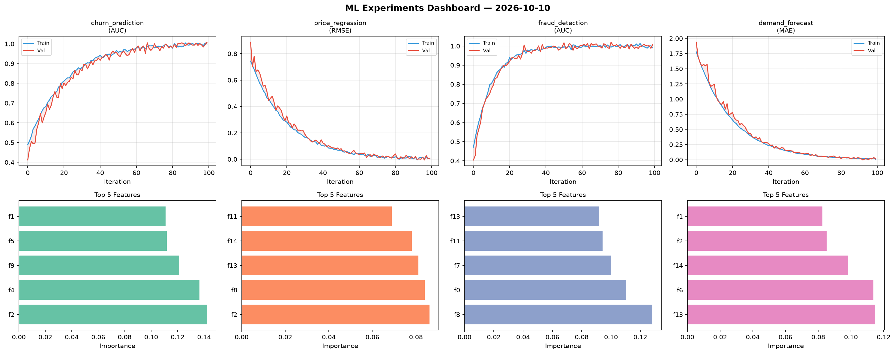
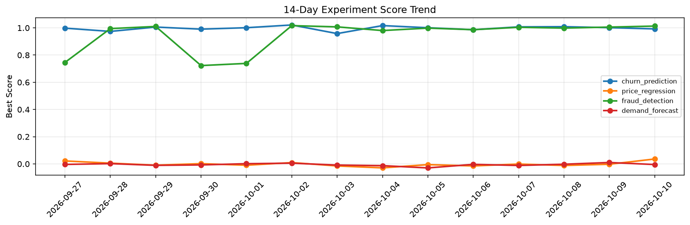

# ML Experiments Report — 2026-10-10

**Run ID:** `fb73910b7c` | **Experiments:** 4 | **Trials:** 16

## Delta vs Yesterday

| Experiment | Today | Yesterday | Change |
|-----------|-------|-----------|--------|
| churn_prediction | 1.0082 | 1.0015 | 📈 0.7% |
| price_regression | 0.0086 | -0.0024 | 📈 458.3% |
| fraud_detection | 1.0086 | 1.0058 | 📈 0.3% |
| demand_forecast | 0.0147 | 0.0102 | 📈 44.1% |

## churn_prediction (AUC)

**Best Score:** 1.0082 (Trial 4)

| Trial | Score | Overfit Gap | Time | LR | Trees | Leaves |
|-------|-------|-------------|------|-----|-------|--------|
| 1 | 1.0014 | 0.0117 | 1.5s | 0.1 | 100 | 63 |
| 2 | 0.9708 | 0.0051 | 2.35s | 0.05 | 200 | 63 |
| 3 | 0.9391 | 0.0097 | 132.55s | 0.05 | 500 | 31 |
| 4 ⭐ | 1.0082 | 0.0094 | 59.75s | 0.1 | 500 | 31 |

## price_regression (RMSE)

**Best Score:** 0.0086 (Trial 1)

| Trial | Score | Overfit Gap | Time | LR | Trees | Leaves |
|-------|-------|-------------|------|-----|-------|--------|
| 1 ⭐ | 0.0086 | 0.0058 | 54.47s | 0.1 | 200 | 63 |
| 2 | 1.1024 | 0.0898 | 106.22s | 0.01 | 1000 | 127 |
| 3 | 0.958 | 0.0582 | 51.8s | 0.01 | 1000 | 15 |
| 4 | 0.0206 | 0.0156 | 65.43s | 0.2 | 500 | 63 |
| 5 | 0.0984 | 0.0019 | 68.77s | 0.05 | 1000 | 31 |
| 6 | 1.0305 | 0.0212 | 12.51s | 0.01 | 100 | 63 |

## fraud_detection (AUC)

**Best Score:** 1.0086 (Trial 3)

| Trial | Score | Overfit Gap | Time | LR | Trees | Leaves |
|-------|-------|-------------|------|-----|-------|--------|
| 1 | 0.6232 | 0.0246 | 4.96s | 0.01 | 200 | 63 |
| 2 | 0.6423 | 0.0189 | 5.34s | 0.01 | 100 | 127 |
| 3 ⭐ | 1.0086 | 0.0176 | 82.6s | 0.2 | 500 | 15 |

## demand_forecast (MAE)

**Best Score:** 0.0147 (Trial 3)

| Trial | Score | Overfit Gap | Time | LR | Trees | Leaves |
|-------|-------|-------------|------|-----|-------|--------|
| 1 | 0.1603 | 0.0041 | 152.64s | 0.05 | 1000 | 31 |
| 2 | 0.1702 | 0.0164 | 27.46s | 0.05 | 100 | 31 |
| 3 ⭐ | 0.0147 | 0.0077 | 35.08s | 0.1 | 200 | 127 |
