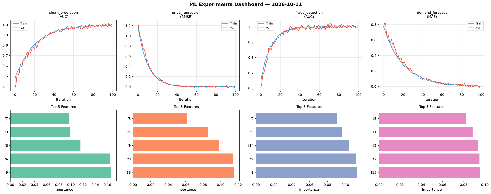
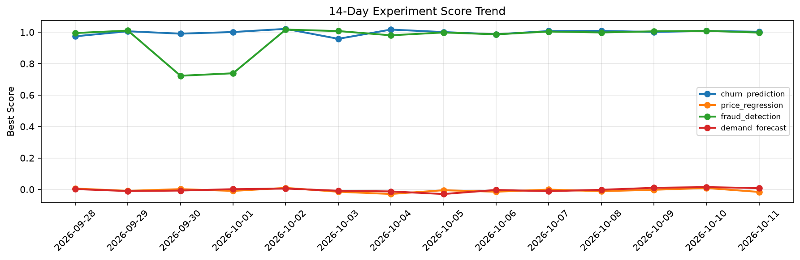

# ML Experiments Report — 2026-10-11

**Run ID:** `47884860ef` | **Experiments:** 4 | **Trials:** 17

## Delta vs Yesterday

| Experiment | Today | Yesterday | Change |
|-----------|-------|-----------|--------|
| churn_prediction | 1.0029 | 1.0082 | 📉 -0.5% |
| price_regression | -0.0161 | 0.0086 | 📉 -287.2% |
| fraud_detection | 0.9975 | 1.0086 | 📉 -1.1% |
| demand_forecast | 0.0081 | 0.0147 | 📉 -44.9% |

## churn_prediction (AUC)

**Best Score:** 1.0029 (Trial 3)

| Trial | Score | Overfit Gap | Time | LR | Trees | Leaves |
|-------|-------|-------------|------|-----|-------|--------|
| 1 | 0.7044 | 0.0082 | 119.11s | 0.01 | 500 | 31 |
| 2 | 0.998 | 0.0013 | 16.27s | 0.2 | 100 | 63 |
| 3 ⭐ | 1.0029 | 0.018 | 199.24s | 0.1 | 1000 | 63 |
| 4 | 0.7446 | 0.0053 | 18.19s | 0.01 | 200 | 127 |

## price_regression (RMSE)

**Best Score:** -0.0161 (Trial 2)

| Trial | Score | Overfit Gap | Time | LR | Trees | Leaves |
|-------|-------|-------------|------|-----|-------|--------|
| 1 | 0.0139 | 0.012 | 47.72s | 0.2 | 200 | 63 |
| 2 ⭐ | -0.0161 | 0.0167 | 102.87s | 0.2 | 500 | 63 |
| 3 | 0.0677 | 0.0098 | 63.32s | 0.05 | 500 | 63 |
| 4 | 0.3715 | 0.0676 | 115.69s | 0.01 | 500 | 31 |

## fraud_detection (AUC)

**Best Score:** 0.9975 (Trial 2)

| Trial | Score | Overfit Gap | Time | LR | Trees | Leaves |
|-------|-------|-------------|------|-----|-------|--------|
| 1 | 0.7159 | 0.0284 | 131.95s | 0.01 | 1000 | 31 |
| 2 ⭐ | 0.9975 | 0.0025 | 29.8s | 0.2 | 100 | 63 |
| 3 | 0.974 | 0.0037 | 63.54s | 0.05 | 1000 | 31 |
| 4 | 0.9658 | 0.0033 | 11.72s | 0.05 | 100 | 15 |
| 5 | 0.9947 | 0.0018 | 12.47s | 0.1 | 500 | 63 |
| 6 | 0.9881 | 0.0152 | 5.91s | 0.2 | 200 | 63 |

## demand_forecast (MAE)

**Best Score:** 0.0081 (Trial 2)

| Trial | Score | Overfit Gap | Time | LR | Trees | Leaves |
|-------|-------|-------------|------|-----|-------|--------|
| 1 | 0.0706 | 0.009 | 16.87s | 0.05 | 500 | 31 |
| 2 ⭐ | 0.0081 | 0.0116 | 156.56s | 0.1 | 1000 | 127 |
| 3 | 0.4718 | 0.0436 | 4.36s | 0.01 | 500 | 127 |
