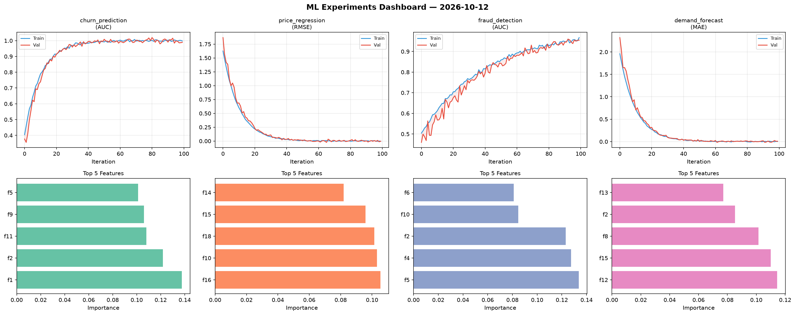
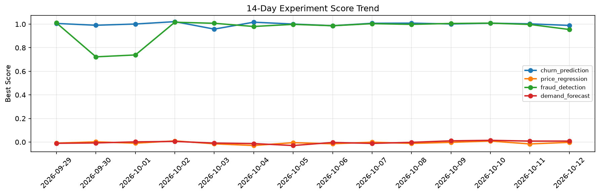

# ML Experiments Report — 2026-10-12

**Run ID:** `9af18084cc` | **Experiments:** 4 | **Trials:** 17

## Delta vs Yesterday

| Experiment | Today | Yesterday | Change |
|-----------|-------|-----------|--------|
| churn_prediction | 0.9891 | 1.0029 | 📉 -1.4% |
| price_regression | -0.0024 | -0.0161 | 📈 85.1% |
| fraud_detection | 0.9547 | 0.9975 | 📉 -4.3% |
| demand_forecast | 0.008 | 0.0081 | 📉 -1.2% |

## churn_prediction (AUC)

**Best Score:** 0.9891 (Trial 1)

| Trial | Score | Overfit Gap | Time | LR | Trees | Leaves |
|-------|-------|-------------|------|-----|-------|--------|
| 1 ⭐ | 0.9891 | 0.0089 | 48.97s | 0.2 | 500 | 127 |
| 2 | 0.9331 | 0.0189 | 92.27s | 0.05 | 500 | 63 |
| 3 | 0.7369 | 0.0086 | 123.43s | 0.01 | 500 | 63 |

## price_regression (RMSE)

**Best Score:** -0.0024 (Trial 2)

| Trial | Score | Overfit Gap | Time | LR | Trees | Leaves |
|-------|-------|-------------|------|-----|-------|--------|
| 1 | 0.0289 | 0.0284 | 55.47s | 0.1 | 200 | 15 |
| 2 ⭐ | -0.0024 | 0.0019 | 2.82s | 0.2 | 100 | 15 |
| 3 | 1.2485 | 0.1079 | 10.94s | 0.01 | 100 | 15 |
| 4 | 0.078 | 0.0162 | 74.24s | 0.05 | 1000 | 31 |
| 5 | 0.9721 | 0.0838 | 107.49s | 0.01 | 500 | 63 |

## fraud_detection (AUC)

**Best Score:** 0.9547 (Trial 1)

| Trial | Score | Overfit Gap | Time | LR | Trees | Leaves |
|-------|-------|-------------|------|-----|-------|--------|
| 1 ⭐ | 0.9547 | 0.0128 | 131.6s | 0.05 | 500 | 63 |
| 2 | 0.5725 | 0.0893 | 167.8s | 0.01 | 1000 | 15 |
| 3 | 0.7197 | 0.0228 | 7.24s | 0.01 | 100 | 31 |

## demand_forecast (MAE)

**Best Score:** 0.008 (Trial 5)

| Trial | Score | Overfit Gap | Time | LR | Trees | Leaves |
|-------|-------|-------------|------|-----|-------|--------|
| 1 | 0.0117 | 0.0003 | 18.03s | 0.1 | 100 | 31 |
| 2 | 0.0891 | 0.0093 | 24.6s | 0.05 | 100 | 63 |
| 3 | 1.0298 | 0.0799 | 30.87s | 0.01 | 200 | 127 |
| 4 | 0.12 | 0.0188 | 173.72s | 0.05 | 1000 | 15 |
| 5 ⭐ | 0.008 | 0.0061 | 116.02s | 0.2 | 1000 | 15 |
| 6 | 0.0595 | 0.0084 | 11.66s | 0.05 | 100 | 31 |
