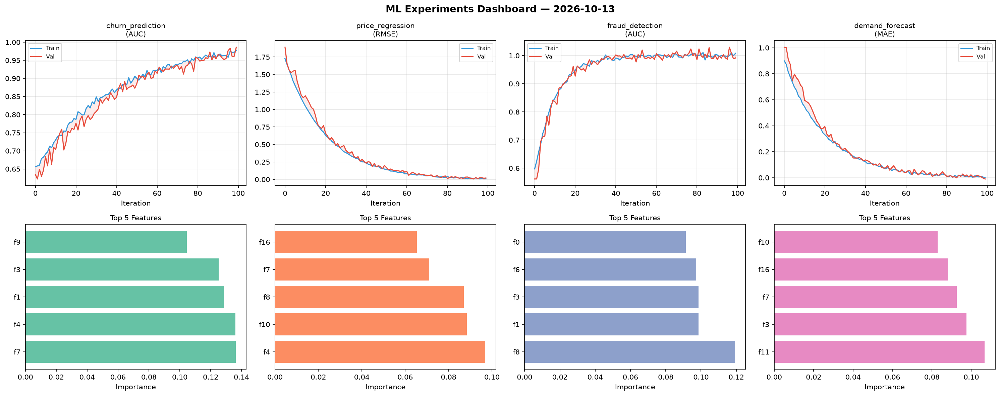
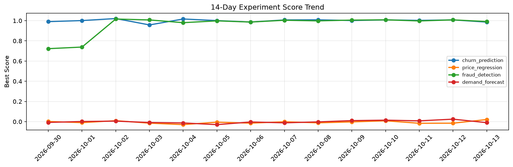

# ML Experiments Report — 2026-10-13

**Run ID:** `6412cb43a5` | **Experiments:** 4 | **Trials:** 15

## Delta vs Yesterday

| Experiment | Today | Yesterday | Change |
|-----------|-------|-----------|--------|
| churn_prediction | 0.9861 | 1.0079 | 📉 -2.2% |
| price_regression | 0.021 | -0.0152 | 📈 238.2% |
| fraud_detection | 0.9917 | 1.0081 | 📉 -1.6% |
| demand_forecast | -0.01 | 0.0247 | 📉 -140.5% |

## churn_prediction (AUC)

**Best Score:** 0.9861 (Trial 2)

| Trial | Score | Overfit Gap | Time | LR | Trees | Leaves |
|-------|-------|-------------|------|-----|-------|--------|
| 1 | 0.9469 | 0.0121 | 48.09s | 0.05 | 200 | 15 |
| 2 ⭐ | 0.9861 | 0.0095 | 40.82s | 0.05 | 500 | 63 |
| 3 | 0.9427 | 0.0238 | 21.27s | 0.05 | 1000 | 63 |

## price_regression (RMSE)

**Best Score:** 0.021 (Trial 1)

| Trial | Score | Overfit Gap | Time | LR | Trees | Leaves |
|-------|-------|-------------|------|-----|-------|--------|
| 1 ⭐ | 0.021 | 0.0103 | 3.72s | 0.1 | 100 | 127 |
| 2 | 0.6293 | 0.0528 | 129.57s | 0.01 | 500 | 63 |
| 3 | 0.0221 | 0.007 | 22.98s | 0.1 | 100 | 15 |
| 4 | 0.191 | 0.0218 | 54.16s | 0.05 | 200 | 127 |

## fraud_detection (AUC)

**Best Score:** 0.9917 (Trial 1)

| Trial | Score | Overfit Gap | Time | LR | Trees | Leaves |
|-------|-------|-------------|------|-----|-------|--------|
| 1 ⭐ | 0.9917 | 0.0165 | 47.81s | 0.2 | 200 | 15 |
| 2 | 0.619 | 0.0564 | 16.52s | 0.01 | 200 | 127 |
| 3 | 0.968 | 0.0032 | 80.21s | 0.05 | 500 | 63 |
| 4 | 0.9451 | 0.0212 | 86.74s | 0.05 | 1000 | 63 |

## demand_forecast (MAE)

**Best Score:** -0.01 (Trial 3)

| Trial | Score | Overfit Gap | Time | LR | Trees | Leaves |
|-------|-------|-------------|------|-----|-------|--------|
| 1 | 0.0214 | 0.0171 | 96.65s | 0.1 | 500 | 63 |
| 2 | -0.0032 | 0.0005 | 76.9s | 0.1 | 500 | 127 |
| 3 ⭐ | -0.01 | 0.0101 | 20.37s | 0.1 | 200 | 127 |
| 4 | 0.1198 | 0.0205 | 33.86s | 0.05 | 1000 | 127 |
