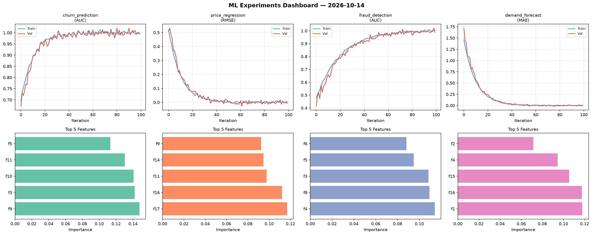
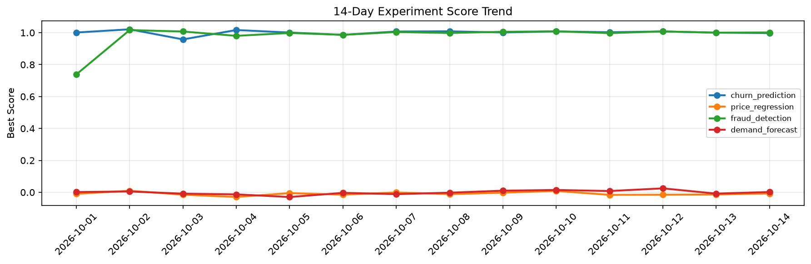

# ML Experiments Report — 2026-10-14

**Run ID:** `223c343fcf` | **Experiments:** 4 | **Trials:** 17

## Delta vs Yesterday

| Experiment | Today | Yesterday | Change |
|-----------|-------|-----------|--------|
| churn_prediction | 0.9978 | 1.0002 | 📉 -0.2% |
| price_regression | -0.0073 | -0.0137 | 📈 46.7% |
| fraud_detection | 1.0016 | 1.0005 | 📈 0.1% |
| demand_forecast | 0.002 | -0.0082 | 📈 124.4% |

## churn_prediction (AUC)

**Best Score:** 0.9978 (Trial 3)

| Trial | Score | Overfit Gap | Time | LR | Trees | Leaves |
|-------|-------|-------------|------|-----|-------|--------|
| 1 | 0.9904 | 0.0152 | 26.35s | 0.1 | 100 | 15 |
| 2 | 0.6501 | 0.0208 | 39.77s | 0.01 | 200 | 63 |
| 3 ⭐ | 0.9978 | 0.0032 | 48.26s | 0.2 | 500 | 15 |

## price_regression (RMSE)

**Best Score:** -0.0073 (Trial 1)

| Trial | Score | Overfit Gap | Time | LR | Trees | Leaves |
|-------|-------|-------------|------|-----|-------|--------|
| 1 ⭐ | -0.0073 | 0.0102 | 44.22s | 0.2 | 200 | 63 |
| 2 | 0.6794 | 0.0765 | 5.11s | 0.01 | 100 | 31 |
| 3 | 0.0758 | 0.0012 | 22.52s | 0.05 | 100 | 127 |
| 4 | -0.0026 | 0.0016 | 10.96s | 0.2 | 200 | 127 |
| 5 | 0.1409 | 0.0235 | 48.71s | 0.05 | 200 | 31 |

## fraud_detection (AUC)

**Best Score:** 1.0016 (Trial 2)

| Trial | Score | Overfit Gap | Time | LR | Trees | Leaves |
|-------|-------|-------------|------|-----|-------|--------|
| 1 | 0.9909 | 0.0039 | 6.08s | 0.1 | 100 | 127 |
| 2 ⭐ | 1.0016 | 0.013 | 20.38s | 0.1 | 100 | 15 |
| 3 | 0.9937 | 0.0043 | 6.59s | 0.1 | 100 | 63 |
| 4 | 0.623 | 0.0673 | 0.79s | 0.01 | 100 | 63 |
| 5 | 0.6912 | 0.0353 | 20.69s | 0.01 | 200 | 127 |
| 6 | 0.6031 | 0.0387 | 12.03s | 0.01 | 100 | 63 |

## demand_forecast (MAE)

**Best Score:** 0.002 (Trial 2)

| Trial | Score | Overfit Gap | Time | LR | Trees | Leaves |
|-------|-------|-------------|------|-----|-------|--------|
| 1 | 0.0056 | 0.0005 | 203.99s | 0.2 | 1000 | 63 |
| 2 ⭐ | 0.002 | 0.0018 | 4.89s | 0.2 | 200 | 31 |
| 3 | 0.0975 | 0.0096 | 47.14s | 0.05 | 200 | 15 |
