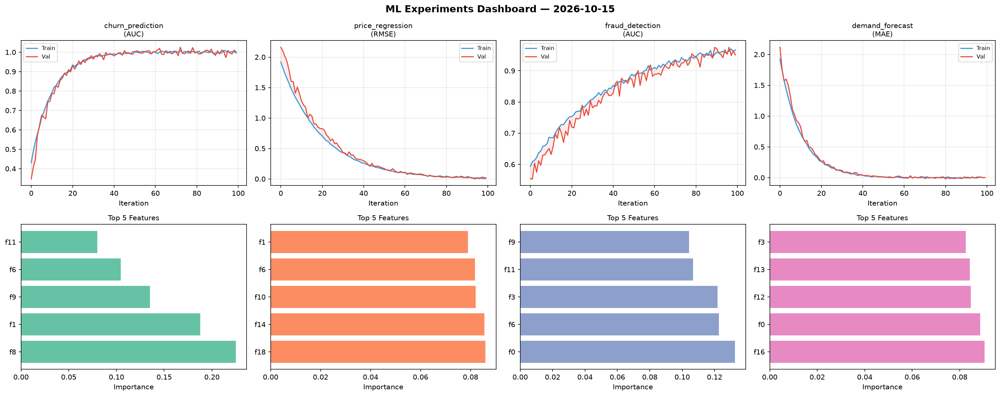
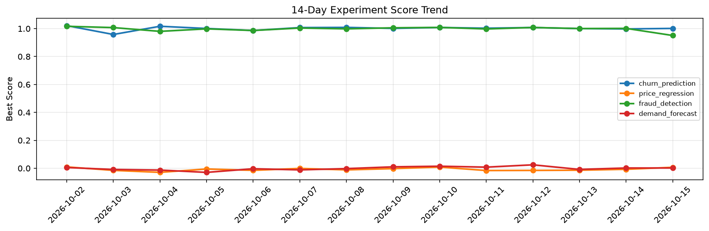

# ML Experiments Report — 2026-10-15

**Run ID:** `93ecc10867` | **Experiments:** 4 | **Trials:** 15

## Delta vs Yesterday

| Experiment | Today | Yesterday | Change |
|-----------|-------|-----------|--------|
| churn_prediction | 1.0015 | 0.9978 | 📈 0.4% |
| price_regression | 0.007 | -0.0073 | 📈 195.9% |
| fraud_detection | 0.9507 | 1.0016 | 📉 -5.1% |
| demand_forecast | 0.0019 | 0.002 | 📉 -5.0% |

## churn_prediction (AUC)

**Best Score:** 1.0015 (Trial 3)

| Trial | Score | Overfit Gap | Time | LR | Trees | Leaves |
|-------|-------|-------------|------|-----|-------|--------|
| 1 | 0.9802 | 0.0199 | 7.75s | 0.2 | 200 | 63 |
| 2 | 0.7043 | 0.0289 | 14.32s | 0.01 | 100 | 127 |
| 3 ⭐ | 1.0015 | 0.0059 | 21.72s | 0.2 | 100 | 127 |

## price_regression (RMSE)

**Best Score:** 0.007 (Trial 1)

| Trial | Score | Overfit Gap | Time | LR | Trees | Leaves |
|-------|-------|-------------|------|-----|-------|--------|
| 1 ⭐ | 0.007 | 0.0154 | 28.37s | 0.1 | 100 | 63 |
| 2 | 0.1628 | 0.0052 | 40.79s | 0.05 | 200 | 15 |
| 3 | 0.1543 | 0.0047 | 72.25s | 0.05 | 1000 | 15 |
| 4 | 0.0314 | 0.0185 | 37.8s | 0.1 | 500 | 15 |
| 5 | 0.1464 | 0.0202 | 147.55s | 0.05 | 500 | 31 |
| 6 | 0.9865 | 0.0703 | 51.53s | 0.01 | 200 | 31 |

## fraud_detection (AUC)

**Best Score:** 0.9507 (Trial 2)

| Trial | Score | Overfit Gap | Time | LR | Trees | Leaves |
|-------|-------|-------------|------|-----|-------|--------|
| 1 | 0.775 | 0.0107 | 20.66s | 0.01 | 500 | 127 |
| 2 ⭐ | 0.9507 | 0.0158 | 19.81s | 0.05 | 100 | 15 |
| 3 | 0.6634 | 0.0171 | 212.19s | 0.01 | 1000 | 127 |

## demand_forecast (MAE)

**Best Score:** 0.0019 (Trial 3)

| Trial | Score | Overfit Gap | Time | LR | Trees | Leaves |
|-------|-------|-------------|------|-----|-------|--------|
| 1 | 0.0113 | 0.0006 | 0.98s | 0.1 | 100 | 127 |
| 2 | 0.0074 | 0.0003 | 28.95s | 0.1 | 200 | 15 |
| 3 ⭐ | 0.0019 | 0.001 | 90.8s | 0.2 | 500 | 63 |
