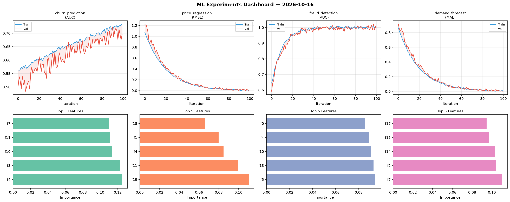
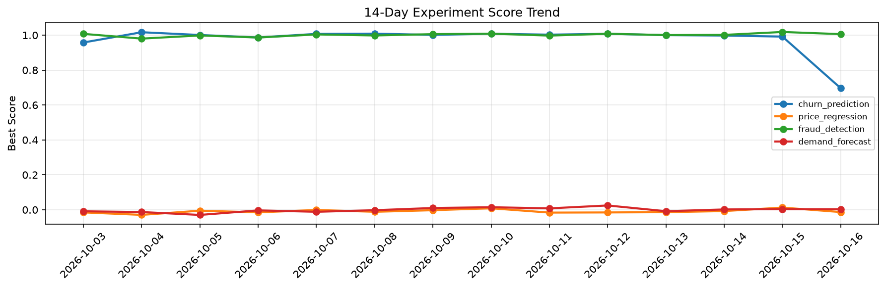

# ML Experiments Report — 2026-10-16

**Run ID:** `ee830178fa` | **Experiments:** 4 | **Trials:** 19

## Delta vs Yesterday

| Experiment | Today | Yesterday | Change |
|-----------|-------|-----------|--------|
| churn_prediction | 0.6964 | 0.9918 | 📉 -29.8% |
| price_regression | -0.013 | 0.0126 | 📉 -203.2% |
| fraud_detection | 1.006 | 1.0183 | 📉 -1.2% |
| demand_forecast | 0.0029 | 0.0035 | 📉 -17.1% |

## churn_prediction (AUC)

**Best Score:** 0.6964 (Trial 2)

| Trial | Score | Overfit Gap | Time | LR | Trees | Leaves |
|-------|-------|-------------|------|-----|-------|--------|
| 1 | 0.6875 | 0.0395 | 76.05s | 0.01 | 500 | 63 |
| 2 ⭐ | 0.6964 | 0.0376 | 78.92s | 0.01 | 500 | 15 |
| 3 | 0.6522 | 0.0368 | 17.8s | 0.01 | 200 | 15 |

## price_regression (RMSE)

**Best Score:** -0.013 (Trial 5)

| Trial | Score | Overfit Gap | Time | LR | Trees | Leaves |
|-------|-------|-------------|------|-----|-------|--------|
| 1 | 0.0042 | 0.0056 | 48.48s | 0.2 | 500 | 31 |
| 2 | 0.0214 | 0.0128 | 55.69s | 0.1 | 200 | 31 |
| 3 | 0.9952 | 0.0636 | 46.2s | 0.01 | 1000 | 63 |
| 4 | 0.0738 | 0.0019 | 141.0s | 0.05 | 500 | 63 |
| 5 ⭐ | -0.013 | 0.0166 | 92.4s | 0.1 | 1000 | 127 |
| 6 | 0.0024 | 0.01 | 81.77s | 0.1 | 500 | 63 |

## fraud_detection (AUC)

**Best Score:** 1.006 (Trial 1)

| Trial | Score | Overfit Gap | Time | LR | Trees | Leaves |
|-------|-------|-------------|------|-----|-------|--------|
| 1 ⭐ | 1.006 | 0.008 | 43.33s | 0.2 | 200 | 15 |
| 2 | 0.7416 | 0.0208 | 15.63s | 0.01 | 500 | 31 |
| 3 | 0.9912 | 0.0051 | 12.48s | 0.1 | 200 | 31 |
| 4 | 1.0019 | 0.0081 | 66.6s | 0.2 | 1000 | 15 |

## demand_forecast (MAE)

**Best Score:** 0.0029 (Trial 5)

| Trial | Score | Overfit Gap | Time | LR | Trees | Leaves |
|-------|-------|-------------|------|-----|-------|--------|
| 1 | 0.0983 | 0.016 | 3.84s | 0.05 | 100 | 31 |
| 2 | 0.4044 | 0.0417 | 4.86s | 0.01 | 200 | 31 |
| 3 | 0.1623 | 0.0329 | 28.76s | 0.05 | 500 | 127 |
| 4 | 0.0047 | 0.0053 | 51.27s | 0.1 | 500 | 15 |
| 5 ⭐ | 0.0029 | 0.008 | 21.29s | 0.1 | 100 | 127 |
| 6 | 0.6589 | 0.1007 | 66.9s | 0.01 | 1000 | 63 |
