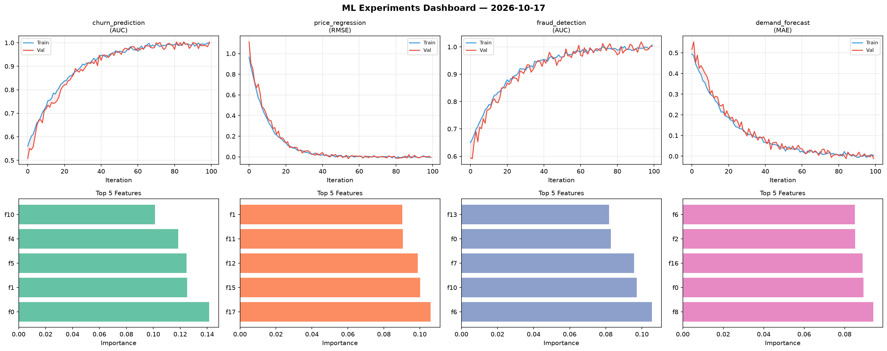
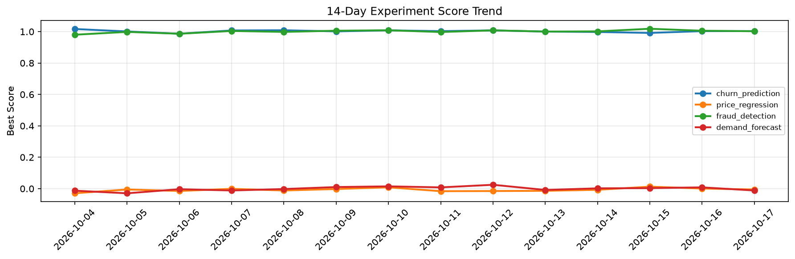

# ML Experiments Report — 2026-10-17

**Run ID:** `35c0bbd666` | **Experiments:** 4 | **Trials:** 21

## Delta vs Yesterday

| Experiment | Today | Yesterday | Change |
|-----------|-------|-----------|--------|
| churn_prediction | 1.0034 | 1.0031 | 📉 0.0% |
| price_regression | -0.0053 | 0.0008 | 📉 -610.0% |
| fraud_detection | 1.0024 | 1.0056 | 📉 -0.3% |
| demand_forecast | -0.0116 | 0.0082 | 📉 -241.5% |

## churn_prediction (AUC)

**Best Score:** 1.0034 (Trial 5)

| Trial | Score | Overfit Gap | Time | LR | Trees | Leaves |
|-------|-------|-------------|------|-----|-------|--------|
| 1 | 0.6387 | 0.0371 | 95.69s | 0.01 | 1000 | 63 |
| 2 | 0.9812 | 0.0017 | 20.36s | 0.1 | 100 | 63 |
| 3 | 0.6508 | 0.0405 | 137.0s | 0.01 | 500 | 15 |
| 4 | 0.9992 | 0.0054 | 18.6s | 0.2 | 100 | 127 |
| 5 ⭐ | 1.0034 | 0.0058 | 178.72s | 0.1 | 1000 | 31 |
| 6 | 1.0007 | 0.0055 | 57.17s | 0.1 | 500 | 127 |

## price_regression (RMSE)

**Best Score:** -0.0053 (Trial 4)

| Trial | Score | Overfit Gap | Time | LR | Trees | Leaves |
|-------|-------|-------------|------|-----|-------|--------|
| 1 | 0.108 | 0.0143 | 22.13s | 0.05 | 500 | 127 |
| 2 | 0.829 | 0.0221 | 25.68s | 0.01 | 200 | 127 |
| 3 | 0.0113 | 0.0061 | 119.73s | 0.1 | 500 | 127 |
| 4 ⭐ | -0.0053 | 0.0021 | 14.58s | 0.2 | 200 | 63 |
| 5 | 0.5748 | 0.0805 | 56.73s | 0.01 | 200 | 127 |
| 6 | 0.125 | 0.0082 | 20.31s | 0.05 | 100 | 127 |

## fraud_detection (AUC)

**Best Score:** 1.0024 (Trial 3)

| Trial | Score | Overfit Gap | Time | LR | Trees | Leaves |
|-------|-------|-------------|------|-----|-------|--------|
| 1 | 0.9555 | 0.0006 | 31.42s | 0.05 | 200 | 127 |
| 2 | 0.6252 | 0.0656 | 74.03s | 0.01 | 500 | 127 |
| 3 ⭐ | 1.0024 | 0.0046 | 193.09s | 0.1 | 1000 | 127 |
| 4 | 1.0 | 0.0082 | 73.89s | 0.1 | 500 | 127 |
| 5 | 0.9809 | 0.0214 | 42.46s | 0.1 | 500 | 127 |

## demand_forecast (MAE)

**Best Score:** -0.0116 (Trial 3)

| Trial | Score | Overfit Gap | Time | LR | Trees | Leaves |
|-------|-------|-------------|------|-----|-------|--------|
| 1 | -0.0025 | 0.014 | 39.36s | 0.1 | 200 | 63 |
| 2 | 0.1386 | 0.0204 | 80.59s | 0.05 | 1000 | 31 |
| 3 ⭐ | -0.0116 | 0.0145 | 50.5s | 0.1 | 200 | 63 |
| 4 | -0.0032 | 0.0039 | 264.67s | 0.2 | 1000 | 15 |
