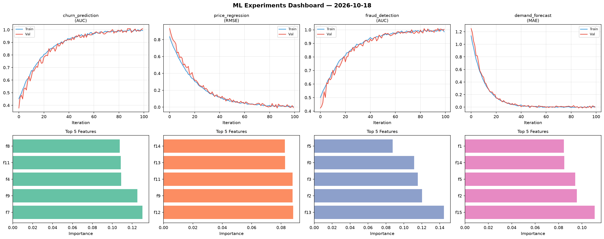
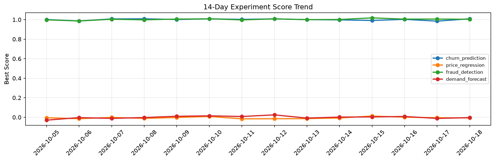

# ML Experiments Report — 2026-10-18

**Run ID:** `c9e3eaf74c` | **Experiments:** 4 | **Trials:** 17

## Delta vs Yesterday

| Experiment | Today | Yesterday | Change |
|-----------|-------|-----------|--------|
| churn_prediction | 1.0089 | 0.9848 | 📈 2.4% |
| price_regression | -0.0071 | -0.0043 | 📉 -65.1% |
| fraud_detection | 1.0041 | 1.006 | 📉 -0.2% |
| demand_forecast | -0.0034 | -0.0118 | 📈 71.2% |

## churn_prediction (AUC)

**Best Score:** 1.0089 (Trial 2)

| Trial | Score | Overfit Gap | Time | LR | Trees | Leaves |
|-------|-------|-------------|------|-----|-------|--------|
| 1 | 0.9376 | 0.0292 | 96.99s | 0.05 | 500 | 31 |
| 2 ⭐ | 1.0089 | 0.0155 | 287.4s | 0.1 | 1000 | 15 |
| 3 | 1.008 | 0.0156 | 121.53s | 0.1 | 1000 | 63 |

## price_regression (RMSE)

**Best Score:** -0.0071 (Trial 3)

| Trial | Score | Overfit Gap | Time | LR | Trees | Leaves |
|-------|-------|-------------|------|-----|-------|--------|
| 1 | 0.765 | 0.0173 | 37.78s | 0.01 | 500 | 15 |
| 2 | 0.3976 | 0.0459 | 21.26s | 0.01 | 1000 | 15 |
| 3 ⭐ | -0.0071 | 0.0134 | 39.07s | 0.1 | 200 | 15 |

## fraud_detection (AUC)

**Best Score:** 1.0041 (Trial 1)

| Trial | Score | Overfit Gap | Time | LR | Trees | Leaves |
|-------|-------|-------------|------|-----|-------|--------|
| 1 ⭐ | 1.0041 | 0.0191 | 249.33s | 0.1 | 1000 | 31 |
| 2 | 0.9745 | 0.0237 | 47.25s | 0.2 | 500 | 31 |
| 3 | 0.948 | 0.0068 | 43.58s | 0.05 | 200 | 15 |
| 4 | 1.0011 | 0.0034 | 27.63s | 0.1 | 100 | 63 |
| 5 | 0.9963 | 0.0072 | 13.75s | 0.2 | 100 | 63 |
| 6 | 0.9886 | 0.0029 | 20.06s | 0.1 | 100 | 31 |

## demand_forecast (MAE)

**Best Score:** -0.0034 (Trial 3)

| Trial | Score | Overfit Gap | Time | LR | Trees | Leaves |
|-------|-------|-------------|------|-----|-------|--------|
| 1 | 0.1449 | 0.0118 | 2.08s | 0.05 | 100 | 63 |
| 2 | 0.1149 | 0.0047 | 36.55s | 0.05 | 200 | 63 |
| 3 ⭐ | -0.0034 | 0.0125 | 176.24s | 0.2 | 1000 | 31 |
| 4 | 0.0102 | 0.0071 | 118.72s | 0.2 | 1000 | 63 |
| 5 | 0.0134 | 0.0027 | 5.36s | 0.1 | 200 | 31 |
