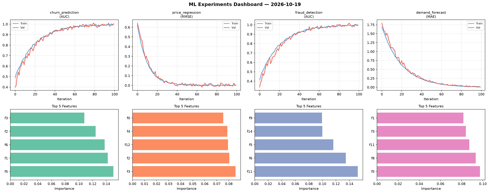
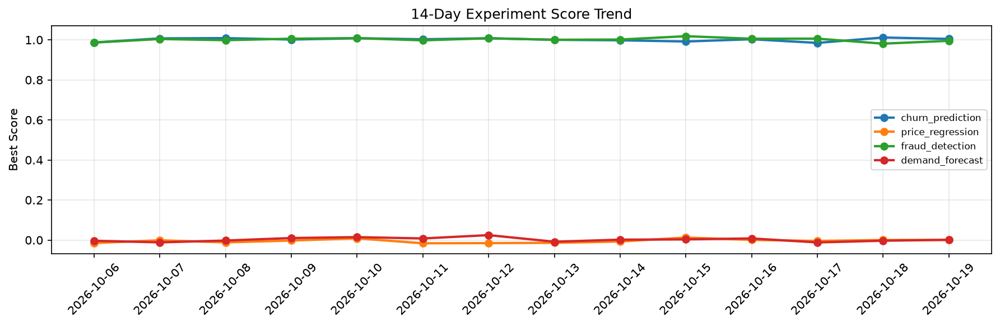

# ML Experiments Report — 2026-10-19

**Run ID:** `3e3f3947d5` | **Experiments:** 4 | **Trials:** 16

## Delta vs Yesterday

| Experiment | Today | Yesterday | Change |
|-----------|-------|-----------|--------|
| churn_prediction | 1.0047 | 1.0117 | 📉 -0.7% |
| price_regression | 0.0009 | 0.0004 | 📈 50.0% |
| fraud_detection | 0.9952 | 0.981 | 📈 1.4% |
| demand_forecast | 0.0012 | -0.0032 | 📈 137.5% |

## churn_prediction (AUC)

**Best Score:** 1.0047 (Trial 4)

| Trial | Score | Overfit Gap | Time | LR | Trees | Leaves |
|-------|-------|-------------|------|-----|-------|--------|
| 1 | 0.9868 | 0.0191 | 14.09s | 0.2 | 200 | 31 |
| 2 | 0.74 | 0.0111 | 298.99s | 0.01 | 1000 | 63 |
| 3 | 0.9859 | 0.0122 | 13.89s | 0.1 | 200 | 31 |
| 4 ⭐ | 1.0047 | 0.011 | 35.56s | 0.1 | 200 | 15 |

## price_regression (RMSE)

**Best Score:** 0.0009 (Trial 4)

| Trial | Score | Overfit Gap | Time | LR | Trees | Leaves |
|-------|-------|-------------|------|-----|-------|--------|
| 1 | 0.6168 | 0.0882 | 10.46s | 0.01 | 200 | 127 |
| 2 | 0.1239 | 0.0028 | 211.41s | 0.05 | 1000 | 31 |
| 3 | 0.0066 | 0.0056 | 30.84s | 0.2 | 500 | 63 |
| 4 ⭐ | 0.0009 | 0.001 | 3.53s | 0.2 | 100 | 127 |

## fraud_detection (AUC)

**Best Score:** 0.9952 (Trial 5)

| Trial | Score | Overfit Gap | Time | LR | Trees | Leaves |
|-------|-------|-------------|------|-----|-------|--------|
| 1 | 0.9849 | 0.0165 | 7.96s | 0.1 | 100 | 31 |
| 2 | 0.9487 | 0.018 | 212.1s | 0.05 | 1000 | 63 |
| 3 | 0.6366 | 0.0199 | 144.61s | 0.01 | 1000 | 31 |
| 4 | 0.6817 | 0.0322 | 216.49s | 0.01 | 1000 | 31 |
| 5 ⭐ | 0.9952 | 0.0007 | 13.41s | 0.1 | 200 | 15 |

## demand_forecast (MAE)

**Best Score:** 0.0012 (Trial 1)

| Trial | Score | Overfit Gap | Time | LR | Trees | Leaves |
|-------|-------|-------------|------|-----|-------|--------|
| 1 ⭐ | 0.0012 | 0.0091 | 106.09s | 0.1 | 1000 | 31 |
| 2 | 0.0085 | 0.0068 | 14.82s | 0.1 | 100 | 127 |
| 3 | 0.1407 | 0.0379 | 13.61s | 0.05 | 100 | 31 |
