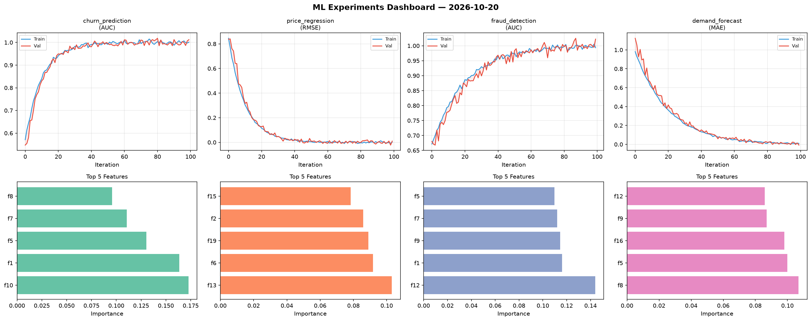
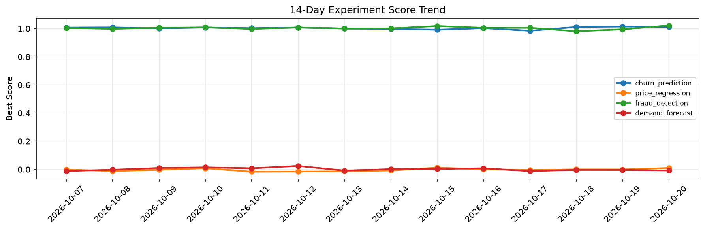

# ML Experiments Report — 2026-10-20

**Run ID:** `3c42362be4` | **Experiments:** 4 | **Trials:** 19

## Delta vs Yesterday

| Experiment | Today | Yesterday | Change |
|-----------|-------|-----------|--------|
| churn_prediction | 1.0122 | 1.0145 | 📉 -0.2% |
| price_regression | 0.0101 | -0.0002 | 📈 1030.0% |
| fraud_detection | 1.0222 | 0.9949 | 📈 2.7% |
| demand_forecast | -0.0077 | -0.0034 | 📉 -126.5% |

## churn_prediction (AUC)

**Best Score:** 1.0122 (Trial 4)

| Trial | Score | Overfit Gap | Time | LR | Trees | Leaves |
|-------|-------|-------------|------|-----|-------|--------|
| 1 | 0.9302 | 0.0162 | 2.19s | 0.05 | 100 | 31 |
| 2 | 0.9848 | 0.0096 | 12.35s | 0.1 | 100 | 15 |
| 3 | 0.9671 | 0.0107 | 52.67s | 0.05 | 500 | 31 |
| 4 ⭐ | 1.0122 | 0.0112 | 37.32s | 0.2 | 200 | 15 |
| 5 | 1.0104 | 0.0076 | 13.94s | 0.2 | 100 | 127 |
| 6 | 1.0078 | 0.0178 | 74.91s | 0.1 | 500 | 31 |

## price_regression (RMSE)

**Best Score:** 0.0101 (Trial 2)

| Trial | Score | Overfit Gap | Time | LR | Trees | Leaves |
|-------|-------|-------------|------|-----|-------|--------|
| 1 | 0.9129 | 0.0411 | 119.29s | 0.01 | 500 | 31 |
| 2 ⭐ | 0.0101 | 0.0087 | 201.67s | 0.2 | 1000 | 15 |
| 3 | 0.1065 | 0.0055 | 29.72s | 0.05 | 100 | 31 |

## fraud_detection (AUC)

**Best Score:** 1.0222 (Trial 4)

| Trial | Score | Overfit Gap | Time | LR | Trees | Leaves |
|-------|-------|-------------|------|-----|-------|--------|
| 1 | 0.9885 | 0.0052 | 134.9s | 0.1 | 1000 | 127 |
| 2 | 0.953 | 0.0028 | 2.15s | 0.05 | 100 | 15 |
| 3 | 0.9983 | 0.0009 | 24.31s | 0.2 | 100 | 31 |
| 4 ⭐ | 1.0222 | 0.0287 | 118.83s | 0.1 | 1000 | 31 |

## demand_forecast (MAE)

**Best Score:** -0.0077 (Trial 2)

| Trial | Score | Overfit Gap | Time | LR | Trees | Leaves |
|-------|-------|-------------|------|-----|-------|--------|
| 1 | 0.1658 | 0.0128 | 128.85s | 0.05 | 500 | 63 |
| 2 ⭐ | -0.0077 | 0.0185 | 95.62s | 0.1 | 1000 | 127 |
| 3 | 0.9737 | 0.0743 | 284.79s | 0.01 | 1000 | 63 |
| 4 | 0.0059 | 0.0126 | 2.89s | 0.2 | 100 | 63 |
| 5 | 0.0779 | 0.0214 | 232.03s | 0.05 | 1000 | 15 |
| 6 | 0.5769 | 0.0331 | 128.89s | 0.01 | 1000 | 31 |
