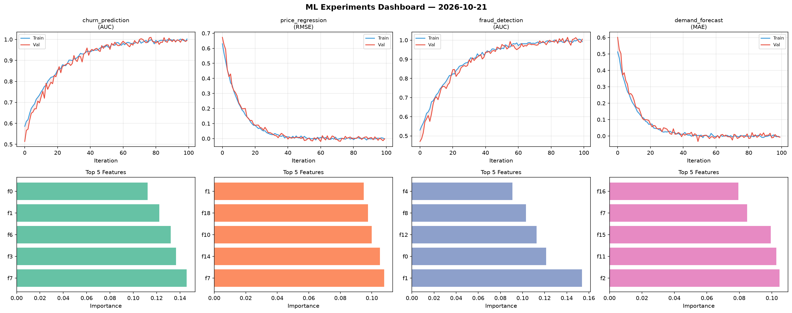
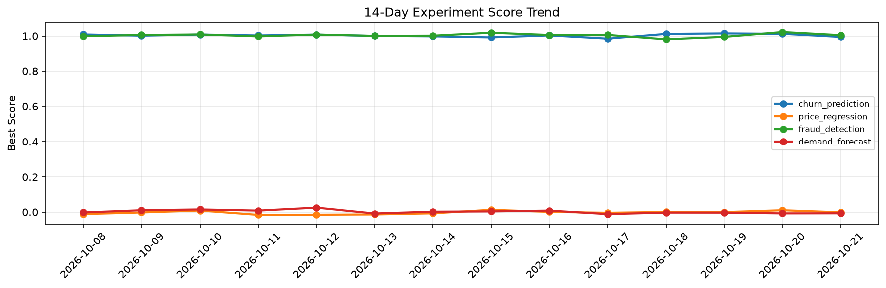

# ML Experiments Report — 2026-10-21

**Run ID:** `0aec3aaa4f` | **Experiments:** 4 | **Trials:** 19

## Delta vs Yesterday

| Experiment | Today | Yesterday | Change |
|-----------|-------|-----------|--------|
| churn_prediction | 0.9946 | 1.0122 | 📉 -1.7% |
| price_regression | -0.0014 | 0.0101 | 📉 -113.9% |
| fraud_detection | 1.0047 | 1.0222 | 📉 -1.7% |
| demand_forecast | -0.0072 | -0.0077 | 📈 6.5% |

## churn_prediction (AUC)

**Best Score:** 0.9946 (Trial 6)

| Trial | Score | Overfit Gap | Time | LR | Trees | Leaves |
|-------|-------|-------------|------|-----|-------|--------|
| 1 | 0.99 | 0.0122 | 21.18s | 0.2 | 100 | 63 |
| 2 | 0.6907 | 0.0081 | 147.63s | 0.01 | 500 | 31 |
| 3 | 0.7085 | 0.0277 | 20.55s | 0.01 | 200 | 15 |
| 4 | 0.7253 | 0.0111 | 117.0s | 0.01 | 1000 | 127 |
| 5 | 0.9766 | 0.0074 | 17.92s | 0.05 | 500 | 127 |
| 6 ⭐ | 0.9946 | 0.0074 | 4.22s | 0.1 | 100 | 31 |

## price_regression (RMSE)

**Best Score:** -0.0014 (Trial 3)

| Trial | Score | Overfit Gap | Time | LR | Trees | Leaves |
|-------|-------|-------------|------|-----|-------|--------|
| 1 | -0.0012 | 0.0024 | 22.91s | 0.2 | 200 | 127 |
| 2 | 0.4736 | 0.0068 | 6.28s | 0.01 | 500 | 31 |
| 3 ⭐ | -0.0014 | 0.0011 | 232.09s | 0.2 | 1000 | 63 |

## fraud_detection (AUC)

**Best Score:** 1.0047 (Trial 1)

| Trial | Score | Overfit Gap | Time | LR | Trees | Leaves |
|-------|-------|-------------|------|-----|-------|--------|
| 1 ⭐ | 1.0047 | 0.013 | 213.88s | 0.1 | 1000 | 15 |
| 2 | 1.0001 | 0.0028 | 2.87s | 0.2 | 200 | 31 |
| 3 | 0.9841 | 0.0251 | 123.99s | 0.05 | 1000 | 63 |
| 4 | 0.8242 | 0.0206 | 29.01s | 0.01 | 200 | 127 |
| 5 | 1.0011 | 0.0011 | 3.25s | 0.2 | 100 | 15 |
| 6 | 0.7471 | 0.012 | 50.7s | 0.01 | 200 | 127 |

## demand_forecast (MAE)

**Best Score:** -0.0072 (Trial 4)

| Trial | Score | Overfit Gap | Time | LR | Trees | Leaves |
|-------|-------|-------------|------|-----|-------|--------|
| 1 | 0.0063 | 0.0008 | 11.45s | 0.1 | 100 | 127 |
| 2 | 0.4069 | 0.0374 | 206.7s | 0.01 | 1000 | 63 |
| 3 | 0.1766 | 0.0206 | 50.67s | 0.05 | 1000 | 63 |
| 4 ⭐ | -0.0072 | 0.0009 | 13.94s | 0.2 | 500 | 31 |
