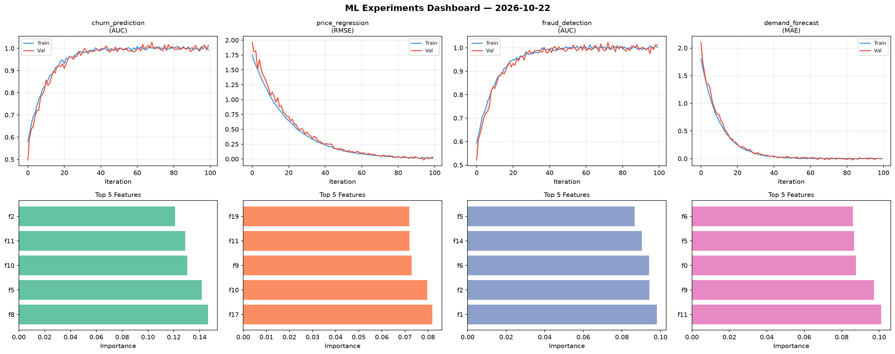
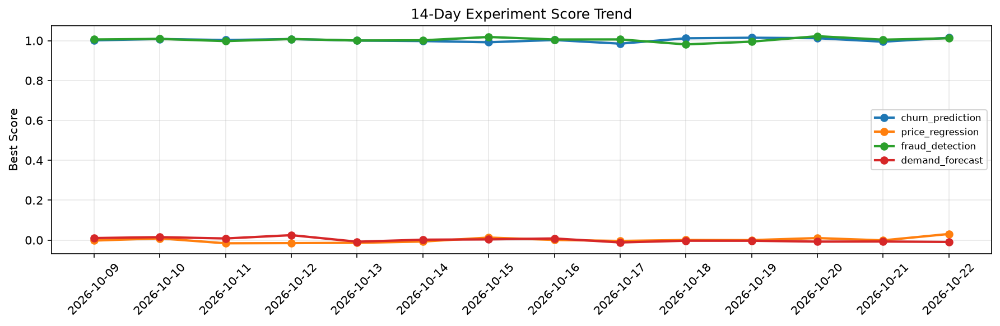

# ML Experiments Report — 2026-10-22

**Run ID:** `bc1026b42d` | **Experiments:** 4 | **Trials:** 18

## Delta vs Yesterday

| Experiment | Today | Yesterday | Change |
|-----------|-------|-----------|--------|
| churn_prediction | 1.0142 | 0.9946 | 📈 2.0% |
| price_regression | 0.0306 | -0.0014 | 📈 2285.7% |
| fraud_detection | 1.0119 | 1.0047 | 📈 0.7% |
| demand_forecast | -0.0094 | -0.0072 | 📉 -30.6% |

## churn_prediction (AUC)

**Best Score:** 1.0142 (Trial 5)

| Trial | Score | Overfit Gap | Time | LR | Trees | Leaves |
|-------|-------|-------------|------|-----|-------|--------|
| 1 | 1.006 | 0.0133 | 40.84s | 0.2 | 500 | 63 |
| 2 | 0.9478 | 0.0084 | 4.84s | 0.05 | 200 | 63 |
| 3 | 1.0031 | 0.0056 | 23.43s | 0.2 | 1000 | 15 |
| 4 | 1.0027 | 0.0132 | 268.35s | 0.1 | 1000 | 63 |
| 5 ⭐ | 1.0142 | 0.0221 | 88.66s | 0.2 | 500 | 127 |
| 6 | 0.6962 | 0.0271 | 6.91s | 0.01 | 100 | 31 |

## price_regression (RMSE)

**Best Score:** 0.0306 (Trial 1)

| Trial | Score | Overfit Gap | Time | LR | Trees | Leaves |
|-------|-------|-------------|------|-----|-------|--------|
| 1 ⭐ | 0.0306 | 0.0167 | 2.2s | 0.1 | 100 | 127 |
| 2 | 0.1596 | 0.0298 | 49.4s | 0.05 | 200 | 31 |
| 3 | 0.0819 | 0.0013 | 9.21s | 0.05 | 100 | 31 |

## fraud_detection (AUC)

**Best Score:** 1.0119 (Trial 5)

| Trial | Score | Overfit Gap | Time | LR | Trees | Leaves |
|-------|-------|-------------|------|-----|-------|--------|
| 1 | 0.9503 | 0.001 | 58.34s | 0.05 | 200 | 31 |
| 2 | 0.9934 | 0.0073 | 42.95s | 0.1 | 200 | 31 |
| 3 | 0.9408 | 0.0097 | 194.11s | 0.05 | 1000 | 31 |
| 4 | 0.6767 | 0.0144 | 120.92s | 0.01 | 500 | 127 |
| 5 ⭐ | 1.0119 | 0.0099 | 17.32s | 0.2 | 100 | 31 |

## demand_forecast (MAE)

**Best Score:** -0.0094 (Trial 2)

| Trial | Score | Overfit Gap | Time | LR | Trees | Leaves |
|-------|-------|-------------|------|-----|-------|--------|
| 1 | 1.2296 | 0.083 | 31.27s | 0.01 | 500 | 15 |
| 2 ⭐ | -0.0094 | 0.0116 | 184.51s | 0.2 | 1000 | 15 |
| 3 | 0.0003 | 0.0095 | 42.3s | 0.2 | 200 | 63 |
| 4 | -0.0034 | 0.0055 | 16.62s | 0.2 | 500 | 63 |
