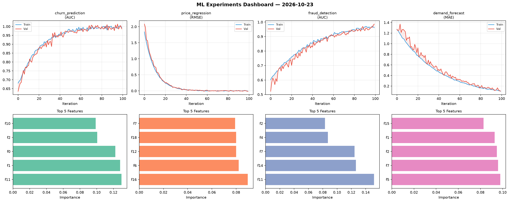
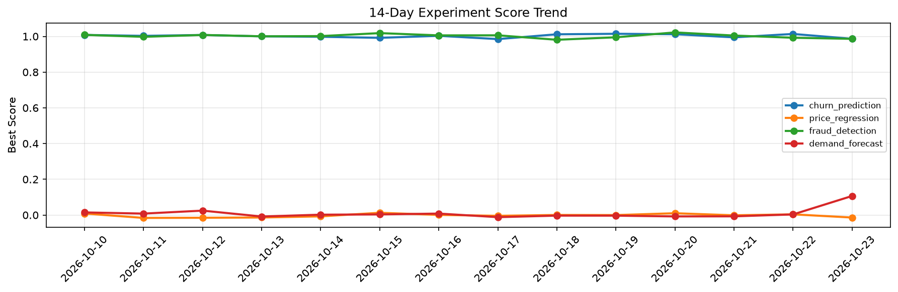

# ML Experiments Report — 2026-10-23

**Run ID:** `bb98d376d5` | **Experiments:** 4 | **Trials:** 12

## Delta vs Yesterday

| Experiment | Today | Yesterday | Change |
|-----------|-------|-----------|--------|
| churn_prediction | 0.9865 | 1.0136 | 📉 -2.7% |
| price_regression | -0.0139 | 0.0039 | 📉 -456.4% |
| fraud_detection | 0.9862 | 0.9924 | 📉 -0.6% |
| demand_forecast | 0.1067 | 0.0034 | 📈 3038.2% |

## churn_prediction (AUC)

**Best Score:** 0.9865 (Trial 1)

| Trial | Score | Overfit Gap | Time | LR | Trees | Leaves |
|-------|-------|-------------|------|-----|-------|--------|
| 1 ⭐ | 0.9865 | 0.0069 | 127.08s | 0.1 | 500 | 63 |
| 2 | 0.9582 | 0.012 | 135.72s | 0.05 | 500 | 127 |
| 3 | 0.9527 | 0.0009 | 14.0s | 0.05 | 100 | 127 |

## price_regression (RMSE)

**Best Score:** -0.0139 (Trial 3)

| Trial | Score | Overfit Gap | Time | LR | Trees | Leaves |
|-------|-------|-------------|------|-----|-------|--------|
| 1 | -0.0038 | 0.0131 | 12.54s | 0.1 | 200 | 127 |
| 2 | 1.2609 | 0.1965 | 21.52s | 0.01 | 100 | 31 |
| 3 ⭐ | -0.0139 | 0.0031 | 11.32s | 0.2 | 200 | 15 |

## fraud_detection (AUC)

**Best Score:** 0.9862 (Trial 2)

| Trial | Score | Overfit Gap | Time | LR | Trees | Leaves |
|-------|-------|-------------|------|-----|-------|--------|
| 1 | 0.5958 | 0.0532 | 25.86s | 0.01 | 200 | 15 |
| 2 ⭐ | 0.9862 | 0.025 | 3.63s | 0.05 | 100 | 15 |
| 3 | 0.7685 | 0.0157 | 22.97s | 0.01 | 100 | 15 |

## demand_forecast (MAE)

**Best Score:** 0.1067 (Trial 2)

| Trial | Score | Overfit Gap | Time | LR | Trees | Leaves |
|-------|-------|-------------|------|-----|-------|--------|
| 1 | 0.7789 | 0.0822 | 22.9s | 0.01 | 100 | 63 |
| 2 ⭐ | 0.1067 | 0.0057 | 21.14s | 0.05 | 100 | 15 |
| 3 | 0.1823 | 0.0319 | 7.68s | 0.05 | 200 | 127 |
