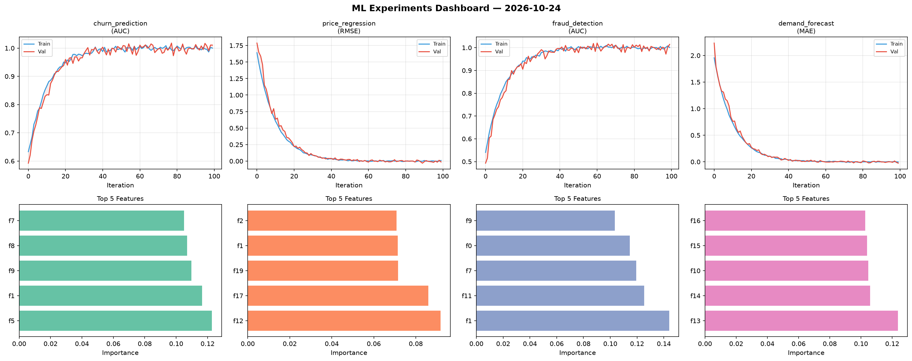
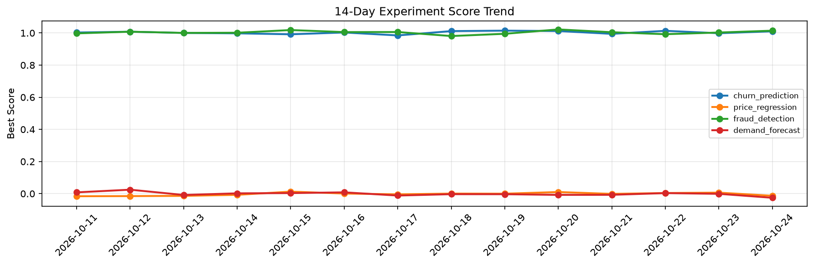

# ML Experiments Report — 2026-10-24

**Run ID:** `c1f9129e43` | **Experiments:** 4 | **Trials:** 17

## Delta vs Yesterday

| Experiment | Today | Yesterday | Change |
|-----------|-------|-----------|--------|
| churn_prediction | 1.0105 | 0.9984 | 📈 1.2% |
| price_regression | -0.0132 | 0.0063 | 📉 -309.5% |
| fraud_detection | 1.0144 | 1.0029 | 📈 1.1% |
| demand_forecast | -0.0256 | -0.0011 | 📉 -2227.3% |

## churn_prediction (AUC)

**Best Score:** 1.0105 (Trial 1)

| Trial | Score | Overfit Gap | Time | LR | Trees | Leaves |
|-------|-------|-------------|------|-----|-------|--------|
| 1 ⭐ | 1.0105 | 0.0106 | 4.94s | 0.2 | 100 | 31 |
| 2 | 0.7585 | 0.0014 | 64.56s | 0.01 | 500 | 31 |
| 3 | 1.0099 | 0.0131 | 59.86s | 0.1 | 500 | 31 |
| 4 | 1.0021 | 0.004 | 10.8s | 0.1 | 200 | 31 |

## price_regression (RMSE)

**Best Score:** -0.0132 (Trial 6)

| Trial | Score | Overfit Gap | Time | LR | Trees | Leaves |
|-------|-------|-------------|------|-----|-------|--------|
| 1 | 0.4393 | 0.0397 | 15.94s | 0.01 | 1000 | 63 |
| 2 | -0.0101 | 0.011 | 263.61s | 0.2 | 1000 | 31 |
| 3 | -0.0078 | 0.0167 | 125.61s | 0.1 | 500 | 63 |
| 4 | -0.0108 | 0.0031 | 84.91s | 0.2 | 500 | 31 |
| 5 | 0.0662 | 0.009 | 54.49s | 0.05 | 200 | 127 |
| 6 ⭐ | -0.0132 | 0.0226 | 110.74s | 0.2 | 500 | 127 |

## fraud_detection (AUC)

**Best Score:** 1.0144 (Trial 2)

| Trial | Score | Overfit Gap | Time | LR | Trees | Leaves |
|-------|-------|-------------|------|-----|-------|--------|
| 1 | 0.7029 | 0.0288 | 31.38s | 0.01 | 200 | 31 |
| 2 ⭐ | 1.0144 | 0.0141 | 27.19s | 0.2 | 100 | 15 |
| 3 | 1.0076 | 0.009 | 21.7s | 0.1 | 100 | 15 |
| 4 | 1.0107 | 0.0084 | 224.74s | 0.2 | 1000 | 127 |

## demand_forecast (MAE)

**Best Score:** -0.0256 (Trial 3)

| Trial | Score | Overfit Gap | Time | LR | Trees | Leaves |
|-------|-------|-------------|------|-----|-------|--------|
| 1 | 0.1094 | 0.0026 | 148.29s | 0.05 | 1000 | 63 |
| 2 | -0.0178 | 0.0247 | 16.97s | 0.1 | 200 | 15 |
| 3 ⭐ | -0.0256 | 0.0229 | 19.34s | 0.2 | 500 | 127 |
