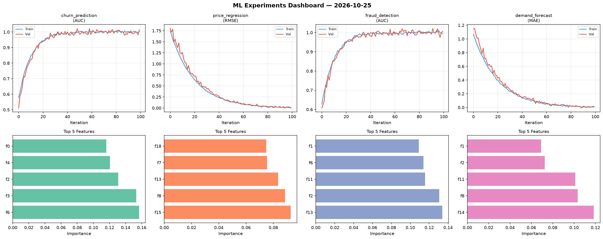
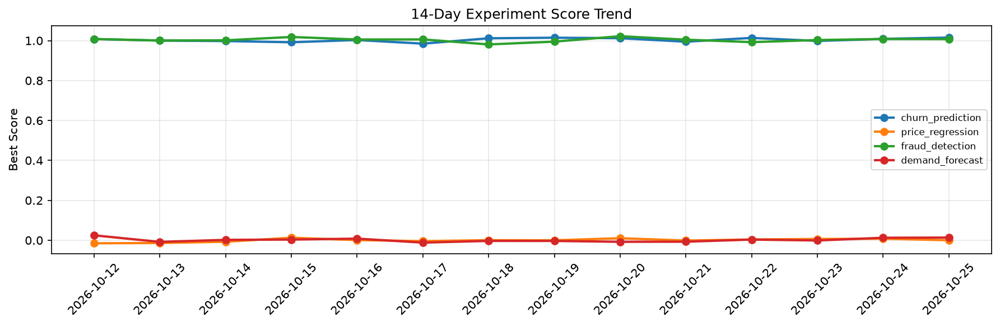

# ML Experiments Report — 2026-10-25

**Run ID:** `8c45214b9c` | **Experiments:** 4 | **Trials:** 17

## Delta vs Yesterday

| Experiment | Today | Yesterday | Change |
|-----------|-------|-----------|--------|
| churn_prediction | 1.0152 | 1.0087 | 📈 0.6% |
| price_regression | 0.0 | 0.0079 | 📉 -100.0% |
| fraud_detection | 1.0075 | 1.0081 | 📉 -0.1% |
| demand_forecast | 0.0135 | 0.0125 | 📈 8.0% |

## churn_prediction (AUC)

**Best Score:** 1.0152 (Trial 1)

| Trial | Score | Overfit Gap | Time | LR | Trees | Leaves |
|-------|-------|-------------|------|-----|-------|--------|
| 1 ⭐ | 1.0152 | 0.0109 | 25.73s | 0.2 | 200 | 127 |
| 2 | 1.0039 | 0.0114 | 110.18s | 0.1 | 500 | 127 |
| 3 | 0.9942 | 0.0081 | 58.03s | 0.1 | 500 | 15 |

## price_regression (RMSE)

**Best Score:** 0.0 (Trial 5)

| Trial | Score | Overfit Gap | Time | LR | Trees | Leaves |
|-------|-------|-------------|------|-----|-------|--------|
| 1 | 0.0062 | 0.0006 | 54.21s | 0.1 | 1000 | 31 |
| 2 | 0.1176 | 0.0068 | 16.26s | 0.05 | 100 | 31 |
| 3 | 1.2334 | 0.0823 | 131.44s | 0.01 | 500 | 127 |
| 4 | 0.0375 | 0.0217 | 83.23s | 0.1 | 1000 | 31 |
| 5 ⭐ | 0.0 | 0.0147 | 28.3s | 0.1 | 100 | 15 |
| 6 | 0.4852 | 0.0928 | 120.71s | 0.01 | 1000 | 127 |

## fraud_detection (AUC)

**Best Score:** 1.0075 (Trial 1)

| Trial | Score | Overfit Gap | Time | LR | Trees | Leaves |
|-------|-------|-------------|------|-----|-------|--------|
| 1 ⭐ | 1.0075 | 0.0127 | 25.13s | 0.2 | 1000 | 127 |
| 2 | 0.9506 | 0.0162 | 0.56s | 0.05 | 100 | 127 |
| 3 | 1.0075 | 0.0049 | 25.72s | 0.2 | 200 | 63 |
| 4 | 0.9704 | 0.0008 | 26.38s | 0.05 | 200 | 63 |

## demand_forecast (MAE)

**Best Score:** 0.0135 (Trial 2)

| Trial | Score | Overfit Gap | Time | LR | Trees | Leaves |
|-------|-------|-------------|------|-----|-------|--------|
| 1 | 0.669 | 0.033 | 75.86s | 0.01 | 1000 | 63 |
| 2 ⭐ | 0.0135 | 0.0057 | 29.78s | 0.1 | 200 | 127 |
| 3 | 1.247 | 0.1572 | 12.31s | 0.01 | 200 | 63 |
| 4 | 0.5288 | 0.0733 | 175.76s | 0.01 | 1000 | 127 |
