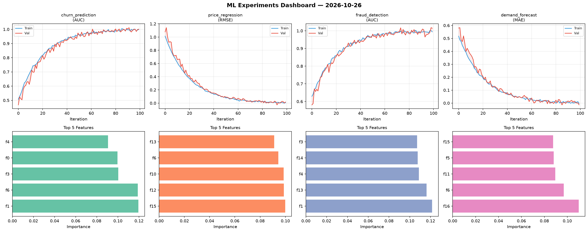
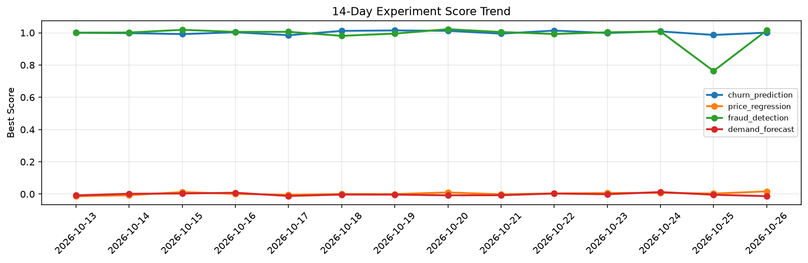

# ML Experiments Report — 2026-10-26

**Run ID:** `4d4a26712e` | **Experiments:** 4 | **Trials:** 19

## Delta vs Yesterday

| Experiment | Today | Yesterday | Change |
|-----------|-------|-----------|--------|
| churn_prediction | 1.001 | 0.9863 | 📈 1.5% |
| price_regression | 0.0166 | 0.003 | 📈 453.3% |
| fraud_detection | 1.0146 | 0.7631 | 📈 33.0% |
| demand_forecast | -0.013 | -0.0043 | 📉 -202.3% |

## churn_prediction (AUC)

**Best Score:** 1.001 (Trial 1)

| Trial | Score | Overfit Gap | Time | LR | Trees | Leaves |
|-------|-------|-------------|------|-----|-------|--------|
| 1 ⭐ | 1.001 | 0.0024 | 137.53s | 0.1 | 500 | 15 |
| 2 | 0.9997 | 0.0022 | 47.67s | 0.1 | 1000 | 127 |
| 3 | 0.9928 | 0.0005 | 2.64s | 0.1 | 100 | 15 |

## price_regression (RMSE)

**Best Score:** 0.0166 (Trial 3)

| Trial | Score | Overfit Gap | Time | LR | Trees | Leaves |
|-------|-------|-------------|------|-----|-------|--------|
| 1 | 0.0263 | 0.0291 | 37.73s | 0.2 | 500 | 127 |
| 2 | 0.5768 | 0.0256 | 25.29s | 0.01 | 500 | 31 |
| 3 ⭐ | 0.0166 | 0.0095 | 6.24s | 0.1 | 200 | 127 |
| 4 | 0.5528 | 0.0227 | 55.23s | 0.01 | 200 | 63 |

## fraud_detection (AUC)

**Best Score:** 1.0146 (Trial 6)

| Trial | Score | Overfit Gap | Time | LR | Trees | Leaves |
|-------|-------|-------------|------|-----|-------|--------|
| 1 | 0.694 | 0.0465 | 10.72s | 0.01 | 100 | 63 |
| 2 | 0.6006 | 0.0535 | 10.92s | 0.01 | 100 | 127 |
| 3 | 0.9465 | 0.0224 | 36.72s | 0.05 | 1000 | 31 |
| 4 | 0.9616 | 0.0035 | 52.93s | 0.05 | 200 | 15 |
| 5 | 0.9494 | 0.0062 | 8.81s | 0.05 | 100 | 15 |
| 6 ⭐ | 1.0146 | 0.0204 | 133.18s | 0.1 | 500 | 127 |

## demand_forecast (MAE)

**Best Score:** -0.013 (Trial 2)

| Trial | Score | Overfit Gap | Time | LR | Trees | Leaves |
|-------|-------|-------------|------|-----|-------|--------|
| 1 | 0.008 | 0.0051 | 22.0s | 0.1 | 100 | 31 |
| 2 ⭐ | -0.013 | 0.0113 | 28.99s | 0.1 | 100 | 31 |
| 3 | 0.019 | 0.0098 | 54.32s | 0.1 | 200 | 31 |
| 4 | 0.3744 | 0.0228 | 291.48s | 0.01 | 1000 | 31 |
| 5 | 0.0208 | 0.0251 | 242.02s | 0.1 | 1000 | 31 |
| 6 | -0.0052 | 0.004 | 47.69s | 0.2 | 200 | 63 |
