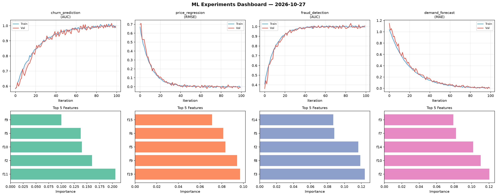
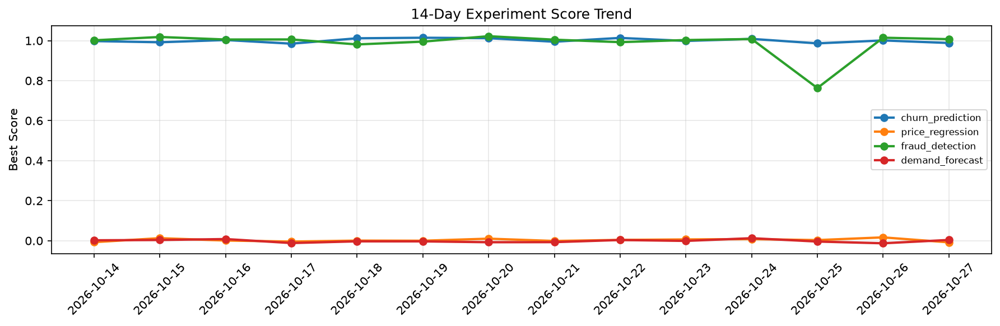

# ML Experiments Report — 2026-10-27

**Run ID:** `108487b238` | **Experiments:** 4 | **Trials:** 19

## Delta vs Yesterday

| Experiment | Today | Yesterday | Change |
|-----------|-------|-----------|--------|
| churn_prediction | 0.9882 | 1.001 | 📉 -1.3% |
| price_regression | -0.0083 | 0.0166 | 📉 -150.0% |
| fraud_detection | 1.0073 | 1.0146 | 📉 -0.7% |
| demand_forecast | 0.0037 | -0.013 | 📈 128.5% |

## churn_prediction (AUC)

**Best Score:** 0.9882 (Trial 3)

| Trial | Score | Overfit Gap | Time | LR | Trees | Leaves |
|-------|-------|-------------|------|-----|-------|--------|
| 1 | 0.933 | 0.0135 | 188.22s | 0.05 | 1000 | 63 |
| 2 | 0.9581 | 0.0038 | 19.07s | 0.05 | 500 | 127 |
| 3 ⭐ | 0.9882 | 0.0096 | 3.19s | 0.1 | 200 | 63 |
| 4 | 0.955 | 0.0051 | 1.97s | 0.05 | 200 | 63 |

## price_regression (RMSE)

**Best Score:** -0.0083 (Trial 4)

| Trial | Score | Overfit Gap | Time | LR | Trees | Leaves |
|-------|-------|-------------|------|-----|-------|--------|
| 1 | 1.0371 | 0.0049 | 34.96s | 0.01 | 200 | 63 |
| 2 | 0.0019 | 0.0034 | 21.51s | 0.1 | 200 | 63 |
| 3 | 0.0091 | 0.0101 | 98.54s | 0.2 | 1000 | 15 |
| 4 ⭐ | -0.0083 | 0.0027 | 26.57s | 0.2 | 200 | 15 |
| 5 | 0.1406 | 0.0207 | 109.36s | 0.05 | 500 | 31 |
| 6 | -0.0066 | 0.0003 | 144.33s | 0.2 | 1000 | 15 |

## fraud_detection (AUC)

**Best Score:** 1.0073 (Trial 1)

| Trial | Score | Overfit Gap | Time | LR | Trees | Leaves |
|-------|-------|-------------|------|-----|-------|--------|
| 1 ⭐ | 1.0073 | 0.0122 | 24.23s | 0.2 | 100 | 31 |
| 2 | 0.9798 | 0.0125 | 191.43s | 0.05 | 1000 | 15 |
| 3 | 0.9835 | 0.0127 | 60.14s | 0.1 | 500 | 63 |
| 4 | 0.9874 | 0.0082 | 15.74s | 0.1 | 100 | 31 |
| 5 | 0.9413 | 0.0079 | 272.24s | 0.05 | 1000 | 63 |

## demand_forecast (MAE)

**Best Score:** 0.0037 (Trial 2)

| Trial | Score | Overfit Gap | Time | LR | Trees | Leaves |
|-------|-------|-------------|------|-----|-------|--------|
| 1 | 0.7852 | 0.0024 | 228.36s | 0.01 | 1000 | 15 |
| 2 ⭐ | 0.0037 | 0.0059 | 8.94s | 0.1 | 100 | 15 |
| 3 | 0.0101 | 0.0028 | 73.88s | 0.2 | 1000 | 127 |
| 4 | 0.0853 | 0.0011 | 85.74s | 0.05 | 500 | 31 |
