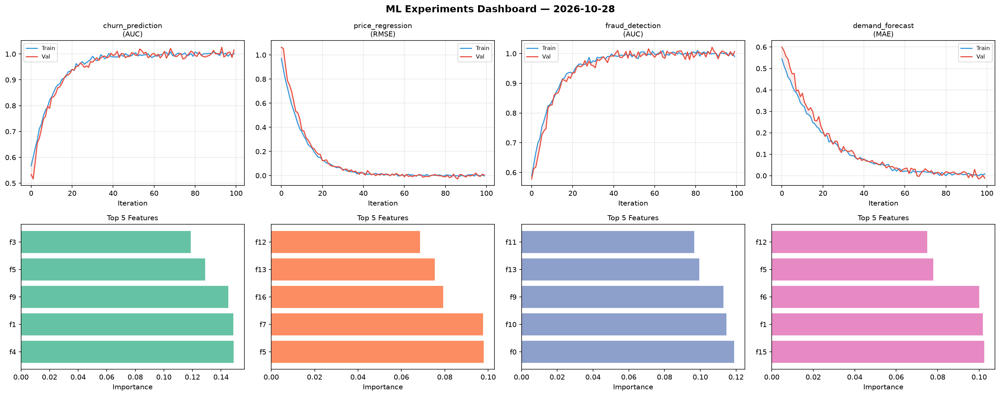
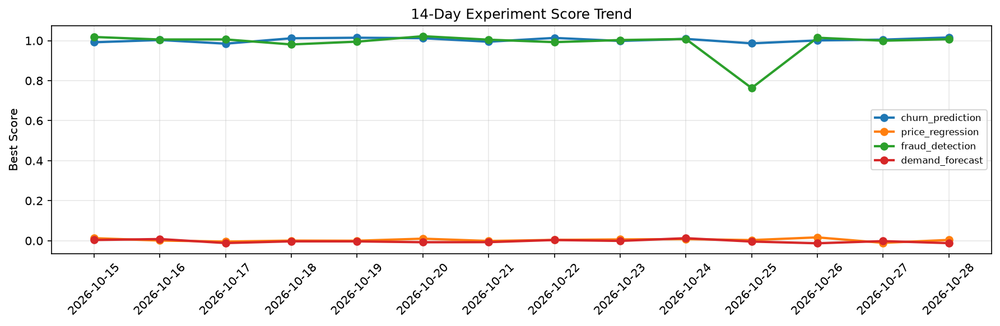

# ML Experiments Report — 2026-10-28

**Run ID:** `34b22e8854` | **Experiments:** 4 | **Trials:** 20

## Delta vs Yesterday

| Experiment | Today | Yesterday | Change |
|-----------|-------|-----------|--------|
| churn_prediction | 1.0158 | 1.0049 | 📈 1.1% |
| price_regression | 0.0038 | -0.0107 | 📈 135.5% |
| fraud_detection | 1.0071 | 0.9996 | 📈 0.8% |
| demand_forecast | -0.0122 | -0.0021 | 📉 -481.0% |

## churn_prediction (AUC)

**Best Score:** 1.0158 (Trial 3)

| Trial | Score | Overfit Gap | Time | LR | Trees | Leaves |
|-------|-------|-------------|------|-----|-------|--------|
| 1 | 0.7505 | 0.0342 | 214.15s | 0.01 | 1000 | 127 |
| 2 | 0.9955 | 0.0128 | 17.24s | 0.2 | 1000 | 31 |
| 3 ⭐ | 1.0158 | 0.0149 | 198.87s | 0.2 | 1000 | 15 |
| 4 | 0.9619 | 0.017 | 18.77s | 0.05 | 100 | 127 |
| 5 | 0.9873 | 0.0148 | 38.75s | 0.2 | 500 | 31 |
| 6 | 1.0104 | 0.0074 | 26.25s | 0.1 | 100 | 31 |

## price_regression (RMSE)

**Best Score:** 0.0038 (Trial 3)

| Trial | Score | Overfit Gap | Time | LR | Trees | Leaves |
|-------|-------|-------------|------|-----|-------|--------|
| 1 | 0.0142 | 0.0054 | 16.81s | 0.1 | 100 | 15 |
| 2 | 0.1427 | 0.0134 | 10.39s | 0.05 | 200 | 63 |
| 3 ⭐ | 0.0038 | 0.0068 | 54.31s | 0.2 | 200 | 31 |
| 4 | 0.0705 | 0.0019 | 32.41s | 0.05 | 1000 | 63 |

## fraud_detection (AUC)

**Best Score:** 1.0071 (Trial 5)

| Trial | Score | Overfit Gap | Time | LR | Trees | Leaves |
|-------|-------|-------------|------|-----|-------|--------|
| 1 | 0.75 | 0.0111 | 21.32s | 0.01 | 200 | 127 |
| 2 | 0.9424 | 0.0267 | 146.67s | 0.05 | 500 | 127 |
| 3 | 0.9804 | 0.0199 | 14.35s | 0.1 | 1000 | 15 |
| 4 | 0.6544 | 0.0192 | 11.81s | 0.01 | 100 | 31 |
| 5 ⭐ | 1.0071 | 0.0171 | 94.24s | 0.2 | 500 | 31 |

## demand_forecast (MAE)

**Best Score:** -0.0122 (Trial 3)

| Trial | Score | Overfit Gap | Time | LR | Trees | Leaves |
|-------|-------|-------------|------|-----|-------|--------|
| 1 | 0.0628 | 0.0063 | 129.44s | 0.05 | 500 | 31 |
| 2 | 0.0036 | 0.0182 | 162.12s | 0.1 | 1000 | 31 |
| 3 ⭐ | -0.0122 | 0.0212 | 9.49s | 0.1 | 100 | 127 |
| 4 | -0.006 | 0.0006 | 4.0s | 0.2 | 500 | 15 |
| 5 | 0.0131 | 0.0101 | 20.96s | 0.2 | 200 | 31 |
