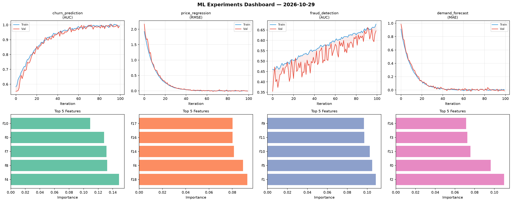
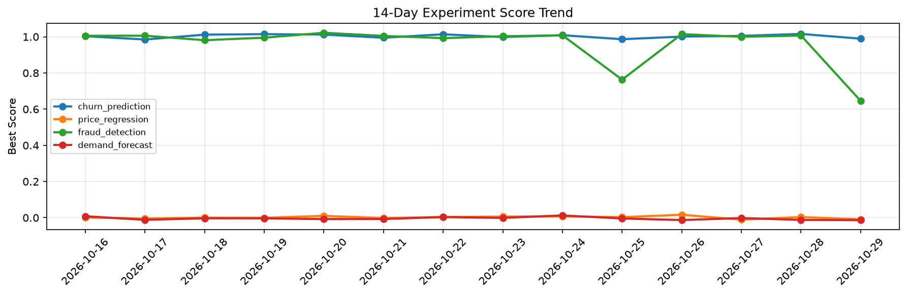

# ML Experiments Report — 2026-10-29

**Run ID:** `1a2cb73f2d` | **Experiments:** 4 | **Trials:** 17

## Delta vs Yesterday

| Experiment | Today | Yesterday | Change |
|-----------|-------|-----------|--------|
| churn_prediction | 0.9894 | 1.0158 | 📉 -2.6% |
| price_regression | -0.0087 | 0.0038 | 📉 -328.9% |
| fraud_detection | 0.6459 | 1.0071 | 📉 -35.9% |
| demand_forecast | -0.0136 | -0.0122 | 📉 -11.5% |

## churn_prediction (AUC)

**Best Score:** 0.9894 (Trial 2)

| Trial | Score | Overfit Gap | Time | LR | Trees | Leaves |
|-------|-------|-------------|------|-----|-------|--------|
| 1 | 0.9473 | 0.0095 | 37.61s | 0.05 | 200 | 127 |
| 2 ⭐ | 0.9894 | 0.0042 | 13.6s | 0.1 | 100 | 127 |
| 3 | 0.9658 | 0.0062 | 229.39s | 0.05 | 1000 | 127 |
| 4 | 0.7735 | 0.0388 | 19.02s | 0.01 | 200 | 127 |
| 5 | 0.9514 | 0.007 | 99.05s | 0.05 | 1000 | 31 |
| 6 | 0.981 | 0.0119 | 44.61s | 0.1 | 200 | 63 |

## price_regression (RMSE)

**Best Score:** -0.0087 (Trial 2)

| Trial | Score | Overfit Gap | Time | LR | Trees | Leaves |
|-------|-------|-------------|------|-----|-------|--------|
| 1 | 0.0116 | 0.004 | 8.58s | 0.1 | 200 | 63 |
| 2 ⭐ | -0.0087 | 0.008 | 17.63s | 0.2 | 500 | 127 |
| 3 | 0.1474 | 0.0028 | 4.44s | 0.05 | 200 | 15 |
| 4 | -0.005 | 0.0167 | 171.4s | 0.2 | 1000 | 127 |

## fraud_detection (AUC)

**Best Score:** 0.6459 (Trial 2)

| Trial | Score | Overfit Gap | Time | LR | Trees | Leaves |
|-------|-------|-------------|------|-----|-------|--------|
| 1 | 0.592 | 0.0376 | 30.05s | 0.01 | 500 | 127 |
| 2 ⭐ | 0.6459 | 0.0324 | 25.92s | 0.01 | 200 | 63 |
| 3 | 0.6306 | 0.0352 | 33.21s | 0.01 | 1000 | 15 |

## demand_forecast (MAE)

**Best Score:** -0.0136 (Trial 1)

| Trial | Score | Overfit Gap | Time | LR | Trees | Leaves |
|-------|-------|-------------|------|-----|-------|--------|
| 1 ⭐ | -0.0136 | 0.0198 | 7.61s | 0.2 | 100 | 63 |
| 2 | 0.0123 | 0.0053 | 18.51s | 0.1 | 100 | 31 |
| 3 | 0.1197 | 0.032 | 15.04s | 0.05 | 100 | 63 |
| 4 | -0.0091 | 0.0039 | 297.98s | 0.2 | 1000 | 127 |
