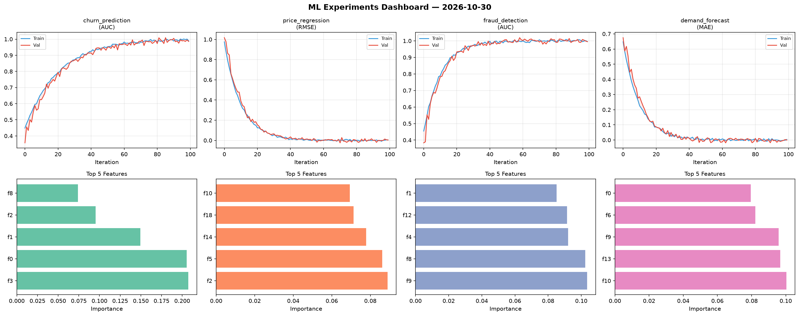
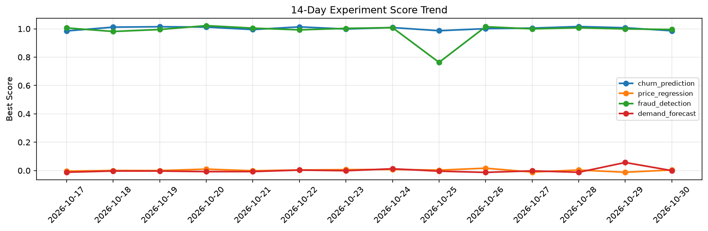

# ML Experiments Report — 2026-10-30

**Run ID:** `8099da9039` | **Experiments:** 4 | **Trials:** 20

## Delta vs Yesterday

| Experiment | Today | Yesterday | Change |
|-----------|-------|-----------|--------|
| churn_prediction | 0.9859 | 1.0072 | 📉 -2.1% |
| price_regression | 0.0041 | -0.0119 | 📈 134.5% |
| fraud_detection | 0.9951 | 0.999 | 📉 -0.4% |
| demand_forecast | -0.0004 | 0.0568 | 📉 -100.7% |

## churn_prediction (AUC)

**Best Score:** 0.9859 (Trial 3)

| Trial | Score | Overfit Gap | Time | LR | Trees | Leaves |
|-------|-------|-------------|------|-----|-------|--------|
| 1 | 0.9818 | 0.0175 | 15.77s | 0.05 | 100 | 127 |
| 2 | 0.6348 | 0.0502 | 29.12s | 0.01 | 100 | 31 |
| 3 ⭐ | 0.9859 | 0.0035 | 10.07s | 0.1 | 500 | 31 |
| 4 | 0.7306 | 0.0016 | 4.76s | 0.01 | 100 | 127 |

## price_regression (RMSE)

**Best Score:** 0.0041 (Trial 1)

| Trial | Score | Overfit Gap | Time | LR | Trees | Leaves |
|-------|-------|-------------|------|-----|-------|--------|
| 1 ⭐ | 0.0041 | 0.0 | 18.09s | 0.2 | 100 | 31 |
| 2 | 0.1508 | 0.0024 | 51.35s | 0.05 | 200 | 127 |
| 3 | 0.0183 | 0.0008 | 88.46s | 0.1 | 1000 | 31 |
| 4 | 1.2408 | 0.1516 | 5.95s | 0.01 | 200 | 31 |
| 5 | 0.8421 | 0.1339 | 52.46s | 0.01 | 500 | 63 |

## fraud_detection (AUC)

**Best Score:** 0.9951 (Trial 3)

| Trial | Score | Overfit Gap | Time | LR | Trees | Leaves |
|-------|-------|-------------|------|-----|-------|--------|
| 1 | 0.993 | 0.0061 | 230.69s | 0.1 | 1000 | 127 |
| 2 | 0.9892 | 0.0091 | 55.28s | 0.1 | 500 | 31 |
| 3 ⭐ | 0.9951 | 0.0004 | 12.25s | 0.2 | 100 | 127 |
| 4 | 0.6327 | 0.0561 | 5.06s | 0.01 | 100 | 15 |
| 5 | 0.6176 | 0.0351 | 85.85s | 0.01 | 500 | 127 |
| 6 | 0.9947 | 0.0023 | 64.31s | 0.1 | 500 | 63 |

## demand_forecast (MAE)

**Best Score:** -0.0004 (Trial 4)

| Trial | Score | Overfit Gap | Time | LR | Trees | Leaves |
|-------|-------|-------------|------|-----|-------|--------|
| 1 | 0.7675 | 0.1017 | 15.78s | 0.01 | 200 | 31 |
| 2 | 0.0031 | 0.0009 | 252.87s | 0.2 | 1000 | 127 |
| 3 | 0.0878 | 0.012 | 5.53s | 0.05 | 100 | 63 |
| 4 ⭐ | -0.0004 | 0.0042 | 199.29s | 0.2 | 1000 | 31 |
| 5 | 0.0213 | 0.0222 | 128.77s | 0.2 | 500 | 63 |
