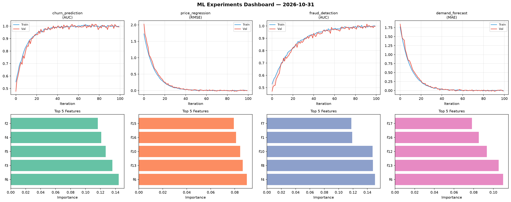
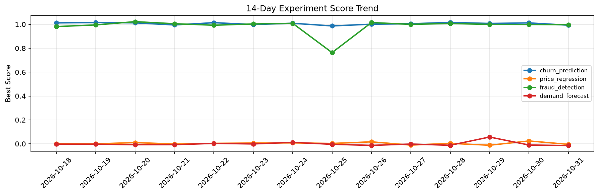

# ML Experiments Report — 2026-10-31

**Run ID:** `47d0767512` | **Experiments:** 4 | **Trials:** 18

## Delta vs Yesterday

| Experiment | Today | Yesterday | Change |
|-----------|-------|-----------|--------|
| churn_prediction | 0.9926 | 1.0117 | 📉 -1.9% |
| price_regression | -0.0046 | 0.0239 | 📉 -119.2% |
| fraud_detection | 0.9971 | 0.9982 | 📉 -0.1% |
| demand_forecast | -0.0144 | -0.0101 | 📉 -42.6% |

## churn_prediction (AUC)

**Best Score:** 0.9926 (Trial 1)

| Trial | Score | Overfit Gap | Time | LR | Trees | Leaves |
|-------|-------|-------------|------|-----|-------|--------|
| 1 ⭐ | 0.9926 | 0.0066 | 271.04s | 0.2 | 1000 | 63 |
| 2 | 0.623 | 0.0432 | 27.3s | 0.01 | 200 | 15 |
| 3 | 0.953 | 0.0032 | 57.05s | 0.05 | 200 | 15 |
| 4 | 0.7144 | 0.0515 | 152.49s | 0.01 | 1000 | 15 |
| 5 | 0.9529 | 0.0021 | 43.42s | 0.05 | 200 | 63 |

## price_regression (RMSE)

**Best Score:** -0.0046 (Trial 3)

| Trial | Score | Overfit Gap | Time | LR | Trees | Leaves |
|-------|-------|-------------|------|-----|-------|--------|
| 1 | 0.0094 | 0.0109 | 59.64s | 0.2 | 200 | 63 |
| 2 | 0.5693 | 0.0957 | 62.08s | 0.01 | 500 | 15 |
| 3 ⭐ | -0.0046 | 0.0089 | 254.32s | 0.2 | 1000 | 31 |
| 4 | 0.1806 | 0.0116 | 26.61s | 0.05 | 100 | 31 |

## fraud_detection (AUC)

**Best Score:** 0.9971 (Trial 1)

| Trial | Score | Overfit Gap | Time | LR | Trees | Leaves |
|-------|-------|-------------|------|-----|-------|--------|
| 1 ⭐ | 0.9971 | 0.0016 | 21.79s | 0.1 | 500 | 31 |
| 2 | 0.6485 | 0.0557 | 154.9s | 0.01 | 1000 | 63 |
| 3 | 0.6699 | 0.0303 | 46.84s | 0.01 | 200 | 15 |

## demand_forecast (MAE)

**Best Score:** -0.0144 (Trial 5)

| Trial | Score | Overfit Gap | Time | LR | Trees | Leaves |
|-------|-------|-------------|------|-----|-------|--------|
| 1 | 0.0109 | 0.0121 | 7.74s | 0.1 | 500 | 15 |
| 2 | 0.0723 | 0.0119 | 73.42s | 0.05 | 500 | 15 |
| 3 | -0.0086 | 0.0057 | 25.42s | 0.2 | 100 | 63 |
| 4 | 0.0177 | 0.0176 | 275.64s | 0.1 | 1000 | 127 |
| 5 ⭐ | -0.0144 | 0.014 | 122.05s | 0.2 | 1000 | 127 |
| 6 | 0.8892 | 0.001 | 22.2s | 0.01 | 100 | 63 |
