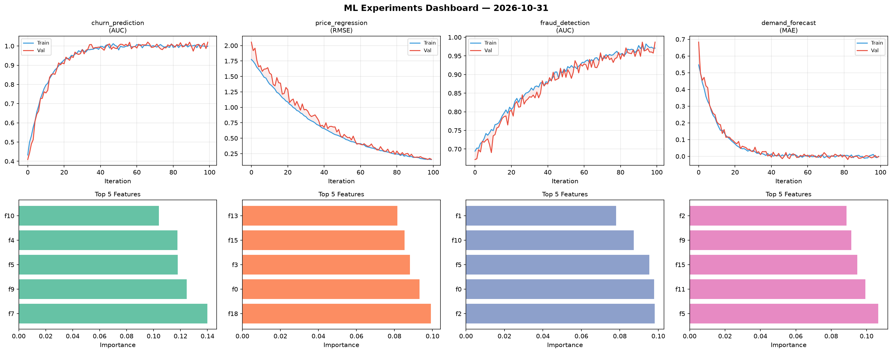
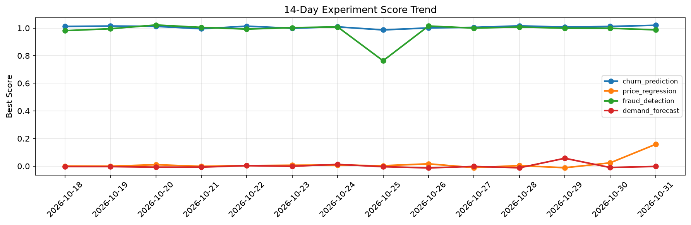

# ML Experiments Report — 2026-10-31

**Run ID:** `c86eac20fe` | **Experiments:** 4 | **Trials:** 17

## Delta vs Yesterday

| Experiment | Today | Yesterday | Change |
|-----------|-------|-----------|--------|
| churn_prediction | 1.0201 | 1.0117 | 📈 0.8% |
| price_regression | 0.158 | 0.0239 | 📈 561.1% |
| fraud_detection | 0.987 | 0.9982 | 📉 -1.1% |
| demand_forecast | -0.0022 | -0.0101 | 📈 78.2% |

## churn_prediction (AUC)

**Best Score:** 1.0201 (Trial 4)

| Trial | Score | Overfit Gap | Time | LR | Trees | Leaves |
|-------|-------|-------------|------|-----|-------|--------|
| 1 | 0.7782 | 0.0231 | 52.08s | 0.01 | 1000 | 63 |
| 2 | 0.9468 | 0.0076 | 71.37s | 0.05 | 500 | 31 |
| 3 | 0.9419 | 0.0252 | 37.42s | 0.05 | 200 | 63 |
| 4 ⭐ | 1.0201 | 0.021 | 43.24s | 0.2 | 200 | 31 |
| 5 | 1.0116 | 0.0105 | 7.74s | 0.1 | 100 | 127 |

## price_regression (RMSE)

**Best Score:** 0.158 (Trial 1)

| Trial | Score | Overfit Gap | Time | LR | Trees | Leaves |
|-------|-------|-------------|------|-----|-------|--------|
| 1 ⭐ | 0.158 | 0.0034 | 162.53s | 0.05 | 1000 | 63 |
| 2 | 0.884 | 0.1503 | 110.0s | 0.01 | 1000 | 127 |
| 3 | 0.6239 | 0.0744 | 119.16s | 0.01 | 1000 | 63 |

## fraud_detection (AUC)

**Best Score:** 0.987 (Trial 3)

| Trial | Score | Overfit Gap | Time | LR | Trees | Leaves |
|-------|-------|-------------|------|-----|-------|--------|
| 1 | 0.9852 | 0.0153 | 83.76s | 0.2 | 1000 | 31 |
| 2 | 0.6687 | 0.0482 | 25.57s | 0.01 | 500 | 15 |
| 3 ⭐ | 0.987 | 0.0162 | 20.04s | 0.05 | 100 | 63 |
| 4 | 0.9736 | 0.0006 | 6.26s | 0.05 | 100 | 15 |
| 5 | 0.5831 | 0.0531 | 111.85s | 0.01 | 1000 | 63 |

## demand_forecast (MAE)

**Best Score:** -0.0022 (Trial 2)

| Trial | Score | Overfit Gap | Time | LR | Trees | Leaves |
|-------|-------|-------------|------|-----|-------|--------|
| 1 | 0.0215 | 0.0087 | 157.84s | 0.1 | 1000 | 127 |
| 2 ⭐ | -0.0022 | 0.0024 | 94.87s | 0.2 | 500 | 63 |
| 3 | 1.2673 | 0.089 | 4.49s | 0.01 | 100 | 127 |
| 4 | 0.0356 | 0.0281 | 95.33s | 0.1 | 500 | 63 |
