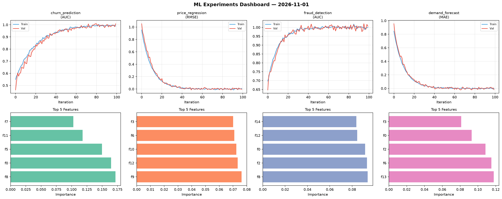
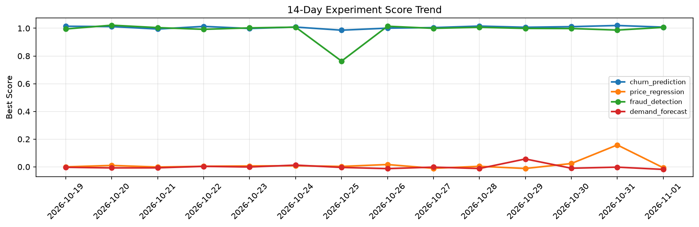

# ML Experiments Report — 2026-11-01

**Run ID:** `9d6617ab1f` | **Experiments:** 4 | **Trials:** 18

## Delta vs Yesterday

| Experiment | Today | Yesterday | Change |
|-----------|-------|-----------|--------|
| churn_prediction | 1.0083 | 1.0201 | 📉 -1.2% |
| price_regression | -0.0064 | 0.158 | 📉 -104.1% |
| fraud_detection | 1.0065 | 0.987 | 📈 2.0% |
| demand_forecast | -0.0186 | -0.0022 | 📉 -745.5% |

## churn_prediction (AUC)

**Best Score:** 1.0083 (Trial 2)

| Trial | Score | Overfit Gap | Time | LR | Trees | Leaves |
|-------|-------|-------------|------|-----|-------|--------|
| 1 | 0.9902 | 0.0182 | 145.46s | 0.1 | 1000 | 31 |
| 2 ⭐ | 1.0083 | 0.019 | 55.93s | 0.1 | 500 | 127 |
| 3 | 0.9849 | 0.0109 | 33.76s | 0.2 | 500 | 63 |

## price_regression (RMSE)

**Best Score:** -0.0064 (Trial 2)

| Trial | Score | Overfit Gap | Time | LR | Trees | Leaves |
|-------|-------|-------------|------|-----|-------|--------|
| 1 | 0.0136 | 0.0043 | 13.65s | 0.1 | 200 | 31 |
| 2 ⭐ | -0.0064 | 0.0169 | 34.21s | 0.2 | 1000 | 15 |
| 3 | 0.1366 | 0.0202 | 88.55s | 0.05 | 1000 | 31 |
| 4 | -0.004 | 0.0039 | 4.97s | 0.2 | 200 | 63 |
| 5 | 0.877 | 0.1572 | 98.65s | 0.01 | 500 | 63 |
| 6 | 0.0176 | 0.0154 | 51.35s | 0.1 | 200 | 31 |

## fraud_detection (AUC)

**Best Score:** 1.0065 (Trial 2)

| Trial | Score | Overfit Gap | Time | LR | Trees | Leaves |
|-------|-------|-------------|------|-----|-------|--------|
| 1 | 0.997 | 0.0016 | 10.92s | 0.1 | 200 | 15 |
| 2 ⭐ | 1.0065 | 0.0072 | 86.85s | 0.2 | 1000 | 63 |
| 3 | 0.9696 | 0.0032 | 171.06s | 0.05 | 1000 | 31 |

## demand_forecast (MAE)

**Best Score:** -0.0186 (Trial 5)

| Trial | Score | Overfit Gap | Time | LR | Trees | Leaves |
|-------|-------|-------------|------|-----|-------|--------|
| 1 | 0.6127 | 0.0364 | 98.66s | 0.01 | 500 | 15 |
| 2 | 0.0675 | 0.0153 | 6.88s | 0.05 | 200 | 31 |
| 3 | 0.0696 | 0.0134 | 15.0s | 0.05 | 100 | 31 |
| 4 | 0.0103 | 0.0051 | 10.54s | 0.2 | 200 | 15 |
| 5 ⭐ | -0.0186 | 0.0204 | 7.94s | 0.2 | 200 | 31 |
| 6 | 0.1334 | 0.0017 | 57.54s | 0.05 | 500 | 127 |
