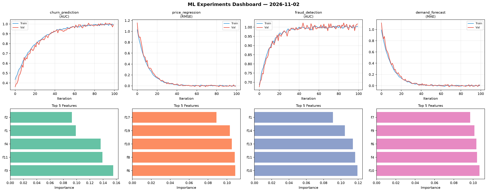
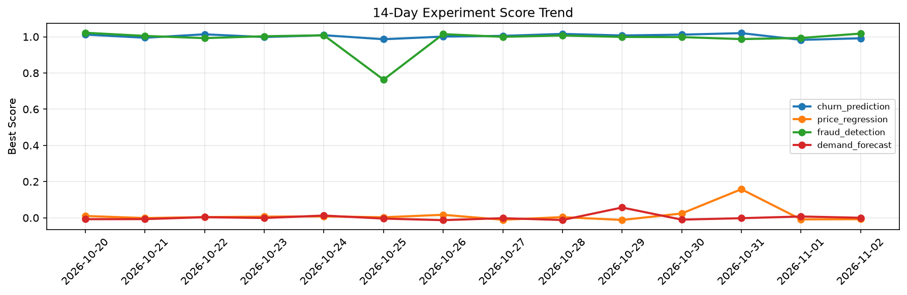

# ML Experiments Report — 2026-11-02

**Run ID:** `bad7eaad80` | **Experiments:** 4 | **Trials:** 22

## Delta vs Yesterday

| Experiment | Today | Yesterday | Change |
|-----------|-------|-----------|--------|
| churn_prediction | 0.9915 | 0.9828 | 📈 0.9% |
| price_regression | -0.0076 | -0.0087 | 📈 12.6% |
| fraud_detection | 1.0176 | 0.9934 | 📈 2.4% |
| demand_forecast | 0.0001 | 0.0073 | 📉 -98.6% |

## churn_prediction (AUC)

**Best Score:** 0.9915 (Trial 2)

| Trial | Score | Overfit Gap | Time | LR | Trees | Leaves |
|-------|-------|-------------|------|-----|-------|--------|
| 1 | 0.6005 | 0.0518 | 24.46s | 0.01 | 100 | 15 |
| 2 ⭐ | 0.9915 | 0.0007 | 219.4s | 0.1 | 1000 | 127 |
| 3 | 0.6762 | 0.0476 | 138.27s | 0.01 | 1000 | 31 |
| 4 | 0.7368 | 0.0047 | 3.1s | 0.01 | 200 | 15 |
| 5 | 0.9489 | 0.0087 | 21.15s | 0.05 | 100 | 63 |
| 6 | 0.7747 | 0.0005 | 43.51s | 0.01 | 200 | 31 |

## price_regression (RMSE)

**Best Score:** -0.0076 (Trial 1)

| Trial | Score | Overfit Gap | Time | LR | Trees | Leaves |
|-------|-------|-------------|------|-----|-------|--------|
| 1 ⭐ | -0.0076 | 0.0081 | 158.16s | 0.2 | 1000 | 15 |
| 2 | 1.1982 | 0.0449 | 32.33s | 0.01 | 500 | 127 |
| 3 | -0.0016 | 0.0014 | 59.2s | 0.2 | 200 | 31 |
| 4 | 0.0068 | 0.0021 | 28.91s | 0.2 | 100 | 127 |
| 5 | 0.9105 | 0.0791 | 268.38s | 0.01 | 1000 | 63 |
| 6 | 0.0359 | 0.0142 | 2.62s | 0.05 | 200 | 31 |

## fraud_detection (AUC)

**Best Score:** 1.0176 (Trial 1)

| Trial | Score | Overfit Gap | Time | LR | Trees | Leaves |
|-------|-------|-------------|------|-----|-------|--------|
| 1 ⭐ | 1.0176 | 0.0137 | 6.85s | 0.2 | 100 | 15 |
| 2 | 0.58 | 0.0568 | 17.74s | 0.01 | 200 | 63 |
| 3 | 1.0005 | 0.0019 | 13.47s | 0.1 | 200 | 63 |
| 4 | 0.9859 | 0.0129 | 47.96s | 0.2 | 500 | 63 |

## demand_forecast (MAE)

**Best Score:** 0.0001 (Trial 6)

| Trial | Score | Overfit Gap | Time | LR | Trees | Leaves |
|-------|-------|-------------|------|-----|-------|--------|
| 1 | 0.1439 | 0.0182 | 118.87s | 0.05 | 500 | 15 |
| 2 | 0.027 | 0.0122 | 127.3s | 0.1 | 500 | 15 |
| 3 | 0.0783 | 0.012 | 29.99s | 0.05 | 100 | 31 |
| 4 | 0.0192 | 0.0183 | 53.49s | 0.1 | 500 | 127 |
| 5 | 1.1579 | 0.1646 | 29.28s | 0.01 | 500 | 31 |
| 6 ⭐ | 0.0001 | 0.0142 | 23.06s | 0.2 | 100 | 31 |
