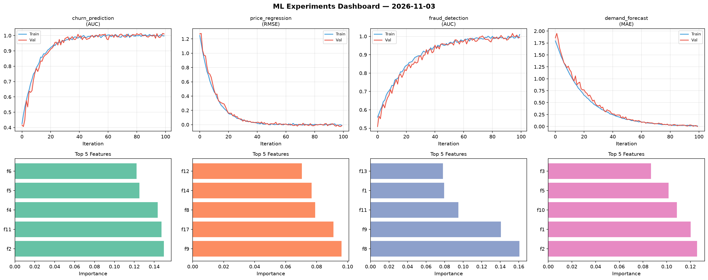
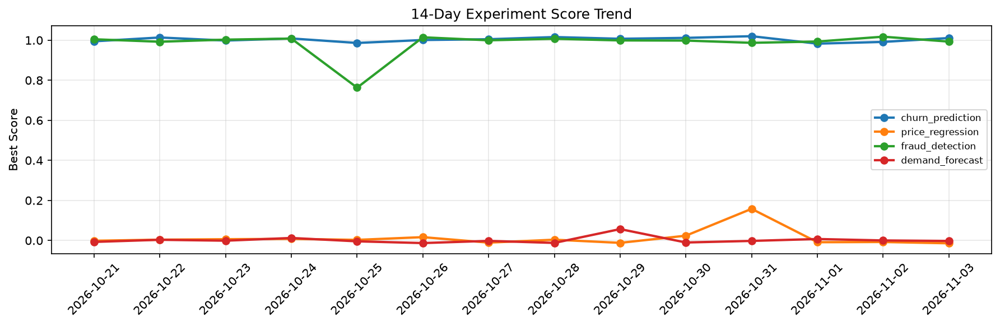

# ML Experiments Report — 2026-11-03

**Run ID:** `0db44ef372` | **Experiments:** 4 | **Trials:** 19

## Delta vs Yesterday

| Experiment | Today | Yesterday | Change |
|-----------|-------|-----------|--------|
| churn_prediction | 1.0109 | 0.9915 | 📈 2.0% |
| price_regression | -0.0141 | -0.0076 | 📉 -85.5% |
| fraud_detection | 0.9931 | 1.0176 | 📉 -2.4% |
| demand_forecast | -0.0024 | 0.0001 | 📉 -250.0% |

## churn_prediction (AUC)

**Best Score:** 1.0109 (Trial 3)

| Trial | Score | Overfit Gap | Time | LR | Trees | Leaves |
|-------|-------|-------------|------|-----|-------|--------|
| 1 | 0.995 | 0.0057 | 258.5s | 0.1 | 1000 | 31 |
| 2 | 0.9967 | 0.008 | 225.51s | 0.1 | 1000 | 127 |
| 3 ⭐ | 1.0109 | 0.0135 | 82.22s | 0.2 | 500 | 127 |
| 4 | 0.9639 | 0.0104 | 48.78s | 0.05 | 200 | 63 |
| 5 | 0.6144 | 0.0197 | 56.08s | 0.01 | 200 | 15 |

## price_regression (RMSE)

**Best Score:** -0.0141 (Trial 4)

| Trial | Score | Overfit Gap | Time | LR | Trees | Leaves |
|-------|-------|-------------|------|-----|-------|--------|
| 1 | -0.0119 | 0.0132 | 24.19s | 0.2 | 100 | 127 |
| 2 | 0.0278 | 0.0199 | 70.84s | 0.1 | 500 | 127 |
| 3 | 0.003 | 0.0087 | 10.11s | 0.2 | 100 | 63 |
| 4 ⭐ | -0.0141 | 0.0034 | 23.47s | 0.2 | 100 | 31 |

## fraud_detection (AUC)

**Best Score:** 0.9931 (Trial 1)

| Trial | Score | Overfit Gap | Time | LR | Trees | Leaves |
|-------|-------|-------------|------|-----|-------|--------|
| 1 ⭐ | 0.9931 | 0.0172 | 6.77s | 0.1 | 100 | 63 |
| 2 | 0.6426 | 0.0383 | 11.98s | 0.01 | 100 | 31 |
| 3 | 0.9582 | 0.0135 | 17.89s | 0.05 | 100 | 63 |
| 4 | 0.6908 | 0.0091 | 11.86s | 0.01 | 500 | 31 |

## demand_forecast (MAE)

**Best Score:** -0.0024 (Trial 4)

| Trial | Score | Overfit Gap | Time | LR | Trees | Leaves |
|-------|-------|-------------|------|-----|-------|--------|
| 1 | 1.234 | 0.0838 | 58.98s | 0.01 | 200 | 31 |
| 2 | 0.9566 | 0.0862 | 19.35s | 0.01 | 100 | 15 |
| 3 | 1.0632 | 0.0407 | 13.86s | 0.01 | 100 | 15 |
| 4 ⭐ | -0.0024 | 0.0144 | 54.53s | 0.1 | 1000 | 63 |
| 5 | 0.1505 | 0.0109 | 52.88s | 0.05 | 200 | 31 |
| 6 | 0.166 | 0.022 | 29.0s | 0.05 | 1000 | 127 |
