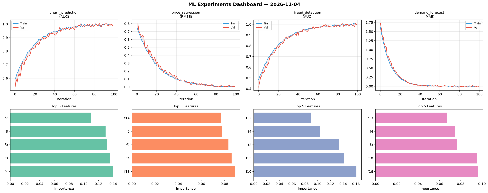
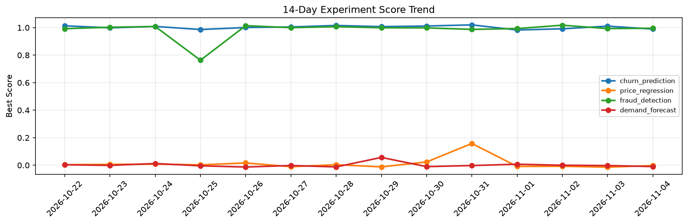

# ML Experiments Report — 2026-11-04

**Run ID:** `17fb49df16` | **Experiments:** 4 | **Trials:** 15

## Delta vs Yesterday

| Experiment | Today | Yesterday | Change |
|-----------|-------|-----------|--------|
| churn_prediction | 0.9898 | 1.0109 | 📉 -2.1% |
| price_regression | -0.0024 | -0.0141 | 📈 83.0% |
| fraud_detection | 0.9956 | 0.9931 | 📈 0.3% |
| demand_forecast | -0.0098 | -0.0024 | 📉 -308.3% |

## churn_prediction (AUC)

**Best Score:** 0.9898 (Trial 2)

| Trial | Score | Overfit Gap | Time | LR | Trees | Leaves |
|-------|-------|-------------|------|-----|-------|--------|
| 1 | 0.7247 | 0.0411 | 158.21s | 0.01 | 1000 | 63 |
| 2 ⭐ | 0.9898 | 0.0122 | 55.06s | 0.1 | 500 | 63 |
| 3 | 0.7204 | 0.0431 | 29.05s | 0.01 | 200 | 15 |
| 4 | 0.9732 | 0.0015 | 16.14s | 0.05 | 200 | 15 |
| 5 | 0.957 | 0.0033 | 80.68s | 0.05 | 500 | 31 |

## price_regression (RMSE)

**Best Score:** -0.0024 (Trial 1)

| Trial | Score | Overfit Gap | Time | LR | Trees | Leaves |
|-------|-------|-------------|------|-----|-------|--------|
| 1 ⭐ | -0.0024 | 0.0079 | 4.94s | 0.1 | 500 | 31 |
| 2 | 0.1358 | 0.0264 | 253.14s | 0.05 | 1000 | 31 |
| 3 | 0.0172 | 0.0021 | 40.89s | 0.1 | 1000 | 31 |

## fraud_detection (AUC)

**Best Score:** 0.9956 (Trial 3)

| Trial | Score | Overfit Gap | Time | LR | Trees | Leaves |
|-------|-------|-------------|------|-----|-------|--------|
| 1 | 0.9345 | 0.0254 | 25.87s | 0.05 | 100 | 31 |
| 2 | 0.7026 | 0.0069 | 179.49s | 0.01 | 1000 | 127 |
| 3 ⭐ | 0.9956 | 0.0067 | 26.78s | 0.1 | 1000 | 127 |

## demand_forecast (MAE)

**Best Score:** -0.0098 (Trial 2)

| Trial | Score | Overfit Gap | Time | LR | Trees | Leaves |
|-------|-------|-------------|------|-----|-------|--------|
| 1 | 0.1058 | 0.0048 | 102.65s | 0.05 | 500 | 127 |
| 2 ⭐ | -0.0098 | 0.0133 | 131.58s | 0.2 | 500 | 63 |
| 3 | 0.0058 | 0.0085 | 119.51s | 0.2 | 500 | 15 |
| 4 | 0.0012 | 0.0033 | 17.63s | 0.2 | 100 | 15 |
