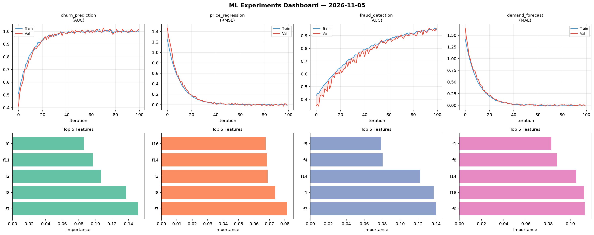
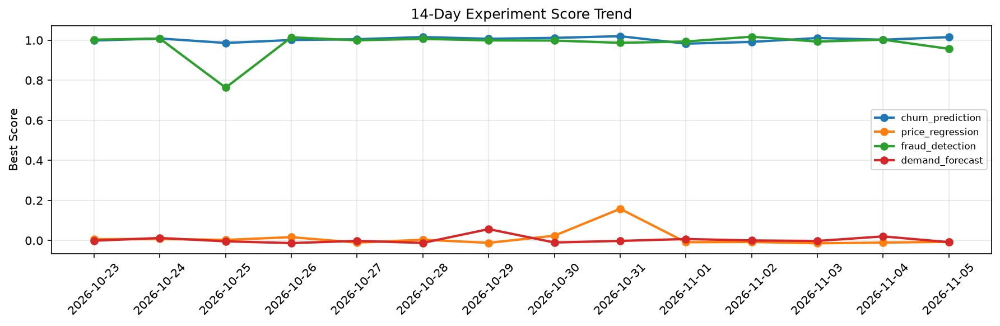

# ML Experiments Report — 2026-11-05

**Run ID:** `2881b82d85` | **Experiments:** 4 | **Trials:** 20

## Delta vs Yesterday

| Experiment | Today | Yesterday | Change |
|-----------|-------|-----------|--------|
| churn_prediction | 1.0155 | 1.0026 | 📈 1.3% |
| price_regression | -0.0068 | -0.0105 | 📈 35.2% |
| fraud_detection | 0.9569 | 1.0028 | 📉 -4.6% |
| demand_forecast | -0.0083 | 0.0203 | 📉 -140.9% |

## churn_prediction (AUC)

**Best Score:** 1.0155 (Trial 5)

| Trial | Score | Overfit Gap | Time | LR | Trees | Leaves |
|-------|-------|-------------|------|-----|-------|--------|
| 1 | 1.011 | 0.0024 | 82.1s | 0.1 | 500 | 31 |
| 2 | 0.9609 | 0.0002 | 178.44s | 0.05 | 1000 | 63 |
| 3 | 0.9842 | 0.005 | 25.77s | 0.1 | 200 | 31 |
| 4 | 0.951 | 0.013 | 137.66s | 0.05 | 500 | 127 |
| 5 ⭐ | 1.0155 | 0.0183 | 41.14s | 0.2 | 200 | 63 |
| 6 | 0.9671 | 0.0209 | 6.21s | 0.05 | 500 | 15 |

## price_regression (RMSE)

**Best Score:** -0.0068 (Trial 4)

| Trial | Score | Overfit Gap | Time | LR | Trees | Leaves |
|-------|-------|-------------|------|-----|-------|--------|
| 1 | 0.1175 | 0.0253 | 22.55s | 0.05 | 100 | 31 |
| 2 | 0.153 | 0.0014 | 8.08s | 0.05 | 200 | 127 |
| 3 | 0.0486 | 0.0066 | 6.62s | 0.05 | 100 | 31 |
| 4 ⭐ | -0.0068 | 0.0023 | 69.54s | 0.2 | 500 | 127 |
| 5 | 1.0115 | 0.1083 | 26.06s | 0.01 | 100 | 31 |

## fraud_detection (AUC)

**Best Score:** 0.9569 (Trial 1)

| Trial | Score | Overfit Gap | Time | LR | Trees | Leaves |
|-------|-------|-------------|------|-----|-------|--------|
| 1 ⭐ | 0.9569 | 0.0085 | 2.67s | 0.05 | 100 | 127 |
| 2 | 0.9525 | 0.0065 | 176.7s | 0.05 | 1000 | 31 |
| 3 | 0.6535 | 0.027 | 121.18s | 0.01 | 1000 | 31 |

## demand_forecast (MAE)

**Best Score:** -0.0083 (Trial 5)

| Trial | Score | Overfit Gap | Time | LR | Trees | Leaves |
|-------|-------|-------------|------|-----|-------|--------|
| 1 | 1.2593 | 0.1924 | 102.44s | 0.01 | 500 | 63 |
| 2 | 0.1628 | 0.0029 | 132.35s | 0.05 | 1000 | 127 |
| 3 | -0.0001 | 0.0002 | 28.52s | 0.2 | 100 | 63 |
| 4 | 0.012 | 0.0112 | 46.31s | 0.2 | 500 | 63 |
| 5 ⭐ | -0.0083 | 0.0085 | 166.83s | 0.2 | 1000 | 63 |
| 6 | 0.0154 | 0.0044 | 19.28s | 0.1 | 100 | 63 |
