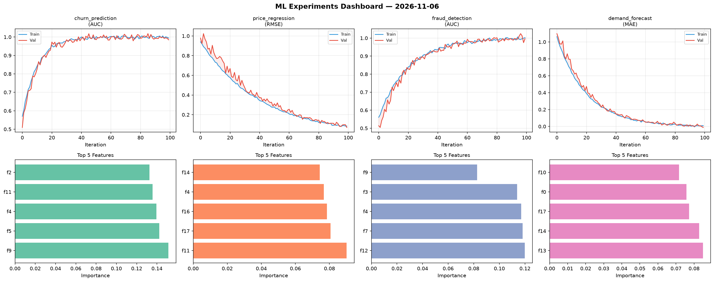
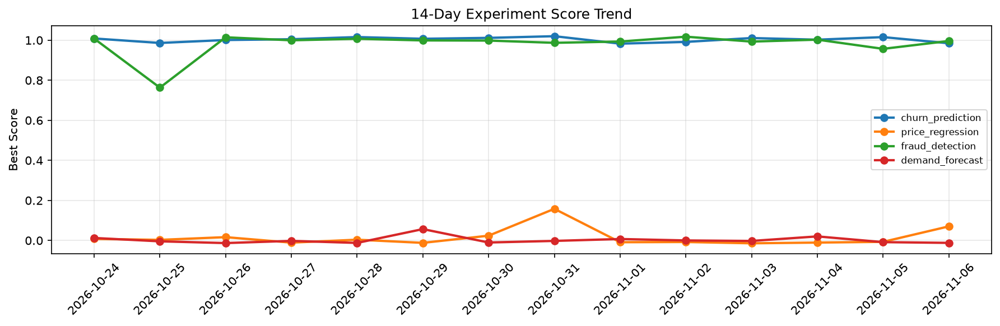

# ML Experiments Report — 2026-11-06

**Run ID:** `7763039d28` | **Experiments:** 4 | **Trials:** 15

## Delta vs Yesterday

| Experiment | Today | Yesterday | Change |
|-----------|-------|-----------|--------|
| churn_prediction | 0.9847 | 1.0155 | 📉 -3.0% |
| price_regression | 0.0704 | -0.0068 | 📈 1135.3% |
| fraud_detection | 0.9961 | 0.9569 | 📈 4.1% |
| demand_forecast | -0.012 | -0.0083 | 📉 -44.6% |

## churn_prediction (AUC)

**Best Score:** 0.9847 (Trial 3)

| Trial | Score | Overfit Gap | Time | LR | Trees | Leaves |
|-------|-------|-------------|------|-----|-------|--------|
| 1 | 0.9722 | 0.0 | 134.7s | 0.05 | 1000 | 31 |
| 2 | 0.7748 | 0.0372 | 270.48s | 0.01 | 1000 | 63 |
| 3 ⭐ | 0.9847 | 0.0097 | 55.43s | 0.2 | 500 | 127 |

## price_regression (RMSE)

**Best Score:** 0.0704 (Trial 4)

| Trial | Score | Overfit Gap | Time | LR | Trees | Leaves |
|-------|-------|-------------|------|-----|-------|--------|
| 1 | 1.1696 | 0.1963 | 19.72s | 0.01 | 500 | 15 |
| 2 | 0.1192 | 0.0014 | 22.2s | 0.05 | 500 | 31 |
| 3 | 0.879 | 0.0473 | 10.39s | 0.01 | 100 | 127 |
| 4 ⭐ | 0.0704 | 0.0143 | 53.89s | 0.05 | 1000 | 63 |
| 5 | 0.1114 | 0.0195 | 16.91s | 0.05 | 100 | 31 |
| 6 | 1.1317 | 0.1335 | 18.42s | 0.01 | 200 | 127 |

## fraud_detection (AUC)

**Best Score:** 0.9961 (Trial 3)

| Trial | Score | Overfit Gap | Time | LR | Trees | Leaves |
|-------|-------|-------------|------|-----|-------|--------|
| 1 | 0.9853 | 0.0174 | 88.33s | 0.2 | 1000 | 15 |
| 2 | 0.9948 | 0.004 | 25.41s | 0.1 | 200 | 15 |
| 3 ⭐ | 0.9961 | 0.0063 | 34.35s | 0.1 | 200 | 127 |

## demand_forecast (MAE)

**Best Score:** -0.012 (Trial 3)

| Trial | Score | Overfit Gap | Time | LR | Trees | Leaves |
|-------|-------|-------------|------|-----|-------|--------|
| 1 | 0.3302 | 0.0229 | 196.63s | 0.01 | 1000 | 31 |
| 2 | 0.1124 | 0.008 | 44.42s | 0.05 | 200 | 15 |
| 3 ⭐ | -0.012 | 0.0214 | 36.24s | 0.1 | 1000 | 31 |
