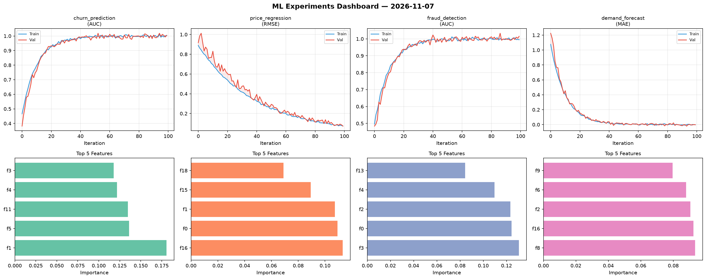
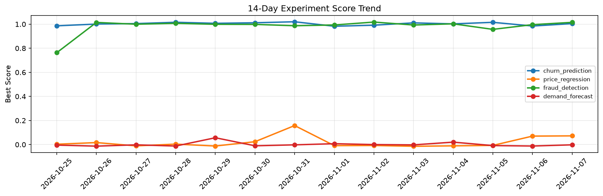

# ML Experiments Report — 2026-11-07

**Run ID:** `d17113144e` | **Experiments:** 4 | **Trials:** 17

## Delta vs Yesterday

| Experiment | Today | Yesterday | Change |
|-----------|-------|-----------|--------|
| churn_prediction | 1.0048 | 0.9847 | 📈 2.0% |
| price_regression | 0.0724 | 0.0704 | 📈 2.8% |
| fraud_detection | 1.0151 | 0.9961 | 📈 1.9% |
| demand_forecast | -0.002 | -0.012 | 📈 83.3% |

## churn_prediction (AUC)

**Best Score:** 1.0048 (Trial 6)

| Trial | Score | Overfit Gap | Time | LR | Trees | Leaves |
|-------|-------|-------------|------|-----|-------|--------|
| 1 | 0.9409 | 0.0244 | 4.69s | 0.05 | 200 | 63 |
| 2 | 0.986 | 0.0139 | 7.88s | 0.2 | 200 | 127 |
| 3 | 0.6074 | 0.0544 | 70.4s | 0.01 | 500 | 31 |
| 4 | 0.9965 | 0.0029 | 16.34s | 0.1 | 100 | 127 |
| 5 | 1.0008 | 0.0024 | 229.84s | 0.2 | 1000 | 31 |
| 6 ⭐ | 1.0048 | 0.0022 | 94.84s | 0.2 | 1000 | 15 |

## price_regression (RMSE)

**Best Score:** 0.0724 (Trial 2)

| Trial | Score | Overfit Gap | Time | LR | Trees | Leaves |
|-------|-------|-------------|------|-----|-------|--------|
| 1 | 0.1107 | 0.0075 | 263.04s | 0.05 | 1000 | 63 |
| 2 ⭐ | 0.0724 | 0.001 | 21.14s | 0.05 | 200 | 63 |
| 3 | 0.1083 | 0.0168 | 41.69s | 0.05 | 200 | 63 |
| 4 | 0.141 | 0.0021 | 15.4s | 0.05 | 200 | 127 |
| 5 | 1.0034 | 0.1515 | 35.12s | 0.01 | 200 | 127 |

## fraud_detection (AUC)

**Best Score:** 1.0151 (Trial 3)

| Trial | Score | Overfit Gap | Time | LR | Trees | Leaves |
|-------|-------|-------------|------|-----|-------|--------|
| 1 | 1.0107 | 0.0077 | 25.22s | 0.2 | 100 | 31 |
| 2 | 1.0072 | 0.0101 | 145.64s | 0.2 | 1000 | 127 |
| 3 ⭐ | 1.0151 | 0.0201 | 9.76s | 0.2 | 100 | 127 |

## demand_forecast (MAE)

**Best Score:** -0.002 (Trial 2)

| Trial | Score | Overfit Gap | Time | LR | Trees | Leaves |
|-------|-------|-------------|------|-----|-------|--------|
| 1 | 0.0095 | 0.0099 | 9.21s | 0.1 | 100 | 15 |
| 2 ⭐ | -0.002 | 0.0005 | 13.33s | 0.2 | 500 | 63 |
| 3 | 0.1699 | 0.0085 | 32.65s | 0.05 | 500 | 15 |
