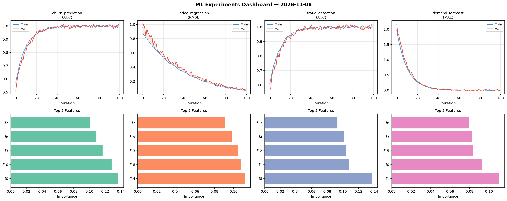
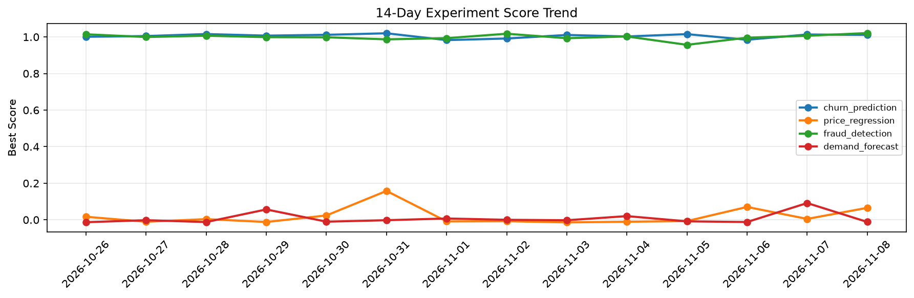

# ML Experiments Report — 2026-11-08

**Run ID:** `5331f67c61` | **Experiments:** 4 | **Trials:** 21

## Delta vs Yesterday

| Experiment | Today | Yesterday | Change |
|-----------|-------|-----------|--------|
| churn_prediction | 1.0113 | 1.0134 | 📉 -0.2% |
| price_regression | 0.0655 | 0.005 | 📈 1210.0% |
| fraud_detection | 1.0212 | 1.0065 | 📈 1.5% |
| demand_forecast | -0.0116 | 0.0917 | 📉 -112.6% |

## churn_prediction (AUC)

**Best Score:** 1.0113 (Trial 2)

| Trial | Score | Overfit Gap | Time | LR | Trees | Leaves |
|-------|-------|-------------|------|-----|-------|--------|
| 1 | 0.9983 | 0.0009 | 151.43s | 0.2 | 1000 | 31 |
| 2 ⭐ | 1.0113 | 0.0118 | 102.59s | 0.2 | 1000 | 63 |
| 3 | 0.9353 | 0.0133 | 3.79s | 0.05 | 100 | 63 |
| 4 | 0.9877 | 0.0165 | 0.95s | 0.1 | 100 | 127 |

## price_regression (RMSE)

**Best Score:** 0.0655 (Trial 4)

| Trial | Score | Overfit Gap | Time | LR | Trees | Leaves |
|-------|-------|-------------|------|-----|-------|--------|
| 1 | 0.5781 | 0.0526 | 241.43s | 0.01 | 1000 | 127 |
| 2 | 0.0782 | 0.0243 | 247.3s | 0.05 | 1000 | 31 |
| 3 | 0.6397 | 0.0124 | 104.77s | 0.01 | 1000 | 63 |
| 4 ⭐ | 0.0655 | 0.0147 | 15.21s | 0.05 | 200 | 63 |
| 5 | 1.3687 | 0.2133 | 184.19s | 0.01 | 1000 | 63 |

## fraud_detection (AUC)

**Best Score:** 1.0212 (Trial 3)

| Trial | Score | Overfit Gap | Time | LR | Trees | Leaves |
|-------|-------|-------------|------|-----|-------|--------|
| 1 | 0.956 | 0.0032 | 22.08s | 0.05 | 100 | 15 |
| 2 | 0.7696 | 0.0344 | 29.38s | 0.01 | 200 | 15 |
| 3 ⭐ | 1.0212 | 0.0205 | 59.28s | 0.2 | 200 | 31 |
| 4 | 0.9341 | 0.0248 | 46.36s | 0.05 | 500 | 15 |
| 5 | 0.9982 | 0.0017 | 6.08s | 0.1 | 1000 | 31 |
| 6 | 0.9716 | 0.0109 | 9.77s | 0.05 | 1000 | 31 |

## demand_forecast (MAE)

**Best Score:** -0.0116 (Trial 1)

| Trial | Score | Overfit Gap | Time | LR | Trees | Leaves |
|-------|-------|-------------|------|-----|-------|--------|
| 1 ⭐ | -0.0116 | 0.011 | 104.32s | 0.2 | 500 | 31 |
| 2 | 0.1042 | 0.0157 | 285.19s | 0.05 | 1000 | 15 |
| 3 | 0.016 | 0.0008 | 122.93s | 0.1 | 1000 | 15 |
| 4 | -0.0023 | 0.0113 | 26.08s | 0.2 | 500 | 31 |
| 5 | 0.0173 | 0.011 | 23.47s | 0.1 | 100 | 15 |
| 6 | 0.0247 | 0.0115 | 231.7s | 0.1 | 1000 | 15 |
