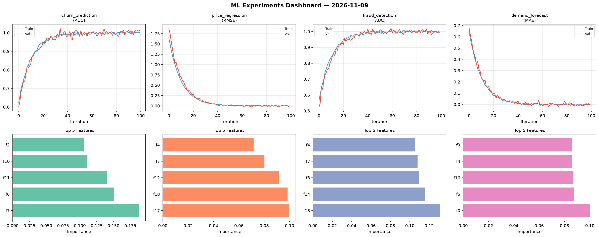
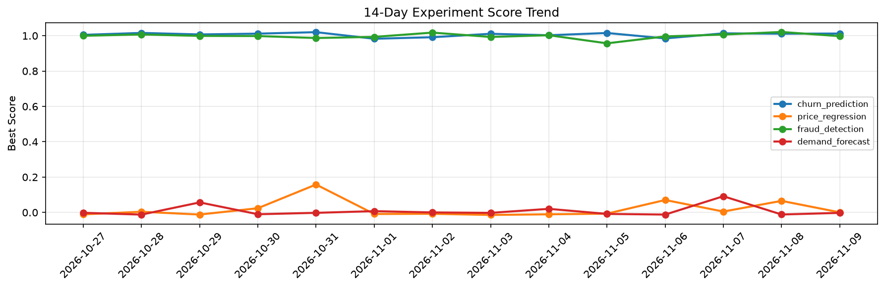

# ML Experiments Report — 2026-11-09

**Run ID:** `8193fa6233` | **Experiments:** 4 | **Trials:** 16

## Delta vs Yesterday

| Experiment | Today | Yesterday | Change |
|-----------|-------|-----------|--------|
| churn_prediction | 1.0123 | 1.0113 | 📈 0.1% |
| price_regression | 0.0005 | 0.0655 | 📉 -99.2% |
| fraud_detection | 0.9975 | 1.0212 | 📉 -2.3% |
| demand_forecast | -0.0025 | -0.0116 | 📈 78.4% |

## churn_prediction (AUC)

**Best Score:** 1.0123 (Trial 3)

| Trial | Score | Overfit Gap | Time | LR | Trees | Leaves |
|-------|-------|-------------|------|-----|-------|--------|
| 1 | 0.9931 | 0.0098 | 49.49s | 0.1 | 200 | 15 |
| 2 | 0.7756 | 0.0123 | 143.26s | 0.01 | 500 | 31 |
| 3 ⭐ | 1.0123 | 0.0109 | 2.06s | 0.2 | 100 | 15 |
| 4 | 0.9874 | 0.0107 | 26.86s | 0.1 | 100 | 127 |

## price_regression (RMSE)

**Best Score:** 0.0005 (Trial 2)

| Trial | Score | Overfit Gap | Time | LR | Trees | Leaves |
|-------|-------|-------------|------|-----|-------|--------|
| 1 | 0.0028 | 0.0097 | 16.54s | 0.2 | 100 | 63 |
| 2 ⭐ | 0.0005 | 0.001 | 146.58s | 0.2 | 1000 | 63 |
| 3 | 0.009 | 0.0101 | 41.49s | 0.2 | 200 | 127 |

## fraud_detection (AUC)

**Best Score:** 0.9975 (Trial 3)

| Trial | Score | Overfit Gap | Time | LR | Trees | Leaves |
|-------|-------|-------------|------|-----|-------|--------|
| 1 | 0.9659 | 0.0068 | 166.39s | 0.05 | 1000 | 63 |
| 2 | 0.9716 | 0.0017 | 23.8s | 0.05 | 100 | 15 |
| 3 ⭐ | 0.9975 | 0.0057 | 28.46s | 0.2 | 200 | 63 |

## demand_forecast (MAE)

**Best Score:** -0.0025 (Trial 1)

| Trial | Score | Overfit Gap | Time | LR | Trees | Leaves |
|-------|-------|-------------|------|-----|-------|--------|
| 1 ⭐ | -0.0025 | 0.0025 | 277.19s | 0.2 | 1000 | 31 |
| 2 | 0.0104 | 0.0004 | 43.1s | 0.1 | 500 | 127 |
| 3 | -0.0009 | 0.0135 | 70.73s | 0.1 | 500 | 15 |
| 4 | 0.0115 | 0.001 | 20.64s | 0.1 | 100 | 31 |
| 5 | 0.3096 | 0.0107 | 148.93s | 0.01 | 500 | 15 |
| 6 | 1.0482 | 0.1148 | 20.34s | 0.01 | 100 | 15 |
