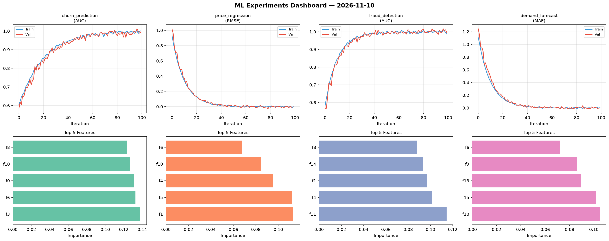
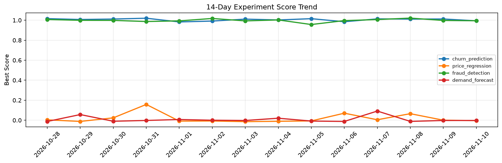

# ML Experiments Report — 2026-11-10

**Run ID:** `3e0b704db5` | **Experiments:** 4 | **Trials:** 18

## Delta vs Yesterday

| Experiment | Today | Yesterday | Change |
|-----------|-------|-----------|--------|
| churn_prediction | 0.9939 | 1.0123 | 📉 -1.8% |
| price_regression | -0.0036 | 0.0005 | 📉 -410.0% |
| fraud_detection | 0.9946 | 0.9975 | 📉 -0.3% |
| demand_forecast | -0.0023 | -0.0025 | 📈 8.0% |

## churn_prediction (AUC)

**Best Score:** 0.9939 (Trial 3)

| Trial | Score | Overfit Gap | Time | LR | Trees | Leaves |
|-------|-------|-------------|------|-----|-------|--------|
| 1 | 0.9916 | 0.009 | 24.9s | 0.2 | 200 | 127 |
| 2 | 0.6658 | 0.0093 | 51.28s | 0.01 | 200 | 15 |
| 3 ⭐ | 0.9939 | 0.0073 | 97.61s | 0.1 | 500 | 127 |
| 4 | 0.6297 | 0.0032 | 139.62s | 0.01 | 500 | 127 |

## price_regression (RMSE)

**Best Score:** -0.0036 (Trial 1)

| Trial | Score | Overfit Gap | Time | LR | Trees | Leaves |
|-------|-------|-------------|------|-----|-------|--------|
| 1 ⭐ | -0.0036 | 0.003 | 28.29s | 0.2 | 200 | 63 |
| 2 | 0.0072 | 0.0061 | 13.32s | 0.2 | 100 | 127 |
| 3 | 0.0099 | 0.0113 | 25.48s | 0.2 | 1000 | 63 |
| 4 | 0.4129 | 0.0344 | 5.02s | 0.01 | 200 | 15 |
| 5 | 0.0002 | 0.01 | 63.05s | 0.2 | 1000 | 127 |
| 6 | 0.0217 | 0.0133 | 29.61s | 0.1 | 100 | 127 |

## fraud_detection (AUC)

**Best Score:** 0.9946 (Trial 4)

| Trial | Score | Overfit Gap | Time | LR | Trees | Leaves |
|-------|-------|-------------|------|-----|-------|--------|
| 1 | 0.9393 | 0.0138 | 39.38s | 0.05 | 200 | 127 |
| 2 | 0.9931 | 0.0001 | 227.27s | 0.1 | 1000 | 63 |
| 3 | 0.9846 | 0.0109 | 144.46s | 0.1 | 500 | 15 |
| 4 ⭐ | 0.9946 | 0.008 | 20.15s | 0.2 | 200 | 63 |
| 5 | 0.9611 | 0.0001 | 24.31s | 0.05 | 100 | 31 |

## demand_forecast (MAE)

**Best Score:** -0.0023 (Trial 2)

| Trial | Score | Overfit Gap | Time | LR | Trees | Leaves |
|-------|-------|-------------|------|-----|-------|--------|
| 1 | 0.1306 | 0.0061 | 21.32s | 0.05 | 100 | 31 |
| 2 ⭐ | -0.0023 | 0.007 | 16.26s | 0.2 | 100 | 31 |
| 3 | 0.1204 | 0.0159 | 201.66s | 0.05 | 1000 | 15 |
