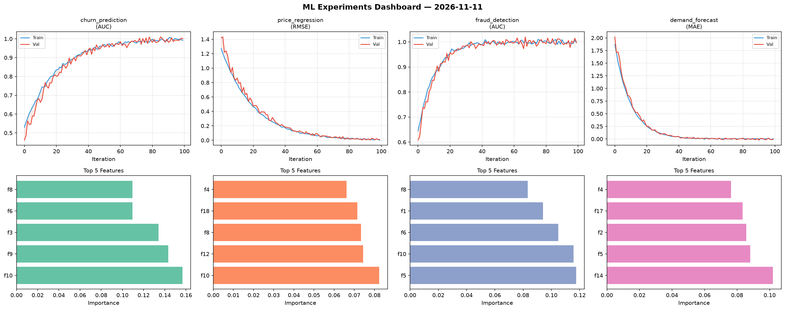
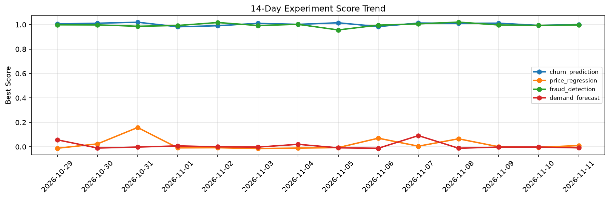

# ML Experiments Report — 2026-11-11

**Run ID:** `75d1ba2653` | **Experiments:** 4 | **Trials:** 17

## Delta vs Yesterday

| Experiment | Today | Yesterday | Change |
|-----------|-------|-----------|--------|
| churn_prediction | 1.0018 | 0.9939 | 📈 0.8% |
| price_regression | 0.0098 | -0.0036 | 📈 372.2% |
| fraud_detection | 0.9974 | 0.9946 | 📈 0.3% |
| demand_forecast | -0.0085 | -0.0023 | 📉 -269.6% |

## churn_prediction (AUC)

**Best Score:** 1.0018 (Trial 2)

| Trial | Score | Overfit Gap | Time | LR | Trees | Leaves |
|-------|-------|-------------|------|-----|-------|--------|
| 1 | 0.9857 | 0.0058 | 20.28s | 0.1 | 100 | 127 |
| 2 ⭐ | 1.0018 | 0.0092 | 81.37s | 0.1 | 500 | 127 |
| 3 | 0.9411 | 0.0143 | 5.36s | 0.05 | 100 | 127 |

## price_regression (RMSE)

**Best Score:** 0.0098 (Trial 5)

| Trial | Score | Overfit Gap | Time | LR | Trees | Leaves |
|-------|-------|-------------|------|-----|-------|--------|
| 1 | 0.4847 | 0.0795 | 12.31s | 0.01 | 200 | 15 |
| 2 | 0.0206 | 0.0189 | 20.86s | 0.2 | 100 | 31 |
| 3 | 1.114 | 0.1264 | 163.22s | 0.01 | 1000 | 127 |
| 4 | 0.439 | 0.0387 | 39.49s | 0.01 | 500 | 15 |
| 5 ⭐ | 0.0098 | 0.0067 | 18.02s | 0.1 | 200 | 127 |
| 6 | 0.0126 | 0.0016 | 54.74s | 0.1 | 200 | 15 |

## fraud_detection (AUC)

**Best Score:** 0.9974 (Trial 3)

| Trial | Score | Overfit Gap | Time | LR | Trees | Leaves |
|-------|-------|-------------|------|-----|-------|--------|
| 1 | 0.678 | 0.0151 | 200.2s | 0.01 | 1000 | 15 |
| 2 | 0.7342 | 0.0286 | 297.16s | 0.01 | 1000 | 63 |
| 3 ⭐ | 0.9974 | 0.0007 | 266.39s | 0.2 | 1000 | 15 |

## demand_forecast (MAE)

**Best Score:** -0.0085 (Trial 2)

| Trial | Score | Overfit Gap | Time | LR | Trees | Leaves |
|-------|-------|-------------|------|-----|-------|--------|
| 1 | 0.1545 | 0.0313 | 101.95s | 0.05 | 500 | 63 |
| 2 ⭐ | -0.0085 | 0.0138 | 59.72s | 0.2 | 500 | 15 |
| 3 | 0.7916 | 0.1348 | 9.13s | 0.01 | 100 | 127 |
| 4 | -0.0077 | 0.0099 | 3.91s | 0.2 | 100 | 31 |
| 5 | 1.0924 | 0.1707 | 17.97s | 0.01 | 200 | 31 |
