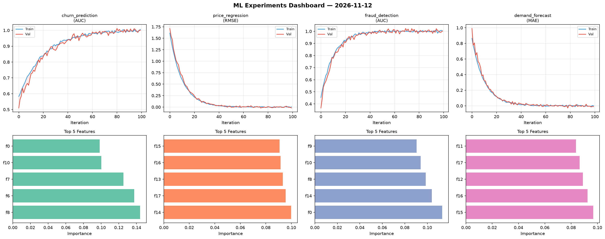
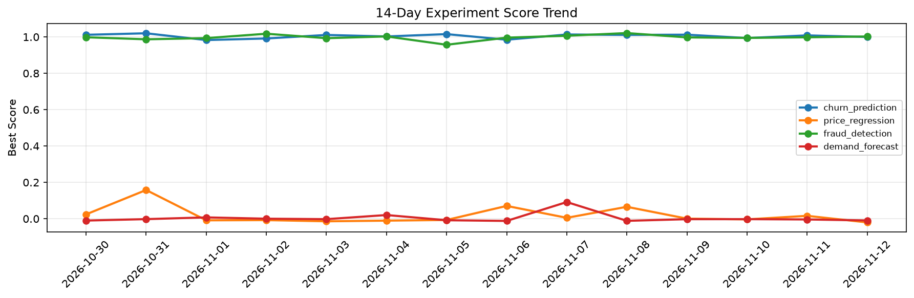

# ML Experiments Report — 2026-11-12

**Run ID:** `fbe4ff6c0c` | **Experiments:** 4 | **Trials:** 21

## Delta vs Yesterday

| Experiment | Today | Yesterday | Change |
|-----------|-------|-----------|--------|
| churn_prediction | 0.9997 | 1.0085 | 📉 -0.9% |
| price_regression | -0.0202 | 0.0159 | 📉 -227.0% |
| fraud_detection | 1.0025 | 0.9981 | 📈 0.4% |
| demand_forecast | -0.0094 | -0.004 | 📉 -135.0% |

## churn_prediction (AUC)

**Best Score:** 0.9997 (Trial 5)

| Trial | Score | Overfit Gap | Time | LR | Trees | Leaves |
|-------|-------|-------------|------|-----|-------|--------|
| 1 | 0.9914 | 0.0061 | 107.25s | 0.2 | 500 | 127 |
| 2 | 0.9611 | 0.0116 | 24.6s | 0.05 | 100 | 31 |
| 3 | 0.9584 | 0.0025 | 53.08s | 0.05 | 200 | 127 |
| 4 | 0.637 | 0.006 | 286.08s | 0.01 | 1000 | 31 |
| 5 ⭐ | 0.9997 | 0.0064 | 85.88s | 0.1 | 500 | 63 |

## price_regression (RMSE)

**Best Score:** -0.0202 (Trial 3)

| Trial | Score | Overfit Gap | Time | LR | Trees | Leaves |
|-------|-------|-------------|------|-----|-------|--------|
| 1 | 0.1354 | 0.0158 | 45.35s | 0.05 | 200 | 63 |
| 2 | -0.0021 | 0.0069 | 26.34s | 0.1 | 200 | 63 |
| 3 ⭐ | -0.0202 | 0.0242 | 12.67s | 0.2 | 100 | 127 |
| 4 | 0.0102 | 0.0109 | 6.7s | 0.2 | 100 | 127 |
| 5 | 0.0142 | 0.0147 | 22.44s | 0.1 | 200 | 63 |
| 6 | -0.0063 | 0.0056 | 142.78s | 0.2 | 500 | 31 |

## fraud_detection (AUC)

**Best Score:** 1.0025 (Trial 3)

| Trial | Score | Overfit Gap | Time | LR | Trees | Leaves |
|-------|-------|-------------|------|-----|-------|--------|
| 1 | 0.6047 | 0.0318 | 16.91s | 0.01 | 100 | 63 |
| 2 | 1.0013 | 0.0054 | 5.49s | 0.2 | 100 | 31 |
| 3 ⭐ | 1.0025 | 0.0014 | 51.0s | 0.2 | 200 | 15 |
| 4 | 0.9991 | 0.0025 | 4.9s | 0.2 | 100 | 31 |

## demand_forecast (MAE)

**Best Score:** -0.0094 (Trial 6)

| Trial | Score | Overfit Gap | Time | LR | Trees | Leaves |
|-------|-------|-------------|------|-----|-------|--------|
| 1 | 0.0079 | 0.0063 | 58.69s | 0.2 | 200 | 127 |
| 2 | 0.0051 | 0.003 | 28.46s | 0.1 | 200 | 15 |
| 3 | 0.0106 | 0.0183 | 279.14s | 0.2 | 1000 | 63 |
| 4 | 0.9929 | 0.0354 | 83.75s | 0.01 | 500 | 31 |
| 5 | 0.9649 | 0.0104 | 26.76s | 0.01 | 200 | 31 |
| 6 ⭐ | -0.0094 | 0.0107 | 16.17s | 0.2 | 100 | 31 |
