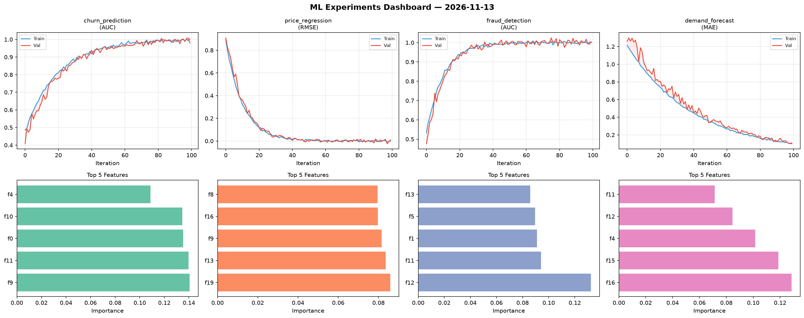
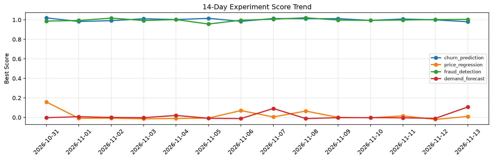

# ML Experiments Report — 2026-11-13

**Run ID:** `2755f8946e` | **Experiments:** 4 | **Trials:** 16

## Delta vs Yesterday

| Experiment | Today | Yesterday | Change |
|-----------|-------|-----------|--------|
| churn_prediction | 0.9803 | 0.9997 | 📉 -1.9% |
| price_regression | 0.0102 | -0.0202 | 📈 150.5% |
| fraud_detection | 1.0046 | 1.0025 | 📈 0.2% |
| demand_forecast | 0.1073 | -0.0094 | 📈 1241.5% |

## churn_prediction (AUC)

**Best Score:** 0.9803 (Trial 1)

| Trial | Score | Overfit Gap | Time | LR | Trees | Leaves |
|-------|-------|-------------|------|-----|-------|--------|
| 1 ⭐ | 0.9803 | 0.0227 | 103.59s | 0.1 | 1000 | 15 |
| 2 | 0.9569 | 0.0067 | 29.88s | 0.05 | 200 | 31 |
| 3 | 0.9617 | 0.0046 | 4.31s | 0.05 | 100 | 31 |
| 4 | 0.9786 | 0.0176 | 37.59s | 0.05 | 1000 | 31 |

## price_regression (RMSE)

**Best Score:** 0.0102 (Trial 4)

| Trial | Score | Overfit Gap | Time | LR | Trees | Leaves |
|-------|-------|-------------|------|-----|-------|--------|
| 1 | 0.1678 | 0.0386 | 8.68s | 0.05 | 200 | 63 |
| 2 | 0.0112 | 0.0208 | 7.61s | 0.2 | 1000 | 31 |
| 3 | 0.0273 | 0.013 | 37.55s | 0.1 | 200 | 31 |
| 4 ⭐ | 0.0102 | 0.0097 | 47.67s | 0.2 | 1000 | 15 |

## fraud_detection (AUC)

**Best Score:** 1.0046 (Trial 2)

| Trial | Score | Overfit Gap | Time | LR | Trees | Leaves |
|-------|-------|-------------|------|-----|-------|--------|
| 1 | 0.6464 | 0.0358 | 53.15s | 0.01 | 200 | 15 |
| 2 ⭐ | 1.0046 | 0.0042 | 5.72s | 0.2 | 100 | 63 |
| 3 | 0.7599 | 0.0127 | 64.23s | 0.01 | 500 | 127 |

## demand_forecast (MAE)

**Best Score:** 0.1073 (Trial 5)

| Trial | Score | Overfit Gap | Time | LR | Trees | Leaves |
|-------|-------|-------------|------|-----|-------|--------|
| 1 | 1.0075 | 0.0459 | 192.05s | 0.01 | 1000 | 63 |
| 2 | 0.6539 | 0.0193 | 125.78s | 0.01 | 500 | 31 |
| 3 | 1.0999 | 0.0244 | 24.91s | 0.01 | 100 | 15 |
| 4 | 1.0458 | 0.1441 | 15.69s | 0.01 | 200 | 15 |
| 5 ⭐ | 0.1073 | 0.0079 | 296.08s | 0.05 | 1000 | 31 |
