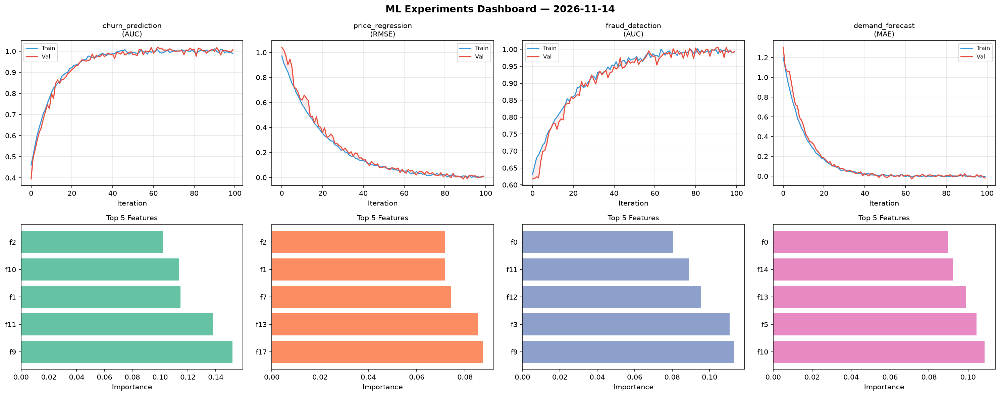
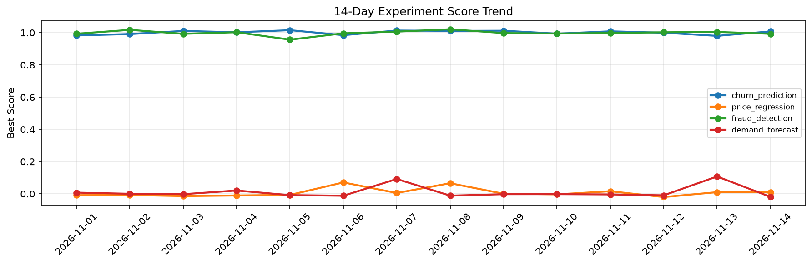

# ML Experiments Report — 2026-11-14

**Run ID:** `a3c09bedae` | **Experiments:** 4 | **Trials:** 17

## Delta vs Yesterday

| Experiment | Today | Yesterday | Change |
|-----------|-------|-----------|--------|
| churn_prediction | 1.0079 | 0.9803 | 📈 2.8% |
| price_regression | 0.0103 | 0.0102 | 📈 1.0% |
| fraud_detection | 0.9932 | 1.0046 | 📉 -1.1% |
| demand_forecast | -0.019 | 0.1073 | 📉 -117.7% |

## churn_prediction (AUC)

**Best Score:** 1.0079 (Trial 4)

| Trial | Score | Overfit Gap | Time | LR | Trees | Leaves |
|-------|-------|-------------|------|-----|-------|--------|
| 1 | 0.9883 | 0.018 | 140.76s | 0.2 | 500 | 127 |
| 2 | 0.974 | 0.0054 | 75.69s | 0.05 | 500 | 127 |
| 3 | 0.6874 | 0.0227 | 10.46s | 0.01 | 100 | 31 |
| 4 ⭐ | 1.0079 | 0.0185 | 274.12s | 0.2 | 1000 | 63 |
| 5 | 0.9897 | 0.0125 | 31.41s | 0.1 | 500 | 15 |
| 6 | 1.0072 | 0.0097 | 21.4s | 0.1 | 200 | 127 |

## price_regression (RMSE)

**Best Score:** 0.0103 (Trial 3)

| Trial | Score | Overfit Gap | Time | LR | Trees | Leaves |
|-------|-------|-------------|------|-----|-------|--------|
| 1 | 1.0411 | 0.1579 | 2.69s | 0.01 | 100 | 127 |
| 2 | 1.0756 | 0.0893 | 197.59s | 0.01 | 1000 | 63 |
| 3 ⭐ | 0.0103 | 0.0001 | 3.57s | 0.1 | 100 | 127 |

## fraud_detection (AUC)

**Best Score:** 0.9932 (Trial 2)

| Trial | Score | Overfit Gap | Time | LR | Trees | Leaves |
|-------|-------|-------------|------|-----|-------|--------|
| 1 | 0.9571 | 0.0013 | 71.43s | 0.05 | 500 | 63 |
| 2 ⭐ | 0.9932 | 0.0007 | 46.96s | 0.1 | 200 | 127 |
| 3 | 0.6283 | 0.0575 | 13.19s | 0.01 | 100 | 15 |
| 4 | 0.9921 | 0.0045 | 5.33s | 0.1 | 100 | 63 |

## demand_forecast (MAE)

**Best Score:** -0.019 (Trial 2)

| Trial | Score | Overfit Gap | Time | LR | Trees | Leaves |
|-------|-------|-------------|------|-----|-------|--------|
| 1 | 0.5892 | 0.0857 | 279.69s | 0.01 | 1000 | 15 |
| 2 ⭐ | -0.019 | 0.0157 | 36.73s | 0.2 | 200 | 15 |
| 3 | 0.0152 | 0.0221 | 19.12s | 0.2 | 200 | 127 |
| 4 | 0.0829 | 0.0187 | 60.0s | 0.05 | 500 | 127 |
