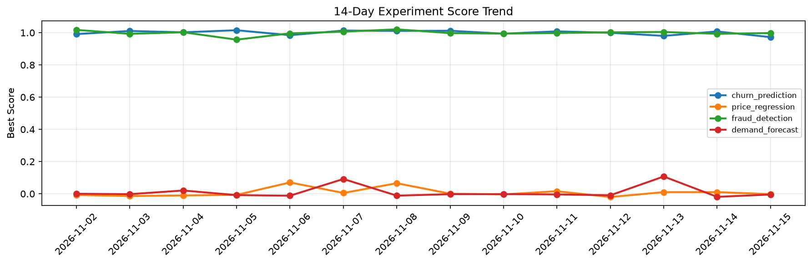

# ML Experiments Report — 2026-11-15

**Run ID:** `41342d62fc` | **Experiments:** 4 | **Trials:** 19

## Delta vs Yesterday

| Experiment | Today | Yesterday | Change |
|-----------|-------|-----------|--------|
| churn_prediction | 0.9726 | 1.0079 | 📉 -3.5% |
| price_regression | -0.0022 | 0.0103 | 📉 -121.4% |
| fraud_detection | 0.998 | 0.9932 | 📈 0.5% |
| demand_forecast | -0.0047 | -0.019 | 📈 75.3% |

## churn_prediction (AUC)

**Best Score:** 0.9726 (Trial 6)

| Trial | Score | Overfit Gap | Time | LR | Trees | Leaves |
|-------|-------|-------------|------|-----|-------|--------|
| 1 | 0.9558 | 0.003 | 10.99s | 0.05 | 100 | 127 |
| 2 | 0.953 | 0.0035 | 195.14s | 0.05 | 1000 | 127 |
| 3 | 0.9631 | 0.0133 | 144.61s | 0.05 | 500 | 127 |
| 4 | 0.6475 | 0.0226 | 58.43s | 0.01 | 200 | 63 |
| 5 | 0.5959 | 0.0555 | 23.61s | 0.01 | 100 | 15 |
| 6 ⭐ | 0.9726 | 0.0187 | 41.9s | 0.05 | 500 | 15 |

## price_regression (RMSE)

**Best Score:** -0.0022 (Trial 3)

| Trial | Score | Overfit Gap | Time | LR | Trees | Leaves |
|-------|-------|-------------|------|-----|-------|--------|
| 1 | 0.0933 | 0.0167 | 4.14s | 0.05 | 100 | 15 |
| 2 | 1.0028 | 0.0887 | 141.3s | 0.01 | 1000 | 127 |
| 3 ⭐ | -0.0022 | 0.009 | 23.56s | 0.1 | 500 | 127 |
| 4 | 0.0015 | 0.0072 | 34.68s | 0.2 | 200 | 31 |
| 5 | 0.0471 | 0.0009 | 205.07s | 0.05 | 1000 | 127 |
| 6 | 0.102 | 0.0095 | 10.93s | 0.05 | 200 | 15 |

## fraud_detection (AUC)

**Best Score:** 0.998 (Trial 4)

| Trial | Score | Overfit Gap | Time | LR | Trees | Leaves |
|-------|-------|-------------|------|-----|-------|--------|
| 1 | 0.6917 | 0.0078 | 19.67s | 0.01 | 1000 | 63 |
| 2 | 0.6179 | 0.0208 | 4.43s | 0.01 | 500 | 31 |
| 3 | 0.7951 | 0.0083 | 33.7s | 0.01 | 500 | 63 |
| 4 ⭐ | 0.998 | 0.0077 | 50.92s | 0.1 | 200 | 31 |

## demand_forecast (MAE)

**Best Score:** -0.0047 (Trial 3)

| Trial | Score | Overfit Gap | Time | LR | Trees | Leaves |
|-------|-------|-------------|------|-----|-------|--------|
| 1 | 0.1062 | 0.0044 | 19.34s | 0.05 | 1000 | 31 |
| 2 | 0.9577 | 0.084 | 11.34s | 0.01 | 500 | 15 |
| 3 ⭐ | -0.0047 | 0.0049 | 39.99s | 0.2 | 200 | 31 |
