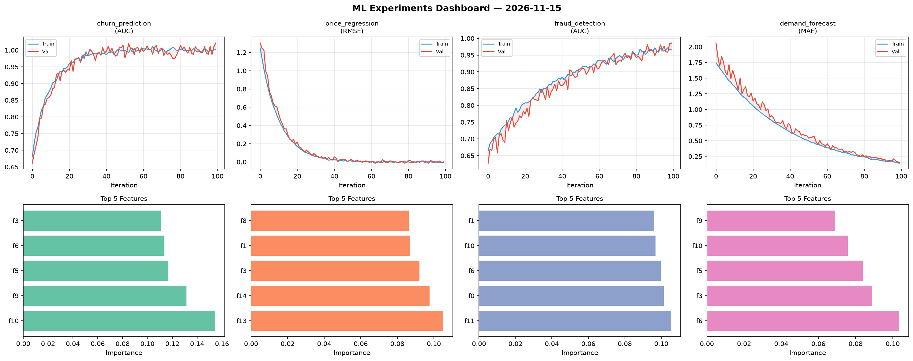

# ML Experiments Report — 2026-11-15

**Run ID:** `777ab092dd` | **Experiments:** 4 | **Trials:** 20

## Delta vs Yesterday

| Experiment | Today | Yesterday | Change |
|-----------|-------|-----------|--------|
| churn_prediction | 1.0213 | 1.0079 | 📈 1.3% |
| price_regression | -0.0101 | 0.0103 | 📉 -198.1% |
| fraud_detection | 0.9859 | 0.9932 | 📉 -0.7% |
| demand_forecast | 0.1516 | -0.019 | 📈 897.9% |

## churn_prediction (AUC)

**Best Score:** 1.0213 (Trial 4)

| Trial | Score | Overfit Gap | Time | LR | Trees | Leaves |
|-------|-------|-------------|------|-----|-------|--------|
| 1 | 0.9904 | 0.0047 | 53.81s | 0.1 | 500 | 63 |
| 2 | 0.6158 | 0.0622 | 141.18s | 0.01 | 500 | 63 |
| 3 | 0.7701 | 0.0145 | 9.99s | 0.01 | 100 | 31 |
| 4 ⭐ | 1.0213 | 0.0193 | 54.34s | 0.2 | 500 | 127 |
| 5 | 0.9877 | 0.0114 | 21.81s | 0.1 | 200 | 127 |
| 6 | 1.0035 | 0.0114 | 138.25s | 0.1 | 1000 | 127 |

## price_regression (RMSE)

**Best Score:** -0.0101 (Trial 4)

| Trial | Score | Overfit Gap | Time | LR | Trees | Leaves |
|-------|-------|-------------|------|-----|-------|--------|
| 1 | 0.0109 | 0.0126 | 38.79s | 0.1 | 200 | 31 |
| 2 | 0.0726 | 0.008 | 106.0s | 0.05 | 500 | 15 |
| 3 | -0.0028 | 0.0043 | 138.81s | 0.2 | 500 | 15 |
| 4 ⭐ | -0.0101 | 0.0105 | 30.91s | 0.2 | 1000 | 63 |
| 5 | 0.0605 | 0.0079 | 17.0s | 0.05 | 200 | 63 |
| 6 | -0.0059 | 0.0101 | 10.24s | 0.2 | 200 | 127 |

## fraud_detection (AUC)

**Best Score:** 0.9859 (Trial 1)

| Trial | Score | Overfit Gap | Time | LR | Trees | Leaves |
|-------|-------|-------------|------|-----|-------|--------|
| 1 ⭐ | 0.9859 | 0.0205 | 27.79s | 0.05 | 100 | 63 |
| 2 | 0.95 | 0.0008 | 8.29s | 0.05 | 200 | 31 |
| 3 | 0.9728 | 0.0039 | 130.72s | 0.05 | 500 | 127 |
| 4 | 0.9626 | 0.0039 | 23.61s | 0.05 | 100 | 63 |

## demand_forecast (MAE)

**Best Score:** 0.1516 (Trial 4)

| Trial | Score | Overfit Gap | Time | LR | Trees | Leaves |
|-------|-------|-------------|------|-----|-------|--------|
| 1 | 0.7567 | 0.0513 | 8.02s | 0.01 | 500 | 63 |
| 2 | 0.48 | 0.0077 | 24.8s | 0.01 | 100 | 31 |
| 3 | 1.1705 | 0.1423 | 46.37s | 0.01 | 200 | 63 |
| 4 ⭐ | 0.1516 | 0.0099 | 12.55s | 0.05 | 100 | 31 |
