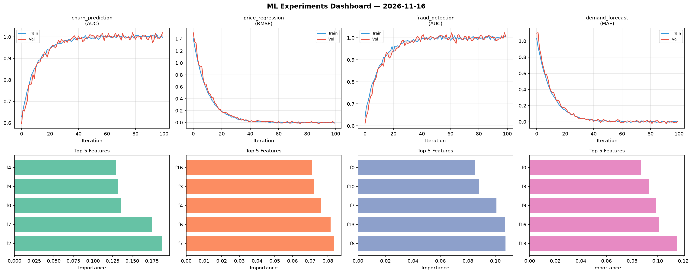
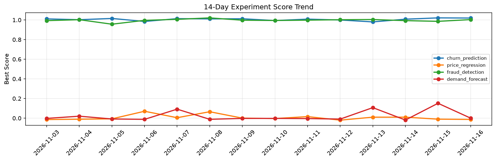

# ML Experiments Report — 2026-11-16

**Run ID:** `424ef2752d` | **Experiments:** 4 | **Trials:** 17

## Delta vs Yesterday

| Experiment | Today | Yesterday | Change |
|-----------|-------|-----------|--------|
| churn_prediction | 1.0195 | 1.0213 | 📉 -0.2% |
| price_regression | -0.0127 | -0.0101 | 📉 -25.7% |
| fraud_detection | 1.0037 | 0.9859 | 📈 1.8% |
| demand_forecast | 0.0004 | 0.1516 | 📉 -99.7% |

## churn_prediction (AUC)

**Best Score:** 1.0195 (Trial 3)

| Trial | Score | Overfit Gap | Time | LR | Trees | Leaves |
|-------|-------|-------------|------|-----|-------|--------|
| 1 | 0.7651 | 0.0352 | 4.39s | 0.01 | 200 | 15 |
| 2 | 0.966 | 0.0161 | 164.89s | 0.05 | 1000 | 127 |
| 3 ⭐ | 1.0195 | 0.0227 | 58.35s | 0.2 | 200 | 15 |
| 4 | 0.8299 | 0.0197 | 5.84s | 0.01 | 500 | 63 |

## price_regression (RMSE)

**Best Score:** -0.0127 (Trial 2)

| Trial | Score | Overfit Gap | Time | LR | Trees | Leaves |
|-------|-------|-------------|------|-----|-------|--------|
| 1 | -0.0026 | 0.0043 | 33.43s | 0.2 | 200 | 127 |
| 2 ⭐ | -0.0127 | 0.0149 | 27.33s | 0.2 | 100 | 31 |
| 3 | 0.0086 | 0.0047 | 77.81s | 0.1 | 500 | 63 |

## fraud_detection (AUC)

**Best Score:** 1.0037 (Trial 2)

| Trial | Score | Overfit Gap | Time | LR | Trees | Leaves |
|-------|-------|-------------|------|-----|-------|--------|
| 1 | 0.6842 | 0.0141 | 26.89s | 0.01 | 100 | 15 |
| 2 ⭐ | 1.0037 | 0.0033 | 7.02s | 0.2 | 200 | 63 |
| 3 | 0.9998 | 0.0057 | 28.79s | 0.2 | 100 | 15 |
| 4 | 0.7721 | 0.0339 | 21.32s | 0.01 | 100 | 15 |
| 5 | 0.7696 | 0.0163 | 8.85s | 0.01 | 100 | 127 |

## demand_forecast (MAE)

**Best Score:** 0.0004 (Trial 1)

| Trial | Score | Overfit Gap | Time | LR | Trees | Leaves |
|-------|-------|-------------|------|-----|-------|--------|
| 1 ⭐ | 0.0004 | 0.0041 | 26.59s | 0.2 | 200 | 15 |
| 2 | 0.0081 | 0.0065 | 20.49s | 0.2 | 100 | 31 |
| 3 | 0.0119 | 0.0065 | 141.23s | 0.1 | 500 | 31 |
| 4 | 0.1447 | 0.0212 | 129.49s | 0.05 | 1000 | 15 |
| 5 | 0.0014 | 0.0095 | 195.93s | 0.2 | 1000 | 31 |
