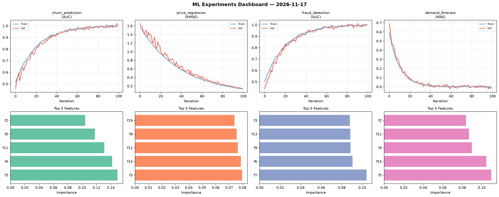
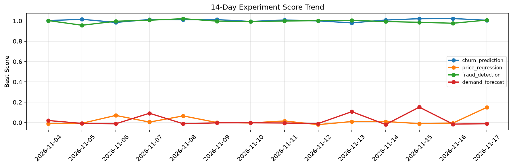

# ML Experiments Report — 2026-11-17

**Run ID:** `08897e6109` | **Experiments:** 4 | **Trials:** 15

## Delta vs Yesterday

| Experiment | Today | Yesterday | Change |
|-----------|-------|-----------|--------|
| churn_prediction | 1.0059 | 1.0228 | 📉 -1.7% |
| price_regression | 0.1493 | -0.0044 | 📈 3493.2% |
| fraud_detection | 1.0077 | 0.9765 | 📈 3.2% |
| demand_forecast | -0.0112 | -0.0151 | 📈 25.8% |

## churn_prediction (AUC)

**Best Score:** 1.0059 (Trial 3)

| Trial | Score | Overfit Gap | Time | LR | Trees | Leaves |
|-------|-------|-------------|------|-----|-------|--------|
| 1 | 0.997 | 0.002 | 49.13s | 0.1 | 200 | 127 |
| 2 | 1.0021 | 0.0049 | 23.3s | 0.1 | 100 | 127 |
| 3 ⭐ | 1.0059 | 0.0116 | 92.68s | 0.1 | 500 | 127 |

## price_regression (RMSE)

**Best Score:** 0.1493 (Trial 1)

| Trial | Score | Overfit Gap | Time | LR | Trees | Leaves |
|-------|-------|-------------|------|-----|-------|--------|
| 1 ⭐ | 0.1493 | 0.0194 | 102.49s | 0.05 | 1000 | 31 |
| 2 | 0.7946 | 0.0153 | 57.13s | 0.01 | 200 | 31 |
| 3 | 0.7304 | 0.0893 | 48.23s | 0.01 | 200 | 63 |

## fraud_detection (AUC)

**Best Score:** 1.0077 (Trial 1)

| Trial | Score | Overfit Gap | Time | LR | Trees | Leaves |
|-------|-------|-------------|------|-----|-------|--------|
| 1 ⭐ | 1.0077 | 0.0089 | 28.87s | 0.1 | 100 | 127 |
| 2 | 0.706 | 0.0579 | 54.51s | 0.01 | 200 | 127 |
| 3 | 0.7396 | 0.0732 | 42.63s | 0.01 | 200 | 127 |
| 4 | 0.7089 | 0.0062 | 42.7s | 0.01 | 500 | 127 |
| 5 | 0.663 | 0.0249 | 88.74s | 0.01 | 1000 | 127 |

## demand_forecast (MAE)

**Best Score:** -0.0112 (Trial 1)

| Trial | Score | Overfit Gap | Time | LR | Trees | Leaves |
|-------|-------|-------------|------|-----|-------|--------|
| 1 ⭐ | -0.0112 | 0.0096 | 94.73s | 0.2 | 500 | 127 |
| 2 | 0.7583 | 0.0955 | 46.84s | 0.01 | 200 | 127 |
| 3 | 0.8422 | 0.1203 | 37.61s | 0.01 | 500 | 31 |
| 4 | 0.0004 | 0.0033 | 164.51s | 0.2 | 1000 | 15 |
