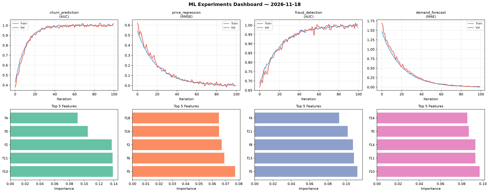

# ML Experiments Report — 2026-11-18

**Run ID:** `e2af777a63` | **Experiments:** 4 | **Trials:** 18

## Delta vs Yesterday

| Experiment | Today | Yesterday | Change |
|-----------|-------|-----------|--------|
| churn_prediction | 1.0194 | 0.9917 | 📈 2.8% |
| price_regression | -0.0059 | 0.009 | 📉 -165.6% |
| fraud_detection | 1.006 | 0.9956 | 📈 1.0% |
| demand_forecast | -0.0006 | 0.0867 | 📉 -100.7% |

## churn_prediction (AUC)

**Best Score:** 1.0194 (Trial 1)

| Trial | Score | Overfit Gap | Time | LR | Trees | Leaves |
|-------|-------|-------------|------|-----|-------|--------|
| 1 ⭐ | 1.0194 | 0.0133 | 18.25s | 0.2 | 100 | 31 |
| 2 | 0.67 | 0.0454 | 138.21s | 0.01 | 1000 | 127 |
| 3 | 0.9457 | 0.0118 | 124.28s | 0.05 | 1000 | 127 |
| 4 | 0.9473 | 0.0001 | 8.96s | 0.05 | 100 | 31 |

## price_regression (RMSE)

**Best Score:** -0.0059 (Trial 2)

| Trial | Score | Overfit Gap | Time | LR | Trees | Leaves |
|-------|-------|-------------|------|-----|-------|--------|
| 1 | 0.1067 | 0.021 | 18.14s | 0.05 | 200 | 127 |
| 2 ⭐ | -0.0059 | 0.0033 | 19.11s | 0.1 | 100 | 63 |
| 3 | 0.0878 | 0.0039 | 15.87s | 0.05 | 200 | 63 |

## fraud_detection (AUC)

**Best Score:** 1.006 (Trial 1)

| Trial | Score | Overfit Gap | Time | LR | Trees | Leaves |
|-------|-------|-------------|------|-----|-------|--------|
| 1 ⭐ | 1.006 | 0.0191 | 28.64s | 0.1 | 100 | 31 |
| 2 | 0.9999 | 0.0044 | 11.94s | 0.2 | 200 | 127 |
| 3 | 0.9856 | 0.0104 | 25.69s | 0.1 | 200 | 31 |
| 4 | 0.7883 | 0.0098 | 24.42s | 0.01 | 1000 | 15 |
| 5 | 1.0027 | 0.0045 | 147.29s | 0.1 | 1000 | 15 |
| 6 | 0.5689 | 0.0759 | 77.69s | 0.01 | 500 | 127 |

## demand_forecast (MAE)

**Best Score:** -0.0006 (Trial 3)

| Trial | Score | Overfit Gap | Time | LR | Trees | Leaves |
|-------|-------|-------------|------|-----|-------|--------|
| 1 | 0.1004 | 0.0124 | 1.73s | 0.05 | 100 | 31 |
| 2 | 0.0176 | 0.0088 | 2.7s | 0.1 | 200 | 63 |
| 3 ⭐ | -0.0006 | 0.0101 | 217.35s | 0.1 | 1000 | 127 |
| 4 | 0.0195 | 0.0086 | 59.31s | 0.1 | 500 | 31 |
| 5 | 0.1221 | 0.0114 | 25.35s | 0.05 | 500 | 127 |
