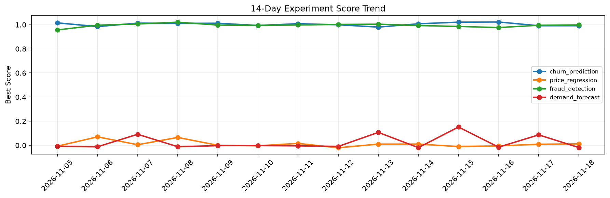

# ML Experiments Report — 2026-11-18

**Run ID:** `25ce2d2ecc` | **Experiments:** 4 | **Trials:** 16

## Delta vs Yesterday

| Experiment | Today | Yesterday | Change |
|-----------|-------|-----------|--------|
| churn_prediction | 0.9916 | 0.9917 | 📉 -0.0% |
| price_regression | 0.0122 | 0.009 | 📈 35.6% |
| fraud_detection | 0.9984 | 0.9956 | 📈 0.3% |
| demand_forecast | -0.0181 | 0.0867 | 📉 -120.9% |

## churn_prediction (AUC)

**Best Score:** 0.9916 (Trial 3)

| Trial | Score | Overfit Gap | Time | LR | Trees | Leaves |
|-------|-------|-------------|------|-----|-------|--------|
| 1 | 0.9547 | 0.0116 | 117.67s | 0.05 | 500 | 127 |
| 2 | 0.9469 | 0.0051 | 26.11s | 0.05 | 100 | 63 |
| 3 ⭐ | 0.9916 | 0.0096 | 17.22s | 0.2 | 500 | 15 |
| 4 | 0.6035 | 0.0558 | 7.32s | 0.01 | 1000 | 31 |
| 5 | 0.6617 | 0.0461 | 257.42s | 0.01 | 1000 | 31 |
| 6 | 0.6546 | 0.0524 | 100.24s | 0.01 | 500 | 31 |

## price_regression (RMSE)

**Best Score:** 0.0122 (Trial 3)

| Trial | Score | Overfit Gap | Time | LR | Trees | Leaves |
|-------|-------|-------------|------|-----|-------|--------|
| 1 | 1.155 | 0.0137 | 234.18s | 0.01 | 1000 | 63 |
| 2 | 0.1079 | 0.0021 | 44.73s | 0.05 | 200 | 63 |
| 3 ⭐ | 0.0122 | 0.0006 | 7.9s | 0.1 | 100 | 15 |
| 4 | 0.0845 | 0.0036 | 15.64s | 0.05 | 100 | 15 |

## fraud_detection (AUC)

**Best Score:** 0.9984 (Trial 3)

| Trial | Score | Overfit Gap | Time | LR | Trees | Leaves |
|-------|-------|-------------|------|-----|-------|--------|
| 1 | 0.6322 | 0.0472 | 42.11s | 0.01 | 500 | 31 |
| 2 | 0.9916 | 0.0081 | 17.11s | 0.2 | 200 | 31 |
| 3 ⭐ | 0.9984 | 0.0038 | 93.33s | 0.1 | 500 | 127 |

## demand_forecast (MAE)

**Best Score:** -0.0181 (Trial 1)

| Trial | Score | Overfit Gap | Time | LR | Trees | Leaves |
|-------|-------|-------------|------|-----|-------|--------|
| 1 ⭐ | -0.0181 | 0.0142 | 266.09s | 0.2 | 1000 | 15 |
| 2 | 0.0612 | 0.0067 | 21.0s | 0.05 | 100 | 31 |
| 3 | -0.013 | 0.0148 | 21.05s | 0.2 | 200 | 15 |
