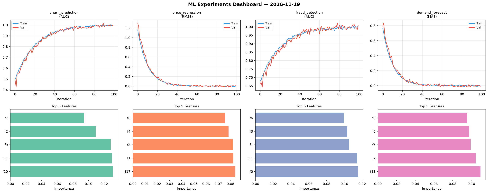
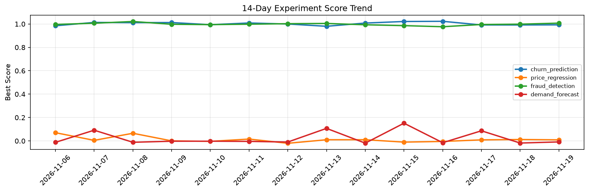

# ML Experiments Report — 2026-11-19

**Run ID:** `eacf5c1c13` | **Experiments:** 4 | **Trials:** 16

## Delta vs Yesterday

| Experiment | Today | Yesterday | Change |
|-----------|-------|-----------|--------|
| churn_prediction | 0.9926 | 0.9916 | 📈 0.1% |
| price_regression | 0.0092 | 0.0122 | 📉 -24.6% |
| fraud_detection | 1.0072 | 0.9984 | 📈 0.9% |
| demand_forecast | -0.0085 | -0.0181 | 📈 53.0% |

## churn_prediction (AUC)

**Best Score:** 0.9926 (Trial 1)

| Trial | Score | Overfit Gap | Time | LR | Trees | Leaves |
|-------|-------|-------------|------|-----|-------|--------|
| 1 ⭐ | 0.9926 | 0.0063 | 255.18s | 0.1 | 1000 | 31 |
| 2 | 0.6535 | 0.0546 | 59.22s | 0.01 | 200 | 63 |
| 3 | 0.6456 | 0.0175 | 4.96s | 0.01 | 500 | 127 |

## price_regression (RMSE)

**Best Score:** 0.0092 (Trial 2)

| Trial | Score | Overfit Gap | Time | LR | Trees | Leaves |
|-------|-------|-------------|------|-----|-------|--------|
| 1 | 0.0338 | 0.0015 | 102.08s | 0.05 | 500 | 31 |
| 2 ⭐ | 0.0092 | 0.0087 | 52.12s | 0.2 | 200 | 31 |
| 3 | 0.0216 | 0.0194 | 48.18s | 0.2 | 200 | 127 |
| 4 | 0.48 | 0.056 | 15.85s | 0.01 | 500 | 127 |

## fraud_detection (AUC)

**Best Score:** 1.0072 (Trial 1)

| Trial | Score | Overfit Gap | Time | LR | Trees | Leaves |
|-------|-------|-------------|------|-----|-------|--------|
| 1 ⭐ | 1.0072 | 0.0098 | 23.96s | 0.1 | 200 | 31 |
| 2 | 0.6592 | 0.0457 | 19.44s | 0.01 | 200 | 15 |
| 3 | 0.6996 | 0.0139 | 229.81s | 0.01 | 1000 | 63 |
| 4 | 0.967 | 0.0001 | 29.19s | 0.05 | 200 | 63 |
| 5 | 0.9929 | 0.0027 | 11.76s | 0.2 | 100 | 127 |

## demand_forecast (MAE)

**Best Score:** -0.0085 (Trial 2)

| Trial | Score | Overfit Gap | Time | LR | Trees | Leaves |
|-------|-------|-------------|------|-----|-------|--------|
| 1 | 0.0175 | 0.0097 | 28.54s | 0.1 | 500 | 63 |
| 2 ⭐ | -0.0085 | 0.0011 | 31.57s | 0.2 | 200 | 127 |
| 3 | 0.9434 | 0.0607 | 38.85s | 0.01 | 200 | 63 |
| 4 | 0.4836 | 0.0583 | 130.16s | 0.01 | 1000 | 31 |
