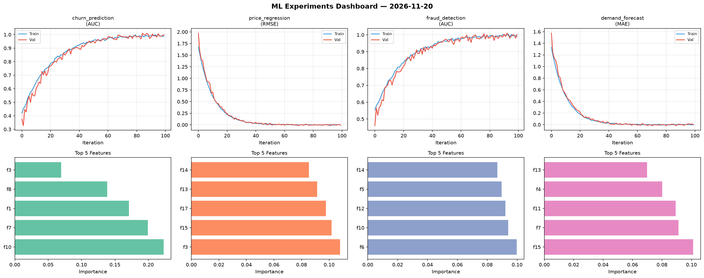

# ML Experiments Report — 2026-11-20

**Run ID:** `3693ff8d20` | **Experiments:** 4 | **Trials:** 18

## Delta vs Yesterday

| Experiment | Today | Yesterday | Change |
|-----------|-------|-----------|--------|
| churn_prediction | 0.9976 | 0.9926 | 📈 0.5% |
| price_regression | -0.0078 | 0.0092 | 📉 -184.8% |
| fraud_detection | 1.0027 | 1.0072 | 📉 -0.4% |
| demand_forecast | -0.005 | -0.0085 | 📈 41.2% |

## churn_prediction (AUC)

**Best Score:** 0.9976 (Trial 2)

| Trial | Score | Overfit Gap | Time | LR | Trees | Leaves |
|-------|-------|-------------|------|-----|-------|--------|
| 1 | 0.6592 | 0.061 | 4.81s | 0.01 | 100 | 127 |
| 2 ⭐ | 0.9976 | 0.0078 | 32.54s | 0.1 | 200 | 31 |
| 3 | 0.7279 | 0.037 | 20.48s | 0.01 | 100 | 127 |

## price_regression (RMSE)

**Best Score:** -0.0078 (Trial 1)

| Trial | Score | Overfit Gap | Time | LR | Trees | Leaves |
|-------|-------|-------------|------|-----|-------|--------|
| 1 ⭐ | -0.0078 | 0.0048 | 22.77s | 0.2 | 100 | 63 |
| 2 | -0.0002 | 0.0044 | 129.13s | 0.2 | 1000 | 127 |
| 3 | 0.1371 | 0.0056 | 11.6s | 0.05 | 200 | 15 |
| 4 | -0.0051 | 0.0158 | 16.71s | 0.1 | 500 | 31 |
| 5 | 0.0702 | 0.0161 | 22.29s | 0.05 | 100 | 63 |

## fraud_detection (AUC)

**Best Score:** 1.0027 (Trial 4)

| Trial | Score | Overfit Gap | Time | LR | Trees | Leaves |
|-------|-------|-------------|------|-----|-------|--------|
| 1 | 0.7351 | 0.0323 | 168.8s | 0.01 | 1000 | 63 |
| 2 | 0.6458 | 0.0121 | 17.09s | 0.01 | 100 | 63 |
| 3 | 0.9656 | 0.0034 | 34.36s | 0.05 | 1000 | 31 |
| 4 ⭐ | 1.0027 | 0.0117 | 72.13s | 0.1 | 500 | 31 |

## demand_forecast (MAE)

**Best Score:** -0.005 (Trial 3)

| Trial | Score | Overfit Gap | Time | LR | Trees | Leaves |
|-------|-------|-------------|------|-----|-------|--------|
| 1 | 0.0059 | 0.0092 | 46.08s | 0.2 | 200 | 15 |
| 2 | 0.0013 | 0.0032 | 267.01s | 0.1 | 1000 | 31 |
| 3 ⭐ | -0.005 | 0.0081 | 26.56s | 0.2 | 200 | 127 |
| 4 | 0.0069 | 0.0067 | 141.48s | 0.2 | 500 | 15 |
| 5 | 0.0009 | 0.017 | 127.31s | 0.1 | 500 | 127 |
| 6 | 0.0156 | 0.0018 | 40.21s | 0.1 | 200 | 63 |
