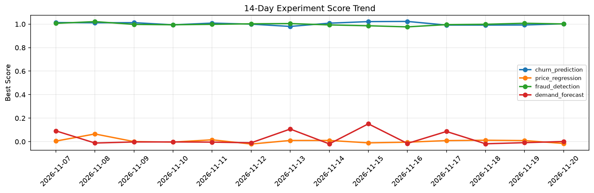

# ML Experiments Report — 2026-11-20

**Run ID:** `36273e7a34` | **Experiments:** 4 | **Trials:** 20

## Delta vs Yesterday

| Experiment | Today | Yesterday | Change |
|-----------|-------|-----------|--------|
| churn_prediction | 1.0027 | 0.9926 | 📈 1.0% |
| price_regression | -0.0154 | 0.0092 | 📉 -267.4% |
| fraud_detection | 1.0014 | 1.0072 | 📉 -0.6% |
| demand_forecast | 0.0014 | -0.0085 | 📈 116.5% |

## churn_prediction (AUC)

**Best Score:** 1.0027 (Trial 1)

| Trial | Score | Overfit Gap | Time | LR | Trees | Leaves |
|-------|-------|-------------|------|-----|-------|--------|
| 1 ⭐ | 1.0027 | 0.0008 | 192.64s | 0.2 | 1000 | 31 |
| 2 | 0.9614 | 0.0094 | 28.1s | 0.05 | 100 | 15 |
| 3 | 0.96 | 0.0066 | 84.67s | 0.05 | 500 | 127 |
| 4 | 0.946 | 0.0123 | 65.81s | 0.05 | 500 | 15 |
| 5 | 0.7029 | 0.0255 | 13.27s | 0.01 | 500 | 127 |

## price_regression (RMSE)

**Best Score:** -0.0154 (Trial 4)

| Trial | Score | Overfit Gap | Time | LR | Trees | Leaves |
|-------|-------|-------------|------|-----|-------|--------|
| 1 | 0.0151 | 0.0227 | 186.34s | 0.2 | 1000 | 31 |
| 2 | 0.5335 | 0.0801 | 84.12s | 0.01 | 500 | 31 |
| 3 | -0.0024 | 0.006 | 88.8s | 0.1 | 500 | 127 |
| 4 ⭐ | -0.0154 | 0.0125 | 29.45s | 0.2 | 100 | 127 |
| 5 | 0.0017 | 0.0127 | 260.07s | 0.1 | 1000 | 63 |
| 6 | 0.5886 | 0.0467 | 117.89s | 0.01 | 500 | 127 |

## fraud_detection (AUC)

**Best Score:** 1.0014 (Trial 2)

| Trial | Score | Overfit Gap | Time | LR | Trees | Leaves |
|-------|-------|-------------|------|-----|-------|--------|
| 1 | 0.9556 | 0.0095 | 255.67s | 0.05 | 1000 | 63 |
| 2 ⭐ | 1.0014 | 0.0024 | 14.38s | 0.1 | 500 | 127 |
| 3 | 0.9879 | 0.0091 | 53.58s | 0.1 | 200 | 31 |
| 4 | 0.9489 | 0.0053 | 236.86s | 0.05 | 1000 | 127 |
| 5 | 0.9994 | 0.005 | 90.28s | 0.2 | 500 | 31 |
| 6 | 0.9909 | 0.0096 | 7.07s | 0.1 | 100 | 63 |

## demand_forecast (MAE)

**Best Score:** 0.0014 (Trial 3)

| Trial | Score | Overfit Gap | Time | LR | Trees | Leaves |
|-------|-------|-------------|------|-----|-------|--------|
| 1 | 0.0173 | 0.0037 | 18.68s | 0.1 | 100 | 63 |
| 2 | 0.0108 | 0.0042 | 142.54s | 0.1 | 500 | 15 |
| 3 ⭐ | 0.0014 | 0.0109 | 108.92s | 0.1 | 1000 | 15 |
