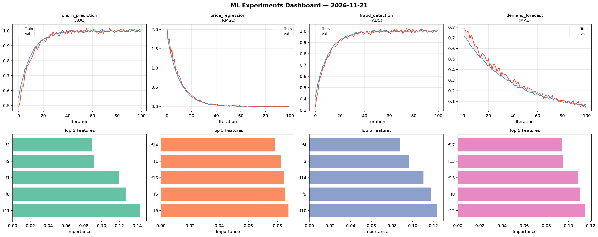

# ML Experiments Report — 2026-11-21

**Run ID:** `7b82035f72` | **Experiments:** 4 | **Trials:** 19

## Delta vs Yesterday

| Experiment | Today | Yesterday | Change |
|-----------|-------|-----------|--------|
| churn_prediction | 1.011 | 1.0027 | 📈 0.8% |
| price_regression | -0.0186 | -0.0154 | 📉 -20.8% |
| fraud_detection | 1.0068 | 1.0014 | 📈 0.5% |
| demand_forecast | 0.0455 | 0.0014 | 📈 3150.0% |

## churn_prediction (AUC)

**Best Score:** 1.011 (Trial 5)

| Trial | Score | Overfit Gap | Time | LR | Trees | Leaves |
|-------|-------|-------------|------|-----|-------|--------|
| 1 | 0.9967 | 0.0098 | 43.53s | 0.1 | 500 | 127 |
| 2 | 0.9461 | 0.0117 | 31.33s | 0.05 | 200 | 31 |
| 3 | 0.6563 | 0.0245 | 30.95s | 0.01 | 200 | 63 |
| 4 | 0.9996 | 0.001 | 198.18s | 0.2 | 1000 | 31 |
| 5 ⭐ | 1.011 | 0.0177 | 63.77s | 0.2 | 1000 | 63 |
| 6 | 0.9748 | 0.0176 | 100.02s | 0.1 | 500 | 31 |

## price_regression (RMSE)

**Best Score:** -0.0186 (Trial 4)

| Trial | Score | Overfit Gap | Time | LR | Trees | Leaves |
|-------|-------|-------------|------|-----|-------|--------|
| 1 | 0.1347 | 0.0135 | 6.97s | 0.05 | 500 | 31 |
| 2 | 0.0348 | 0.0275 | 47.71s | 0.1 | 200 | 31 |
| 3 | 0.0186 | 0.0109 | 138.86s | 0.1 | 1000 | 31 |
| 4 ⭐ | -0.0186 | 0.0182 | 21.1s | 0.2 | 1000 | 31 |

## fraud_detection (AUC)

**Best Score:** 1.0068 (Trial 5)

| Trial | Score | Overfit Gap | Time | LR | Trees | Leaves |
|-------|-------|-------------|------|-----|-------|--------|
| 1 | 0.9497 | 0.002 | 1.94s | 0.05 | 100 | 127 |
| 2 | 0.9926 | 0.0097 | 147.38s | 0.2 | 500 | 63 |
| 3 | 0.9455 | 0.0071 | 48.65s | 0.05 | 200 | 63 |
| 4 | 0.9832 | 0.0126 | 127.35s | 0.1 | 1000 | 127 |
| 5 ⭐ | 1.0068 | 0.0009 | 27.77s | 0.2 | 200 | 63 |

## demand_forecast (MAE)

**Best Score:** 0.0455 (Trial 4)

| Trial | Score | Overfit Gap | Time | LR | Trees | Leaves |
|-------|-------|-------------|------|-----|-------|--------|
| 1 | 0.7495 | 0.0252 | 22.8s | 0.01 | 200 | 63 |
| 2 | 0.1788 | 0.0155 | 39.41s | 0.05 | 200 | 63 |
| 3 | 0.0497 | 0.0073 | 47.51s | 0.05 | 200 | 15 |
| 4 ⭐ | 0.0455 | 0.0226 | 55.5s | 0.05 | 200 | 15 |
