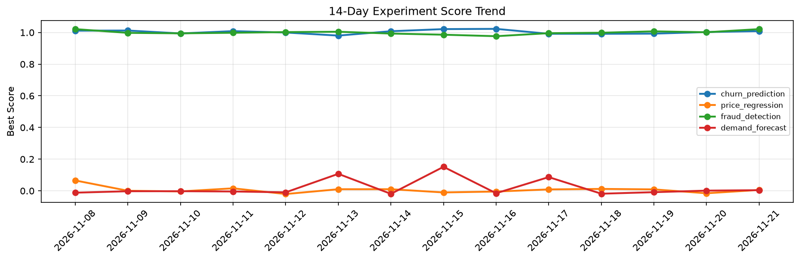

# ML Experiments Report — 2026-11-21

**Run ID:** `c640c7c486` | **Experiments:** 4 | **Trials:** 21

## Delta vs Yesterday

| Experiment | Today | Yesterday | Change |
|-----------|-------|-----------|--------|
| churn_prediction | 1.0085 | 1.0027 | 📈 0.6% |
| price_regression | 0.0056 | -0.0154 | 📈 136.4% |
| fraud_detection | 1.0212 | 1.0014 | 📈 2.0% |
| demand_forecast | 0.0041 | 0.0014 | 📈 192.9% |

## churn_prediction (AUC)

**Best Score:** 1.0085 (Trial 3)

| Trial | Score | Overfit Gap | Time | LR | Trees | Leaves |
|-------|-------|-------------|------|-----|-------|--------|
| 1 | 0.6578 | 0.0499 | 129.06s | 0.01 | 1000 | 31 |
| 2 | 0.9948 | 0.0023 | 97.83s | 0.1 | 500 | 63 |
| 3 ⭐ | 1.0085 | 0.0015 | 49.66s | 0.2 | 1000 | 63 |

## price_regression (RMSE)

**Best Score:** 0.0056 (Trial 6)

| Trial | Score | Overfit Gap | Time | LR | Trees | Leaves |
|-------|-------|-------------|------|-----|-------|--------|
| 1 | 0.1007 | 0.0257 | 27.79s | 0.05 | 100 | 31 |
| 2 | 0.0259 | 0.0259 | 125.63s | 0.1 | 1000 | 31 |
| 3 | 0.0083 | 0.0013 | 57.37s | 0.1 | 200 | 63 |
| 4 | 0.998 | 0.1463 | 147.43s | 0.01 | 500 | 127 |
| 5 | 0.0133 | 0.0096 | 279.98s | 0.1 | 1000 | 127 |
| 6 ⭐ | 0.0056 | 0.0071 | 21.09s | 0.1 | 100 | 63 |

## fraud_detection (AUC)

**Best Score:** 1.0212 (Trial 1)

| Trial | Score | Overfit Gap | Time | LR | Trees | Leaves |
|-------|-------|-------------|------|-----|-------|--------|
| 1 ⭐ | 1.0212 | 0.0281 | 136.08s | 0.2 | 1000 | 127 |
| 2 | 0.9749 | 0.0053 | 32.84s | 0.05 | 200 | 15 |
| 3 | 1.0024 | 0.0077 | 60.77s | 0.2 | 500 | 63 |
| 4 | 0.9584 | 0.012 | 188.95s | 0.05 | 1000 | 15 |
| 5 | 1.0061 | 0.0088 | 65.28s | 0.2 | 500 | 15 |
| 6 | 0.9935 | 0.0084 | 10.28s | 0.2 | 100 | 15 |

## demand_forecast (MAE)

**Best Score:** 0.0041 (Trial 5)

| Trial | Score | Overfit Gap | Time | LR | Trees | Leaves |
|-------|-------|-------------|------|-----|-------|--------|
| 1 | 0.049 | 0.0095 | 15.66s | 0.05 | 100 | 31 |
| 2 | 0.1573 | 0.0118 | 10.72s | 0.05 | 100 | 15 |
| 3 | 0.7533 | 0.0291 | 50.83s | 0.01 | 200 | 127 |
| 4 | 0.164 | 0.0052 | 24.03s | 0.05 | 100 | 15 |
| 5 ⭐ | 0.0041 | 0.0044 | 12.67s | 0.2 | 100 | 63 |
| 6 | 0.0234 | 0.023 | 49.04s | 0.2 | 200 | 15 |
