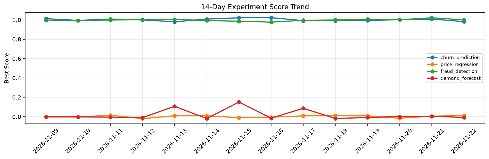

# ML Experiments Report — 2026-11-22

**Run ID:** `0960e1a2c2` | **Experiments:** 4 | **Trials:** 17

## Delta vs Yesterday

| Experiment | Today | Yesterday | Change |
|-----------|-------|-----------|--------|
| churn_prediction | 0.982 | 1.0085 | 📉 -2.6% |
| price_regression | 0.0116 | 0.0056 | 📈 107.1% |
| fraud_detection | 1.0001 | 1.0212 | 📉 -2.1% |
| demand_forecast | -0.0069 | 0.0041 | 📉 -268.3% |

## churn_prediction (AUC)

**Best Score:** 0.982 (Trial 1)

| Trial | Score | Overfit Gap | Time | LR | Trees | Leaves |
|-------|-------|-------------|------|-----|-------|--------|
| 1 ⭐ | 0.982 | 0.0104 | 53.64s | 0.1 | 1000 | 127 |
| 2 | 0.9446 | 0.0228 | 15.55s | 0.05 | 200 | 127 |
| 3 | 0.5989 | 0.0429 | 5.97s | 0.01 | 200 | 15 |
| 4 | 0.9567 | 0.0102 | 10.71s | 0.05 | 100 | 15 |
| 5 | 0.6969 | 0.051 | 276.07s | 0.01 | 1000 | 127 |

## price_regression (RMSE)

**Best Score:** 0.0116 (Trial 1)

| Trial | Score | Overfit Gap | Time | LR | Trees | Leaves |
|-------|-------|-------------|------|-----|-------|--------|
| 1 ⭐ | 0.0116 | 0.001 | 3.5s | 0.1 | 100 | 31 |
| 2 | 0.8207 | 0.0721 | 126.78s | 0.01 | 500 | 31 |
| 3 | 0.1422 | 0.0147 | 145.91s | 0.05 | 500 | 15 |
| 4 | 0.8342 | 0.1176 | 36.54s | 0.01 | 500 | 15 |
| 5 | 0.1493 | 0.0204 | 13.34s | 0.05 | 200 | 31 |
| 6 | 0.0168 | 0.0069 | 4.71s | 0.1 | 100 | 127 |

## fraud_detection (AUC)

**Best Score:** 1.0001 (Trial 2)

| Trial | Score | Overfit Gap | Time | LR | Trees | Leaves |
|-------|-------|-------------|------|-----|-------|--------|
| 1 | 0.9814 | 0.0215 | 36.34s | 0.2 | 200 | 15 |
| 2 ⭐ | 1.0001 | 0.001 | 20.5s | 0.2 | 500 | 15 |
| 3 | 0.9504 | 0.0068 | 56.25s | 0.05 | 500 | 15 |

## demand_forecast (MAE)

**Best Score:** -0.0069 (Trial 2)

| Trial | Score | Overfit Gap | Time | LR | Trees | Leaves |
|-------|-------|-------------|------|-----|-------|--------|
| 1 | 1.025 | 0.0835 | 34.28s | 0.01 | 200 | 15 |
| 2 ⭐ | -0.0069 | 0.0005 | 97.38s | 0.2 | 500 | 63 |
| 3 | 0.0172 | 0.015 | 137.79s | 0.1 | 500 | 127 |
