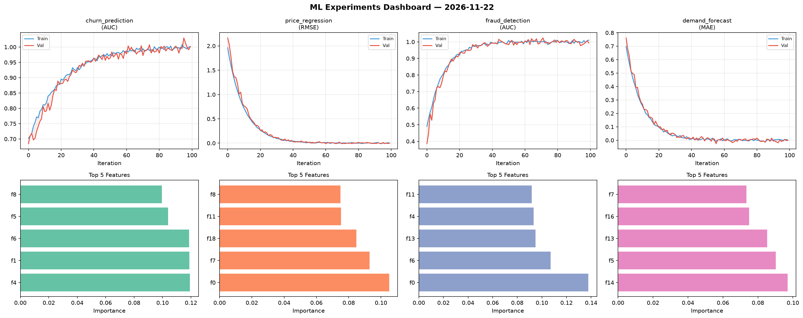

# ML Experiments Report — 2026-11-22

**Run ID:** `5050e07659` | **Experiments:** 4 | **Trials:** 14

## Delta vs Yesterday

| Experiment | Today | Yesterday | Change |
|-----------|-------|-----------|--------|
| churn_prediction | 1.002 | 1.0085 | 📉 -0.6% |
| price_regression | -0.0004 | 0.0056 | 📉 -107.1% |
| fraud_detection | 0.9932 | 1.0212 | 📉 -2.7% |
| demand_forecast | -0.0003 | 0.0041 | 📉 -107.3% |

## churn_prediction (AUC)

**Best Score:** 1.002 (Trial 1)

| Trial | Score | Overfit Gap | Time | LR | Trees | Leaves |
|-------|-------|-------------|------|-----|-------|--------|
| 1 ⭐ | 1.002 | 0.0004 | 21.31s | 0.1 | 100 | 15 |
| 2 | 0.9565 | 0.0054 | 282.26s | 0.05 | 1000 | 15 |
| 3 | 0.9692 | 0.0133 | 28.29s | 0.05 | 200 | 127 |

## price_regression (RMSE)

**Best Score:** -0.0004 (Trial 1)

| Trial | Score | Overfit Gap | Time | LR | Trees | Leaves |
|-------|-------|-------------|------|-----|-------|--------|
| 1 ⭐ | -0.0004 | 0.0002 | 130.17s | 0.2 | 500 | 63 |
| 2 | 0.0113 | 0.0063 | 13.06s | 0.1 | 500 | 127 |
| 3 | 0.0123 | 0.0131 | 50.3s | 0.2 | 200 | 127 |

## fraud_detection (AUC)

**Best Score:** 0.9932 (Trial 3)

| Trial | Score | Overfit Gap | Time | LR | Trees | Leaves |
|-------|-------|-------------|------|-----|-------|--------|
| 1 | 0.9797 | 0.0158 | 82.44s | 0.05 | 1000 | 15 |
| 2 | 0.7282 | 0.0042 | 143.35s | 0.01 | 500 | 63 |
| 3 ⭐ | 0.9932 | 0.0176 | 51.36s | 0.2 | 200 | 15 |

## demand_forecast (MAE)

**Best Score:** -0.0003 (Trial 2)

| Trial | Score | Overfit Gap | Time | LR | Trees | Leaves |
|-------|-------|-------------|------|-----|-------|--------|
| 1 | 0.0763 | 0.0106 | 20.89s | 0.05 | 1000 | 15 |
| 2 ⭐ | -0.0003 | 0.0002 | 103.09s | 0.2 | 1000 | 31 |
| 3 | 0.121 | 0.0002 | 70.91s | 0.05 | 500 | 31 |
| 4 | 0.1476 | 0.0078 | 5.52s | 0.05 | 200 | 31 |
| 5 | 0.0195 | 0.011 | 22.82s | 0.1 | 100 | 15 |
